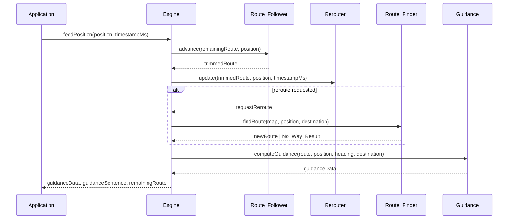

# Design Document

## Overview

This design covers Block A of `docs/brief.md`: the engine core, built in `kit/engine/`. The engine core is a pure TypeScript package with no runtime dependency. It loads and saves map files, finds routes, follows a moving player along a route, decides when to reroute, and produces guidance (distance, next turn, plain sentences). It knows nothing about cars, missions, buildings or any other application concept, and it runs in Node without a browser.

The engine is organized as a pipeline of small, single-purpose components, each in its own file, composed by one top-level `Engine` class that implements the `Engine_API` (Requirement 18):

```
Map_File text --[Map_Loader]--> Map (+ Notices) --[Route_Finder]--> Route | No_Way_Result
                                                        |
Position + timestamp --[Route_Follower]--> remaining Route --[Rerouter]--> reroute request
                                                        |
                                              [Guidance] --> Guidance data --[Guidance_Text]--> sentence
```

The `Engine` class owns the current `Map`, the active `Destination`, the remaining `Route`, and the `Rerouter`'s timing state. Every other component is a pure function or a small stateless/explicitly-stateful class that the `Engine` calls; none of them touch the system clock, `window`, `document` or any browser global.

## Architecture

### Package layout

```
kit/engine/
  package.json          # no "dependencies"; devDependencies: typescript, vitest, fast-check
  tsconfig.json          # strict: true
  src/
    index.ts             # public Engine_API surface (re-exports only, Req 18.10)
    engine.ts            # Engine class: owns state, wires components together
    types.ts             # shared types: Map, Node, Road, Place, Blocked_Area, Prop,
                          # Background_Picture, Style, Position, Route, Route_Part,
                          # Guidance, No_Way_Result, Notice, Engine_Error
    map-loader.ts         # parseMap(text): LoadResult (Map + Notices) | { errors }
    map-loader-checks.ts  # the individual field/shape checks used by map-loader.ts
    map-saver.ts          # saveMap(map): string
    blocked-roads.ts      # classifyBlockedRoads(map): { blockedRoadIds, notices }
    geometry.ts           # point/segment distance, polygon crossing, heading, angle-diff
    snapping.ts           # snapToRoad(map, point): Snapped_Point | NoUsableRoadResult
    route-finder.ts       # findRoute(map, start, destination): Route | No_Way_Result
    route-follower.ts     # advance(route, position): remaining Route
    rerouter.ts            # Rerouter class: margin/delay state machine (pure, timestamp-driven)
    guidance.ts            # computeGuidance(remainingRoute, position, heading, destination): Guidance
    guidance-text.ts       # toSentence(guidance, noWayResult?): string
    mirror.ts              # mirrorMap(map): Map  (test-only helper, still shipped from src
                          # so both engine tests and the maker/apps can reuse it; Req 17.1)
    errors.ts              # EngineError type + factory helpers for plain-worded messages
    format.ts              # MAP_FILE_FORMAT_VERSION constant and shared format docs anchors
  docs/
    map-file-format.md    # Requirement 1.5: full field-by-field format reference
    api.md                 # Requirement 18.7: one entry per exported function/type, with
                          # description, inputs, outputs, one usage example each
  tests/
    map-loader.test.ts
    map-loader-errors.test.ts      # example-based: one hand-written bad file per error case
    map-saver-roundtrip.test.ts
    blocked-roads.test.ts
    snapping.test.ts
    route-finder-chain.test.ts
    route-finder-optimality.test.ts
    route-finder-unreachable.test.ts
    route-finder-rules.test.ts
    route-follower.test.ts
    rerouter.test.ts
    reroute-result.test.ts
    guidance-turn.test.ts
    guidance-arrival.test.ts
    guidance-text.test.ts
    mirror.test.ts
    engine-api.test.ts
    helpers/
      arbitraries.ts        # fast-check generators: Map, Node, Road, Place, Blocked_Area,
                          # Prop, Position, small-map (<=12 nodes) variants
      exhaustive-search.ts # independent brute-force shortest-path search (Req 9.3: no
                          # shared code with route-finder.ts)
  bench/
    generate-large-map.ts  # seeded Large_Generated_Map generator (Req 20.1)
    route-bench.ts          # benchmark command (Req 20.2-20.4), run outside Default_Suite
```

One file per component keeps each task-sized unit small: the loader's per-field checks live in `map-loader-checks.ts` separate from the orchestration in `map-loader.ts`; geometry primitives are isolated in `geometry.ts` so `snapping.ts`, `blocked-roads.ts` and `route-finder.ts` depend on them without duplicating math.

### Data flow for one frame



### Design decisions and rationale

- **One `Engine` class as the only stateful component.** All geometry, loading, saving and classification functions are pure (map/value in, value out). `Rerouter` is the one component with its own small internal clock-state (elapsed-beyond-margin time), but it takes every timestamp as an argument (Req 13.8) rather than reading the system clock, so it stays a deterministic, directly testable unit even though it is "stateful" across calls.
- **Blocked-road classification happens in the loader, not the route finder.** Requirement 5 says the loader classifies and reports `Blocked_Road`s as part of building the `Map`; the `Route_Finder` then just filters `map.usableRoadIds` (computed once at load time) rather than re-running geometry on every route request. This also lets `Engine_API` expose the blocked-road list and notices directly from the loaded `Map` (Req 5.4) without recomputation.
- **Snapping is a separate module from route finding.** Both the `Route_Finder` (start/destination snapping) and the maker/applications (click-to-destination) need snapping; isolating it in `snapping.ts` keeps the module reusable and independently testable against the snapping property (Req 7.4/7.5).
- **The exhaustive search used for the optimality and unreachable properties lives under `tests/helpers/`, not `src/`.** Requirement 9.3 requires it to share no code with the route finder; keeping it test-only in a separate directory makes that separation structural, not just a convention.
- **`mirror.ts` ships from `src/`, not `tests/helpers/`.** The brief frames mirroring as a map operation ("mirroring a map swaps every left turn for a right turn"), useful beyond tests (e.g. a maker "flip map" feature later). Shipping it from `src/` costs nothing extra and keeps the mirror property test a thin consumer of real production code, matching the model-based-testing idea of testing through the real API.
- **Error reporting is centralized in `errors.ts`.** Every rejection across the loader, the API guard checks (Req 18.8/18.9) and the route finder's `No_Way_Result` reasons is built through the same small set of factory helpers, so "plain words, no jargon" (Req 4.5) is enforced in one place rather than re-implemented per call site.

## Components and Interfaces

### `types.ts`
Shared structural types with no behavior: `Map`, `Node`, `Road`, `Place`, `Blocked_Area`, `Prop`, `Background_Picture`, `Style`, `Position`, `Destination`, `Snapped_Point`, `Route`, `Route_Part`, `No_Way_Result`, `Notice`, `Guidance`, `EngineError`, `LoadResult`. `Map` additionally carries a precomputed `usableRoadIds: Set<string>` and `blockedRoads: { roadId, areaId }[]` filled in by the loader.

### `map-loader.ts` — `parseMap(text: string): LoadResult`
Orchestrates: parse JSON (Req 4.1) → check top-level shape and `Format_Version` first (Req 1.2/1.3, 4.2) → run every check from `map-loader-checks.ts` across nodes, roads, places, blocked areas, props, background picture and style, collecting every error rather than stopping at the first (Req 4.6) → if any error exists, return `{ errors }` with no `Map` (Req 4.3/4.7) → else build the `Map`, call `classifyBlockedRoads` (Req 5.1/5.2), and return `{ map, notices }`.

### `map-loader-checks.ts`
One exported check function per field group (`checkNodes`, `checkRoads`, `checkPlaces`, `checkBlockedAreas`, `checkProps`, `checkBackgroundPicture`, `checkStyle`), each returning a list of `EngineError`. Kept separate from `map-loader.ts` so each check is independently unit-testable and small.

### `map-saver.ts` — `saveMap(map: Map): string`
Writes the current `Format_Version` (Req 6.2) and every field the loader reads, in a stable key order, so that `saveMap` is deterministic for the idempotence property (Req 6.4).

### `blocked-roads.ts` — `classifyBlockedRoads(map): { blockedRoadIds: Set<string>, notices: Notice[] }`
Uses `geometry.ts`'s segment/polygon-crossing test to find every road whose centre line touches or crosses a blocked area; returns exactly one notice per blocked road (Req 5.2/5.5).

### `geometry.ts`
Pure math helpers: `distancePointToSegment`, `nearestPointOnSegment`, `segmentCrossesPolygon`, `headingOfSegment`, `angleDifference`. No engine-specific types beyond plain numbers and points.

### `snapping.ts` — `snapToRoad(map, point): Snapped_Point | NoUsableRoadResult`
Scans `map.usableRoadIds`, finds the nearest point per road via `geometry.ts`, and on ties picks the lowest road identifier (Req 7.2). Returns a typed "no usable road" result when `map.usableRoadIds` is empty (Req 7.3), which `route-finder.ts` turns into a `No_Way_Result`.

### `route-finder.ts` — `findRoute(map, start: Position | Snapped_Point, destination: Destination): Route | No_Way_Result`
Snaps start and destination (Req 7.1, 11.3/11.4), runs Dijkstra over `usableRoadIds` respecting one-way direction (Req 11.1/11.2), and on success returns an ordered `Route_Part[]` with road id, direction and endpoints (Req 8.6); ties are broken by a fixed deterministic ordering (lowest road id first in adjacency iteration) so repeated calls on the same inputs return the same route (Req 8.5). When start and destination snap to the same point, returns a zero-length route without running the search (Req 8.4). When no path exists, returns a `No_Way_Result` whose reason is chosen from a fixed set (no usable road / separate parts / one-way blocks the way / blocked roads cut the way) based on which condition the search detected (Req 10.2).

### `route-follower.ts` — `advance(route: Route, position: Position): Route`
Finds the nearest point on the current remaining route to `position` and returns a new `Route` with everything before that point removed (Req 12.1/12.2); never looks at points already removed, so repeated calls only shrink the route while the player stays on it (Req 12.3/12.4).

### `rerouter.ts` — `class Rerouter`
Constructed with `{ margin = 15, delayMs = 1000 }` (Req 13.6 overrides the defaults from Req. glossary). `update(remainingRoute, position, timestampMs): { requestReroute: boolean }`: measures distance from `position` to `remainingRoute`; if beyond `margin`, starts/continues an internal "off since" timestamp; if the elapsed time passes `delayMs` without returning within `margin`, returns `requestReroute: true` once and resets so it will not fire again until the player leaves and overstays the margin again (Req 13.1-13.5). Takes every timestamp as a parameter; stores no wall-clock reads (Req 13.8).

### `guidance.ts` — `computeGuidance(remainingRoute, position, heading, destination, arrivalRadius = 10): Guidance`
Computes distance left as the remaining route's length; if a turn point remains, classifies it via `geometry.angleDifference` into straight/left/right/turn back using the 30°/150° bands (Req 15.3), including the player's current heading vs. the first route part for the initial turn-back case (Req 15.4); sets the `arrived` flag and zeroes distance/turn once within `arrivalRadius` of the destination (Req 15.5/15.6); returns a "no route active" `Guidance` shape when `remainingRoute` is `undefined` (Req 15.7).

### `guidance-text.ts` — `toSentence(guidance: Guidance, noWayResult?: No_Way_Result): string`
A pure function of its arguments only (Req 16.5): produces one of the fixed sentence templates (turn/arrival/distance-only/no-route) from `Guidance` data (Req 16.1-16.4), including the destination place name in the arrival sentence when the destination is a `Place` (Req 16.6).

### `mirror.ts` — `mirrorMap(map: Map): Map`
Negates the x of every `Node`, `Place`, `Prop`, `Blocked_Area` point and `Background_Picture` position, and negates `Prop` rotation (Req 17.1); leaves road widths, kinds, one-way flags and identifiers unchanged, so mirroring twice is its own inverse (Req 17.4).

### `errors.ts`
`EngineError { message: string; field?: string; item?: string; position?: { line, column } }` plus small factory functions (`notValidJson`, `missingField`, `duplicateId`, `unknownReference`, `outOfRange`, ...) that all compose plain-worded, jargon-free messages (Req 4.4/4.5), used by both the loader checks and the API's input guards (Req 18.8/18.9).

### `engine.ts` — `class Engine` (implements `Engine_API`, Req 18)
```
loadMap(text: string): LoadResult
setDestination(destination: { placeId: string } | { point: Point }): Route | No_Way_Result
feedPosition(position: Position, timestampMs: number): void
clearDestination(): void
getRoute(): Route | undefined
getRemainingRoute(): Route | undefined
getGuidance(): Guidance
getGuidanceSentence(): string
getLastNoWayResult(): No_Way_Result | undefined
getBlockedRoads(): { roadId: string; notices: Notice[] }[]
getPlaces(): Place[]
```
Guards every input (type/finite checks) before touching state and leaves state unchanged on a rejected call (Req 18.8); rejects `feedPosition` with a plain "no map is loaded" error if called before `loadMap` succeeds (Req 18.9).

### `index.ts`
Re-exports only `Engine`, the documented types from `types.ts`, and `mirrorMap` (needed by test helpers and, later, the maker) — nothing else, so the module's export list matches `docs/api.md` exactly (Req 18.10).

## Data Models

```ts
type FormatVersion = 1;

interface MapFile {
  formatVersion: FormatVersion;
  nodes: NodeData[];
  roads: RoadData[];
  places: PlaceData[];
  blockedAreas: BlockedAreaData[];
  props: PropData[];
  backgroundPicture?: BackgroundPictureData;
  style: StyleData;
}

interface NodeData { id: string; x: number; y: number }

type RoadKind = "main" | "side" | "footpath" | "corridor";
interface RoadData {
  id: string;
  fromNodeId: string;
  toNodeId: string;
  width: number;
  kind: RoadKind;
  oneWay?: boolean; // travel allowed only fromNodeId -> toNodeId when true
}

interface PlaceData { id: string; name: string; category: string; x: number; y: number }

type BlockedAreaKind = "mountain" | "water" | "wall";
interface BlockedAreaData {
  id: string;
  kind: BlockedAreaKind;
  polygon: { x: number; y: number }[]; // length >= 3
}

interface PropData {
  id: string;
  kind: string;
  x: number; y: number;
  width: number; height: number;
  rotationDegrees: number;
}

interface BackgroundPictureData {
  ref: string;
  scale: number;    // > 0
  opacity: number;  // 0..1 inclusive
}

interface StyleData {
  colors: Record<string, string>;
  lineStyles: Record<string, { dash?: number[]; width: number }>;
}

// In-memory Map adds derived, precomputed fields:
interface EngineMap extends MapFile {
  usableRoadIds: Set<string>;
  blockedRoads: { roadId: string; blockedAreaId: string }[];
}

interface Position { x: number; y: number; headingDegrees: number }

type Destination = { placeId: string } | { point: { x: number; y: number } };

interface SnappedPoint { x: number; y: number; roadId: string; distanceAlongRoad: number }

interface RoutePart {
  roadId: string;
  direction: "forward" | "backward"; // relative to fromNodeId -> toNodeId
  start: { x: number; y: number };
  end: { x: number; y: number };
}

interface Route { parts: RoutePart[]; lengthWorldUnits: number; destination: Destination }

type NoWayReason =
  | "no-usable-road"
  | "separate-parts"
  | "one-way-blocks-the-way"
  | "blocked-roads-cut-the-way"
  | "missing-place";

interface NoWayResult { reason: NoWayReason; message: string; placeId?: string }

interface Notice { roadId: string; blockedAreaId: string; message: string }

type Turn = "left" | "right" | "straight-on" | "turn-back";

interface Guidance {
  active: boolean;
  distanceLeftWorldUnits?: number;
  nextTurn?: Turn;
  distanceToTurnWorldUnits?: number;
  arrived?: boolean;
}

interface EngineError {
  message: string;
  field?: string;
  item?: string;
  position?: { line: number; column: number };
}

type LoadResult =
  | { map: EngineMap; notices: Notice[] }
  | { errors: EngineError[] };
```

## Correctness Properties

*A property is a characteristic or behavior that should hold true across all valid executions of a system — essentially, a formal statement about what the system should do. Properties serve as the bridge between human-readable specifications and machine-verifiable correctness guarantees.*

PBT is appropriate throughout the engine core: every component is a pure function (or, for `Rerouter`, a function of an explicit timestamp) over structured data — maps, points, routes, position sequences — with a large input space and clear universal invariants. The properties below were derived from the prework analysis, with closely related acceptance criteria folded into a single property where one subsumes or is a facet of another (noted inline).

### Property 1: Loader validation matches injected faults

For all generated `MapFile` candidates that are either fully valid or have exactly one injected fault (duplicate node id, dangling road reference, non-distinct road endpoints, non-positive width, unknown road kind, non-boolean one-way flag, invalid place/blocked-area/prop/background-picture/style field, malformed JSON text, non-object top level, missing required top-level field, or an unsupported `formatVersion`), `parseMap` accepts the valid candidates and rejects every faulty candidate with at least one error naming the faulty item and field.

**Validates: Requirements 1.2, 1.3, 2.1, 2.2, 2.3, 2.4, 2.5, 2.6, 2.7, 3.1, 3.2, 3.3, 3.4, 3.5, 3.6, 3.7, 4.1, 4.2, 4.4**

### Property 2: Loader never returns a map together with errors

For all generated `MapFile` text, `parseMap`'s result is either a map with no errors or a list of errors with no map, never both, and a rejected result always has an empty `map` field.

**Validates: Requirements 4.3, 4.7**

### Property 3: Multiple independent faults are all reported

For all generated valid maps with two or more independent faults injected at once, `parseMap` reports at least one error per injected fault in a single result.

**Validates: Requirements 4.6**

### Property 4: Blocked roads are classified and noticed exactly

For all generated maps with blocked areas, the set of roads classified as `Blocked_Road` equals exactly the set of roads whose centre line touches or crosses a blocked area, each with exactly one notice naming the road and the area, and a map with no such roads produces no notices.

**Validates: Requirements 5.1, 5.2, 5.5**

### Property 5: Map round trip

For all generated valid `EngineMap`s covering every road kind, every blocked-area kind, props, and both the presence and absence of a background picture, loading the text produced by `saveMap` yields a map equal to the original field for field.

**Validates: Requirements 6.1, 6.2, 6.3**

### Property 6: Save is idempotent after a round trip

For all generated valid `EngineMap`s, saving, loading the result, and saving again produces text identical to the first saved text.

**Validates: Requirements 6.4**

### Property 7: Snapping finds the nearest usable point

For all generated maps with at least one usable road and all generated points (both arbitrary points and points constructed to lie exactly on a usable road), the distance from the point to its snapped point is less than or equal to the distance from the point to every other sampled point on every usable road, and for points already on a usable road the snapped point equals the original point within 0.001 world units; snapping the same point against the same map always selects the same road when two roads are equally near.

**Validates: Requirements 7.2, 7.4, 7.5**

### Property 8: A returned route is an unbroken chain of usable roads

For all generated maps, starts and destinations where `findRoute` returns a `Route`, each part has a road id, a direction and start/end points; the first part starts at the snapped start point, each part ends where the next starts, every part lies on a usable road, and the last part ends at the snapped destination point.

**Validates: Requirements 8.1, 8.2, 8.6, 8.7**

### Property 9: Same-point start and destination give a zero-length route

For all generated maps, starts and destinations where the start and destination snap to the same point, `findRoute` returns a route of length zero.

**Validates: Requirements 8.4**

### Property 10: Route finding is deterministic

For all generated maps, starts and destinations, calling `findRoute` twice with the same inputs returns the same route, including when multiple routes share the shortest length.

**Validates: Requirements 8.5**

### Property 11: Routes are optimal and complete on small maps

For all generated maps with at most 12 nodes, starts and destinations, the length of the route `findRoute` returns is equal, within a tolerance of 0.000001 world units, to the length found by an independent exhaustive search applying the same usable-road and one-way rules; whenever the exhaustive search finds a path, `findRoute` returns a route.

**Validates: Requirements 9.1, 9.2**

### Property 12: Unreachable destinations produce no route

For all generated maps with at most 12 nodes, starts and destinations where the independent exhaustive search finds no path, `findRoute` returns a `No_Way_Result` and no route.

**Validates: Requirements 10.1, 10.4, 10.5**

### Property 13: Routes never break the usable-road or one-way rules

For all generated maps containing blocked areas and one-way roads (including starts and destinations that snap onto a one-way road), no route `findRoute` returns uses a blocked road, and no route travels a one-way road against its allowed direction.

**Validates: Requirements 5.3, 11.1, 11.2, 11.3, 11.4, 11.5**

### Property 14: Following the route never increases the distance left

For all generated maps, routes and position sequences that move along the route (including positions that momentarily move backward within the already-travelled part), the remaining route's length after each fed position is never greater than it was after the previous position, and the removed, travelled part never reappears.

**Validates: Requirements 12.1, 12.2, 12.3, 12.4, 12.5**

### Property 15: Staying within the margin never triggers a reroute

For all generated maps, routes and position sequences that stay within the reroute margin of the remaining route for any length of time, `Rerouter.update` never requests a new route.

**Validates: Requirements 13.1, 13.3, 13.4, 13.9**

### Property 16: Leaving the margin for the full delay triggers exactly one reroute until the player leaves again

For all generated maps, routes and position sequences that move beyond the reroute margin and stay beyond it for at least the reroute delay, `Rerouter.update` requests a new route exactly once, and requests no further route until the player has returned within the margin and then stayed beyond it for the delay again; moving along the route itself never triggers a reroute.

**Validates: Requirements 13.2, 13.5, 13.10**

### Property 17: A reroute starts where the player is and keeps the destination

For all generated maps and off-route positions where `findRoute` succeeds on a reroute request, the new route starts at the snapped point of the position at the time of the request and ends at the snapped point of the same destination as the route it replaced.

**Validates: Requirements 14.1, 14.2, 14.3**

### Property 18: Turn classification follows the angle bands

For all generated pairs of headings before and after a turn point, including the boundary values 30 and 150 degrees, `computeGuidance`'s turn classification returns straight-on for an absolute change up to 30 degrees, left or right for a change strictly between 30 and 150 degrees in the respective direction, and turn-back for an absolute change greater than 150 degrees; the same bands apply when comparing the player's current heading to the first route part.

**Validates: Requirements 15.3, 15.4**

### Property 19: Arrival radius controls the arrived flag and clears guidance

For all generated maps, routes and positions, the arrived flag is set exactly when the distance from the position to the destination is less than or equal to the arrival radius, and whenever it is set, distance left is zero and no next turn is reported.

**Validates: Requirements 15.5, 15.6**

### Property 20: Guidance distance left starts equal to route length

For all generated maps and routes, the distance left reported immediately after a route is set equals the route's length within a tolerance of 0.000001 world units.

**Validates: Requirements 15.1, 15.2, 15.8**

### Property 21: Guidance sentences are a pure function of guidance data

For all pairs of equal `Guidance` values (and equal optional `No_Way_Result` values), `toSentence` produces identical sentences.

**Validates: Requirements 16.5**

### Property 22: Mirroring swaps turns and preserves lengths

For all generated maps, starts and destinations, the guidance turn sequence for the route on the mirrored map equals the turn sequence on the original map with every left replaced by right and every right replaced by left, with straight-on and turn-back unchanged; the route length, the distance to each turn, and the sequence of road identifiers are equal between the mirrored and original routes within a tolerance of 0.000001 world units.

**Validates: Requirements 17.2, 17.3**

### Property 23: Mirroring twice restores the original map

For all generated maps, applying `mirrorMap` twice produces a map equal to the original.

**Validates: Requirements 17.4**

### Property 24: The API rejects malformed input without changing state

For all generated malformed inputs (wrong type, `NaN`, `Infinity`) passed to any `Engine_API` function, the call returns a plain-worded error naming the input, and the engine's observable state (route, guidance, loaded map) is unchanged from immediately before the call.

**Validates: Requirements 18.8**

**Property reflection notes:**
- Property 13 folds Requirement 5.3 in with Requirement 11.5 because both are the same "no route ever uses a forbidden road" invariant checked by one generator that includes both blocked areas and one-way roads.
- Property 14 and Property 16 both touch "distance left does not increase while on the route" (Req 12.5 and 13.10); they are kept as two properties because they exercise two different components (`Route_Follower` alone vs. `Rerouter` observing the same movement) — collapsing them would hide a regression in either component behind the other's test.
- Property 11 merges Requirements 9.1 and 9.2 (equal-length and completeness-agreement) since both come from the same exhaustive-search comparison in one test.
- Property 22 merges Requirements 17.2 and 17.3 (turn-swap and length/id invariance) since both are assertions over the same mirrored-route generator.

## Error Handling

- **Loading.** `parseMap` never throws for malformed input; JSON parse failures, shape mismatches and field-check failures are all caught internally and converted to `EngineError[]` (Req 4.1-4.6). The function's return type (`LoadResult`) forces callers to branch on success vs. errors rather than relying on exceptions.
- **Error content.** Every `EngineError` is built through the `errors.ts` factories, which compose messages from a fixed vocabulary (no stack traces, no `undefined`/`NaN` literals, no internal identifiers) and always include the offending field or item name and, when known (JSON parse failures), a line/column position (Req 4.4/4.5). An example-based test asserts each error factory's output contains none of a small denylist of jargon markers.
- **Routing.** `findRoute` never throws; it returns a typed `No_Way_Result` with one of a fixed set of reasons (Req 10.2) instead. `Engine.setDestination` with an unknown `placeId` short-circuits to a `No_Way_Result` naming the missing place (Req 10.3) without calling the route finder.
- **Rerouting.** If a reroute request yields a `No_Way_Result`, `Engine` clears the active route and surfaces that result through `getLastNoWayResult`/`getGuidanceSentence` in plain words (Req 13.7); it does not throw and does not leave a stale, no-longer-valid route in place.
- **API guards.** `Engine`'s public methods validate argument types and finiteness before mutating any state, returning a plain-worded `EngineError` and leaving state untouched on failure (Req 18.8); `feedPosition` before a successful `loadMap` returns a specific "no map is loaded" error (Req 18.9). No engine function throws for caller-supplied data; `throw` is reserved for programmer errors inside the package (e.g. an unreachable `switch` branch), never for invalid input.

## Testing Strategy

**Dual approach.** Property-based tests (Vitest + fast-check, `fast-check` as the only new devDependency) cover the 24 universal properties above; example-based unit tests cover fixed scenarios the brief calls out by name, and integration-style tests exercise the `Engine_API` surface end to end.

**Property test configuration.**
- Each property test runs at least 100 cases (`fc.assert(fc.property(...), { numRuns: 100 })` or higher where a property spans a larger input space, e.g. Property 1's fault-injection cases).
- Each test file is tagged in a comment referencing its design property, in the form `// Feature: engine-core, Property {number}: {property title}`.
- Generators live in `tests/helpers/arbitraries.ts`: a general map generator, a constrained "small map" generator (≤12 nodes) for Properties 11-12, and position-sequence generators for Properties 14-17 that can wobble near a margin, move strictly forward, or jump off-route.
- The exhaustive search used by Properties 11 and 12 lives in `tests/helpers/exhaustive-search.ts` and shares no code with `route-finder.ts` (Req 9.3).
- On failure, fast-check's default shrinking and seed reporting is left enabled so the Default_Suite prints the seed and shrunk counterexample (Req 21.7); no test raises an iteration-count or time-limit threshold to force a pass (Req 21.4).

**Example-based tests.**
- `map-loader-errors.test.ts`: one hand-written bad `MapFile` per error case in Requirements 1-4 (missing format version, wrong-typed version, unsupported version, invalid JSON, non-object top level, each field-check failure), asserting the exact error field/item named.
- `route-finder-unreachable.test.ts` (example section) and a small `no-way-reasons.test.ts`: one hand-written map per `No_Way_Result` reason (no usable road, separate parts, one-way blocks the way, blocked roads cut the way) and one for a missing place id (Req 10.2/10.3).
- `rerouter.test.ts` (example section): caller-supplied margin/delay values are honored instead of the defaults (Req 13.6).
- `guidance-text.test.ts` (example section): one hand-written `Guidance` value per sentence template — turn (each of the four turn words), arrival with and without a place name, distance-only, no-route with and without a `No_Way_Result` reason (Req 16.1-16.4, 16.6) — plus the fixed "no active route" guidance shape (Req 15.7).
- `engine-api.test.ts`: calls each documented `Engine_API` function once for its documented shape, asserts `index.ts`'s export list matches `docs/api.md` exactly (Req 18.10), and asserts `feedPosition` before `loadMap` returns the specific "no map is loaded" error (Req 18.9).
- A small Node-only smoke test asserts the compiled package imports cleanly with no browser global referenced (supporting Req 19.2/19.3; the absence of `dependencies` in `package.json` and the `strict` tsconfig flag are checked by reading the config files directly, not generated-input tests, per Req 19.1/19.5).

**Benchmark (outside the Default_Suite).** `bench/route-bench.ts` loads a `Large_Generated_Map` (5,000 roads, seeded per Req 20.1), runs at least 100 seeded start/destination pairs through `findRoute`, and prints median/95th-percentile/maximum time, load time, Node version, machine description and the count of `No_Way_Result`s (Req 20.2-20.4), with no pass/fail threshold (Req 20.5). A one-line example test confirms the generator is deterministic for a fixed seed, but the benchmark itself is run manually and reported at the Block A checkpoint (Req 20.6), not part of the under-60-second Default_Suite (Req 21.1).

**Coverage summary against Requirement 21.2's required property list:** chain → Property 8, optimality → Property 11, unreachable → Property 12, rules (blocked and one-way) → Property 13, snapping → Property 7, monotonic distance left → Property 14, no reroute while on the route → Property 16, reroute start and destination → Property 17, mirror → Properties 22-23, save-then-load round trip → Property 5.

## Decisions made

1. Chose Dijkstra (not A*) for `route-finder.ts`; the brief's performance target (5,000 roads, benchmarked not threshold-gated) does not require A*'s heuristic speed-up, and Dijkstra is simpler to make deterministic and to mirror exactly in the independent exhaustive-search test helper's logic.
2. Put blocked-road classification in the loader (producing a precomputed `usableRoadIds` set on `EngineMap`) rather than recomputing it per route request, so `Route_Finder` is a pure consumer of already-classified data and Requirement 5.4's "expose the list" falls out of the loaded map for free.
3. Shipped `mirror.ts` from `src/` rather than `tests/helpers/`, since the brief describes mirroring as a map-level operation, not a test artifact, and future maker/application use is plausible.
4. Kept the exhaustive search used by the optimality/unreachable properties strictly under `tests/helpers/`, enforcing Requirement 9.3's "no shared code" rule structurally rather than by convention.
5. Folded Requirement 5.3 (blocked roads excluded from routes) into the same property as Requirement 11.5 (one-way rule), since one generator and one assertion style ("no route breaks a routing rule") covers both; kept Requirement 12.5 and 13.10 as two separate properties despite their overlap, so a regression in `Route_Follower` alone is distinguishable from one in `Rerouter` alone.
6. Treated "plain words, no jargon" (Req 4.5) as a narrow mechanical denylist check (no stack-trace markers, no `undefined`/`NaN` literals) inside example-based tests rather than a property, since "plain English" is not mechanically decidable in general.
7. Treated the independence/static requirements of Requirement 19 (no runtime dependency, no browser globals, strict compile) as config/static checks read directly from `package.json`/`tsconfig.json`, not property-based tests, since there is no varying input to generate.
8. Used default parameters (`margin = 15`, `delayMs = 1000`, `arrivalRadius = 10`) matching the glossary's stated defaults, overridable per Requirement 13.6, rather than making them required constructor arguments.
9. Named the Engine_API destination setter `setDestination({ placeId } | { point })` as a single discriminated-union function rather than two functions, since Requirement 18.2 describes it as one function accepting either form.
10. Put `docs/map-file-format.md` and `docs/api.md` under `kit/engine/docs/` (not the repository's top-level `docs/`) so the format and API documentation ship with the engine package itself, per Requirements 1.5 and 18.7's "a file inside `kit/engine/`" wording.
