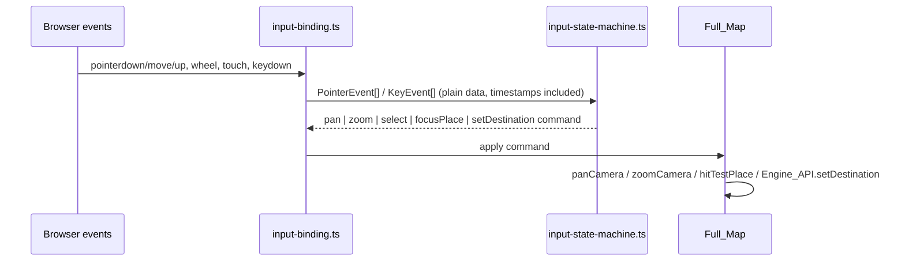

# Design Document

## Overview

This design covers Block B of `docs/brief.md`: the three map views (Minimap, Full_Map, Tilted_View) and the bare demo page that shows them. The Views live inside the engine package, `kit/engine/`, as pure logic plus one thin Canvas_Adapter, so they stay testable in Node like the rest of the engine. A separate, non-package page, `kit/demo/`, is a Vite app that imports the Engine and the Views and wires them to a canvas, a keyboard and a pointer.

The Views read the Map, the Route, the remaining Route, the Guidance and the Position only through the Engine_API (Requirement set, Introduction). Where a View needs something the API lacks — read access to the loaded Map's drawable data, and the already-implemented but unexported `snapToRoad` — that gap is closed on the Engine side first, documented in `kit/engine/docs/api.md`, and tested there, before the View that needs it is built. This design calls out each such gap explicitly (see "Engine API gaps to close" below) so the task list can schedule the Engine-side addition before the View that depends on it.

Logic and drawing are split the same way the engine core splits pure logic from nothing browser-specific: every draw call goes through a Canvas_Interface; a Recording_Canvas stores calls for Node tests; a Canvas_Adapter implements the interface on a real `CanvasRenderingContext2D` and is the only file that touches a browser global. Input handling is split the same way: a pure input state machine turns a sequence of pointer/key events into pan, zoom and selection commands; a thin binding layer attaches real DOM listeners and feeds them into the state machine.

## Architecture

### Module layout inside `kit/engine/`

The Views add a `views/` subtree beside the existing engine-core files, so the existing `src/index.ts`, `engine.ts`, etc. (Block A) are untouched except for the two Engine-API additions this design calls out as production code:

```
kit/engine/
  src/
    ... (Block A files, unchanged except index.ts's export list growing)
    views/
      canvas-interface.ts     # Canvas_Interface type: the operations Views call
      recording-canvas.ts     # Recording_Canvas: stores calls, no browser code
      canvas-adapter.ts        # Canvas_Adapter: implements Canvas_Interface on
                               # CanvasRenderingContext2D; the ONLY file here that
                               # references `window`/`document`/`HTMLCanvasElement`
      camera.ts                # Camera type + createCamera, worldToScreen,
                               # screenToWorld, panCamera, zoomCamera (pure math)
      visible-set.ts            # buildSpatialIndex(map), computeVisibleSet(camera,
                               # index, margins) — pure, Node-testable
      style.ts                  # DEFAULT_STYLE, resolveStyle(map.style) ->
                               # Resolved_Style, contrast() helper (test-shared)
      layers.ts                 # drawLayer functions in fixed order, called by
                               # each view's draw() in the same sequence
      label-placement.ts        # placeLabels(candidates, viewport) -> placed labels
                               # (pure; no canvas access)
      hit-test.ts                # hitTestPlace(places, screenPoint, camera) -> place | undefined
      tilted-projection.ts       # projectTilted, unprojectTilted, depthOrder (pure)
      smoothing.ts               # advanceSmoothed(current, target, dtMs, durationMs)
                               # (pure; caller supplies dtMs, no system clock read)
      input-state-machine.ts    # PointerEvent[]/KeyEvent[] -> pan/zoom/select commands
                               # (pure; no DOM types)
      input-binding.ts          # attaches real listeners, calls input-state-machine,
                               # the ONLY Views file (besides canvas-adapter.ts) that
                               # references a browser-only global
      minimap.ts                 # Minimap: composes camera + visible-set + layers
      full-map.ts                 # Full_Map: composes camera + visible-set + layers +
                               # input-binding + hit-test
      tilted-view.ts              # Tilted_View: composes camera + tilted-projection +
                               # visible-set + layers
      index.ts                   # re-exports the Views' public surface
    index.ts                    # existing Engine_API surface; grows to add the two
                               # gap-closing exports (see below)
  docs/
    views-api.md                 # Requirement 19.14: one entry per exported View
                               # function/type, mirroring the format of api.md
  tests/
    views/
      canvas-interface-recording.test.ts
      camera-round-trip.test.ts
      camera-no-shear.test.ts
      visible-set-model.test.ts
      style-resolution.test.ts
      style-contrast.test.ts
      layer-order.test.ts
      route-line.test.ts
      label-placement-overlap.test.ts
      label-placement-example.test.ts
      hit-test.test.ts
      minimap-player-centred.test.ts
      minimap-north-mark.test.ts
      full-map-zoom-anchor.test.ts
      full-map-click-snaps.test.ts
      tilted-depth-order.test.ts
      tilted-round-trip.test.ts
      smoothing.test.ts
      input-pan-sum.test.ts
      view-error-messages.test.ts        # one example per View_Error/Notice listed
      example-town-map.test.ts            # draws Town_Map on Recording_Canvas,
                                          # checked per Requirement 19.8
      helpers/
        view-arbitraries.ts               # fast-check generators: Camera, Viewport,
                                          # candidate labels, pointer-event sequences,
                                          # tilted-view inputs; reuses engine-core's
                                          # map/position generators
        naive-visibility-check.ts         # independent brute-force visibility check,
                                          # shares no code with visible-set.ts (same
                                          # separation discipline as the engine core's
                                          # exhaustive-search.ts)
        naive-nearest-place.ts            # independent brute-force nearest-place
                                          # search for the hit-test model property
kit/demo/
  index.html
  package.json                  # devDependency on Vite only; no runtime dependency
                               # beyond importing the local engine package
  vite.config.ts
  src/
    main.ts                     # wires Engine + Views to three canvases
    town-map.ts                  # Town_Map: hand-written MapFile (>=12 nodes, >=3
                               # road kinds, >=6 places, >=1 one-way road, >=1
                               # blocked area, >=6 props, >=3 of Raised_Kinds)
    map-choice.ts                 # switches between Town_Map and the engine-core
                               # bench generator's Large_Generated_Map (fixed seed)
    player-dot.ts                  # arrow-key-driven dot: position + heading + speed
    reduced-motion.ts               # reads prefers-reduced-motion, feeds Views
    demo.css
  bench/
    frame-bench.spec.ts            # Playwright: Frame_Benchmark (Requirement 18)
    gate.spec.ts                   # Playwright: the Gate (Requirement 20)
  playwright.config.ts
```

One file per concern mirrors the engine core's discipline (`map-loader.ts` vs `map-loader-checks.ts`): `camera.ts` holds only transform math so it can be fuzzed without a canvas; `visible-set.ts` isolates the spatial index from the drawing code in `layers.ts` so the index can be swapped or tuned without touching draw order; `label-placement.ts` and `hit-test.ts` take plain data (no `Camera`, no canvas) so they are trivial to generate inputs for.

### Why the Views live inside `kit/engine/`, not a new package

The brief's layout names `kit/engine/` as "the map engine (route finding, guidance, map views)" — map views are explicitly part of the engine's job, not a separate package. Keeping `views/` as a subtree of the existing package (rather than a new `kit/views/`) avoids a second `package.json`/`tsconfig.json` to keep in sync, and lets the Views' pure logic import engine-core types (`EngineMap`, `Route`, `Position`, `Guidance`) directly without a package boundary. The split that matters for testability is file-level (pure logic vs. `canvas-adapter.ts`/`input-binding.ts`), not package-level; Requirement 1.6/1.7 are enforced by keeping the browser-touching code in exactly those two files and checking the rest for forbidden globals in a static test, the same way the engine core checks its own package.json/tsconfig statically rather than with a generated-input test.

### Data flow for one drawn frame

```mermaid
sequenceDiagram
    participant Page as Demo_Page
    participant View as Minimap / Full_Map / Tilted_View
    participant Cam as Camera
    participant VS as Visible_Set (spatial index)
    participant Lay as Layers
    participant Can as Canvas_Interface

    Page->>View: draw(map, route, guidance, position, timestampMs)
    View->>Cam: advanceSmoothed(target, dtMs) [unless Reduced_Motion]
    Cam-->>View: camera (this frame)
    View->>VS: computeVisibleSet(camera, index, margins)
    VS-->>View: visibleItems
    View->>Lay: drawGround / drawBlockedAreas / drawProps / drawRoads / ...
    Lay->>Can: save/translate/rotate/path/fill/stroke/text (in fixed layer order)
    Can-->>Page: (Recording_Canvas: stored calls; Canvas_Adapter: pixels)
```



### Design decisions and rationale

- **Views are pure data-in/data-out except two adapter files.** `canvas-adapter.ts` and `input-binding.ts` are the only files allowed to reference `window`, `document`, `HTMLCanvasElement`, pointer/touch/keyboard DOM event types, `ResizeObserver` or `matchMedia`. A static test (same style as the engine core's package.json/tsconfig check) greps the `views/` source (excluding those two files) for those identifiers so the boundary cannot erode silently.
- **One spatial index built once per `setMap`, shared by all three Views.** Requirement 3.7's 5%-region/25%-roads bound rules out a linear scan per frame on the 5,000-road map; a uniform grid (cell size = a multiple of the median road length, rebuilt only when the Map changes) is simple, deterministic, and cheap to test against a brute-force "test every item" check (the model-based property pattern already used for the engine core's exhaustive search). An R-tree would also satisfy the bound but adds a dependency-free implementation cost without a speed requirement that demands it; a grid is chosen for simplicity, matching the engine core's "Dijkstra, not A*" call for the same reason (Decision 1 in `engine-core/design.md`).
- **Camera transforms are affine and shear-free by construction.** `worldToScreen` is composed as translate(viewport centre) ∘ rotate(camera.rotationDegrees) ∘ scale(camera.zoom) ∘ translate(-camera.center), so Requirement 2.10's "no shear, no unequal scaling" holds by construction and the property test is a check on the implementation, not a design risk.
- **Label_Placement and Hit_Test take plain screen-space data, not a `Camera`.** Both are pure functions of already-projected points and sizes; the View projects candidates with `worldToScreen` first and hands plain numbers to `label-placement.ts`/`hit-test.ts`. This keeps those two modules trivially fuzzable (Requirement 8.8/11.9 property tests) without needing a Camera generator inside them.
- **Tilted projection is a single reversible function, not "draw up then offset".** `projectTilted(groundPoint, height, tiltAngleDegrees, camera)` and its inverse `unprojectTilted` are implemented as one pair so Requirement 12.12's round-trip property is a direct test of the pair, and `Raised_Block` footprints reuse the same function `layers.ts` uses for ground items (no duplicate math).
- **Smoothing is a pure step function driven by caller-supplied `dtMs`.** `advanceSmoothed(current, target, dtMs, durationMs)` never reads `Date.now()` or `performance.now()`; the three Views and the demo page supply timestamps, keeping Requirement 13.7's determinism and matching the engine core's `Rerouter` pattern of taking every timestamp as an argument (Decision in `engine-core/design.md`, "one `Engine` class... takes every timestamp as an argument").
- **The input state machine never imports a DOM event type.** It is typed over plain `{ kind, x, y, timestampMs, ... }` records that `input-binding.ts` constructs from real events, so Requirement 15.11's "runs in Node, tested without a browser" and the pan-sum property (Requirement 15.12) can generate event sequences directly without mocking the DOM.
- **The demo page is a separate Vite project, not part of the engine package.** It needs `index.html`, a dev server and DOM wiring that the engine package (no runtime dependency, Node-testable) must not carry; `kit/demo/` depends on the engine package via a local path/workspace reference, matching the brief's "no server... static files" and keeping `kit/engine/`'s own `package.json` free of a `vite` devDependency it does not otherwise need. Playwright specs live under `kit/demo/bench/` since they drive this page specifically, not the engine package's Default_Suite.

## Components and Interfaces

### Engine API gaps to close (production code, before the View that needs it)

Reading `kit/engine/src/index.ts`, `engine.ts`, `types.ts` and `docs/api.md` against the requirements above two gaps:

1. **No read access to the loaded Map's drawable fields.** `Engine` exposes `getPlaces()` and `getBlockedRoads()` but nothing returns the nodes, roads, blocked areas, props, background picture or style of the currently loaded map, which every View needs to draw (Requirements 1, 4, 5, 6, 12). **Fix:** add `Engine.getMap(): EngineMap | undefined` to `engine.ts`, returning a defensive shallow-readonly copy consistent with `getPlaces()`'s copying behavior, and re-export the already-defined `EngineMap`/`MapFile`-field types that are not yet exported if any are missing (the current `index.ts` already exports `EngineMap`, `RoadData`, `PlaceData`, `PropData`, `BlockedAreaData`, `StyleData`, `BackgroundPictureData`, so only the `getMap()` method is new). Documented in `docs/api.md` under `Engine`, with a usage example; tested in `tests/engine-api.test.ts` (engine-core's existing file) alongside the other `Engine_API` methods, and in `tests/views/style-resolution.test.ts` as a consumer.
2. **`snapToRoad` is implemented but not part of the public surface.** `src/snapping.ts` exports `snapToRoad` and `isNoUsableRoad`, but `index.ts` re-exports neither, and `docs/api.md` documents neither — Requirement 11.4/11.8 (Full_Map converts a click to a world point, then needs the engine to snap it to the nearest Usable_Road) needs this as a called, documented function, not an internal implementation detail. **Fix:** add `snapToRoad` and `isNoUsableRoad` (and the `NoUsableRoadResult` type) to `index.ts`'s export list, document both in `docs/api.md` with a usage example, under the existing "Functions and classes" section next to `mirrorMap`. No logic changes to `snapping.ts` itself; this is a visibility/documentation fix, tested by extending `tests/engine-api.test.ts`'s export-list-matches-docs assertion to cover the new exports.

Both additions are engine-core production code (not Views code) and, per the commit rules, land in their own commit with their own test changes before any View file that imports them. They touch no engine-core behavior and the engine-core Default_Suite is asserted unchanged (Requirement 19.12).

No other gap was found: `findRoute`'s destination-snapping already covers Requirement 11.4's "snaps the world point to the nearest Usable_Road" by routing the click's world point through `Engine.setDestination({ point })`, which is the path Requirement 11.6 ("Full_Map sends the Destination to the Engine_API and computes no route itself") already requires; the Full_Map does not need to call `snapToRoad` itself for destination-setting, only for the click-lands-on-a-road property test's independent check and for any future maker use. `getGuidance()`/`getGuidanceSentence()`/`getRoute()`/`getRemainingRoute()`/`getLastNoWayResult()` already cover Requirement 7's needs.

### `canvas-interface.ts`

```ts
interface CanvasInterface {
  save(): void;
  restore(): void;
  translate(x: number, y: number): void;
  rotate(radians: number): void;
  scale(sx: number, sy: number): void;
  beginPath(): void;
  moveTo(x: number, y: number): void;
  lineTo(x: number, y: number): void;
  arc(x: number, y: number, radius: number, startRadians: number, endRadians: number): void;
  closePath(): void;
  fill(): void;
  stroke(): void;
  clip(): void;
  setFillColor(color: string): void;
  setStrokeColor(color: string): void;
  setLineWidth(width: number): void;
  setLineJoin(join: "round" | "bevel" | "miter"): void;
  setLineCap(cap: "round" | "butt" | "square"): void;
  setLineDash(segments: number[]): void;
  setGlobalAlpha(alpha: number): void;
  drawText(text: string, x: number, y: number, font: string, align: "left" | "center" | "right"): void;
  measureText(text: string, font: string): { width: number; height: number };
}
```

Every number argument is checked for finiteness by the calling layer (`layers.ts`) before the call reaches an implementation (Requirement 1.8); neither implementation re-validates, keeping `CanvasInterface` a thin, mechanical seam.

### `recording-canvas.ts` — `class RecordingCanvas implements CanvasInterface`

Stores an ordered `{ op: string; args: unknown[]; state: { fillColor, strokeColor, lineWidth, transform } }[]`, where `transform` is the accumulated translate/rotate/scale stack at the time of the call (a 2x3 matrix), kept so a test can ask "what matrix was active when this path was drawn" without re-deriving it (Requirement 1.4). Exposes `getCalls()` and `findCalls(op)` for tests.

### `canvas-adapter.ts` — `class CanvasAdapter implements CanvasInterface`

Wraps a `CanvasRenderingContext2D`, translating each method 1:1 (e.g. `drawText` calls `fillText`/`textAlign`/`font`). Owns the Device_Pixel_Ratio scaling (Requirement 14.1/14.2/14.3/14.5): on construction and on a `resize(cssWidth, cssHeight, devicePixelRatio)` call, sets `canvas.width/height` to the rounded pixel size and calls `ctx.scale(dpr, dpr)` once so all other calls stay in CSS pixels. `CanvasAdapter.mount(canvas): CanvasAdapter | ViewError` returns a `View_Error` without constructing anything if `canvas.getContext("2d")` is `null` (Requirement 1.9).

### `camera.ts`

```ts
interface Camera {
  centerX: number; centerY: number;      // world units
  zoom: number;                           // CSS px per world unit, 0.001..1000
  rotationDegrees: number;                // finite
  viewportWidth: number; viewportHeight: number; // CSS px, 1..16384
}

function createCamera(init: Partial<Camera>): Camera | ViewError;
function worldToScreen(camera: Camera, point: { x: number; y: number }): { x: number; y: number } | ViewError;
function screenToWorld(camera: Camera, point: { x: number; y: number }): { x: number; y: number } | ViewError;
function panCamera(camera: Camera, screenDelta: { dx: number; dy: number }): Camera;
function zoomCamera(camera: Camera, anchor: { x: number; y: number }, factor: number): Camera | ViewError;
```

`worldToScreen`/`screenToWorld` validate every field of `camera` and the point's coordinates before computing (Requirement 2.4/2.5), returning a `ViewError` that never includes the rejected point's own coordinates per the glossary's `View_Error` rule. The composition translate(viewport centre) ∘ rotate ∘ scale ∘ translate(-centre) makes `screenToWorld` the exact matrix inverse, so round-trip error is pure floating-point error, well under the 0.001-unit tolerances in Requirements 2.7/2.8.

### `visible-set.ts`

```ts
interface SpatialIndex { /* uniform grid over the map's roads, blocked areas, props, places */ }
function buildSpatialIndex(map: EngineMap): SpatialIndex;
function visibleRegion(camera: Camera, marginWorldUnits: number): { minX: number; minY: number; maxX: number; maxY: number };
function computeVisibleSet(index: SpatialIndex, region: VisibleRegion): {
  roadIds: Set<string>; blockedAreaIds: Set<string>; propIds: Set<string>; placeIds: Set<string>;
};
```

`buildSpatialIndex` buckets every item's bounding box into grid cells sized to the map's median road length (a fixed minimum of 10 world units to avoid degenerate tiny maps); `computeVisibleSet` looks up only the cells overlapping `region` and unions their items, satisfying the ≤25%-roads-tested bound on the 5,000-road map (Requirement 3.7) because a region covering ≤5% of the map area overlaps a bounded, small number of grid cells regardless of map size. `visibleRegion` widens the camera's screen rectangle, converted to world units via `screenToWorld` on its corners, by `marginWorldUnits` (the caller passes the max of road width, route-line half-width in world units, and max Block_Height, per Requirement 3.3).

### `style.ts`

```ts
const DEFAULT_STYLE: ResolvedStyle; // one entry per key named in Requirement 4.3
function resolveStyle(style: StyleData | undefined): { resolved: ResolvedStyle; notices: Notice[] };
function contrastRatio(hex1: string, hex2: string): number; // WCAG relative-luminance formula
```

`resolveStyle` walks every key `DEFAULT_STYLE` defines; for each, if the map's `StyleData` has a usable value (a parseable colour string, or a line style whose width/dash values are finite and in range) it is kept, otherwise the default is used and a `Notice` naming the key is appended (Requirement 4.4/4.8). `contrastRatio` is exported so `tests/views/style-contrast.test.ts` can assert Requirement 4.5/4.6/4.7 directly against `DEFAULT_STYLE`'s own values, and so the demo page's palette file (one per application, per the brief) can self-check later.

### `layers.ts`

Exports one `drawX(canvas, resolvedStyle, visibleItems, camera, ...)` function per layer, called in the exact fixed order of Requirement 6.1 (ground, blocked areas, flat props, road outlines, road fills, blocked-road marks, route line, destination marker, place markers, place labels, player marker) from each View's `draw()`. Keeping the order as a single ordered list of function calls in each View (rather than a generic "layer registry") makes Requirement 6.5's layer-order property a direct, readable assertion against `RecordingCanvas.getCalls()` grouped by which `drawX` call produced them.

### `label-placement.ts`

```ts
interface LabelCandidate { placeId: string; priority: number; screenX: number; screenY: number; width: number; height: number }
function placeLabels(candidates: LabelCandidate[], viewport: { width: number; height: number }): { placeId: string; rect: Rect }[];
```

Pure, deterministic: sorts candidates by `priority` ascending (the View assigns priority 0 to the Destination place, 1 to the nearest-to-player place, then identifier order, per Requirement 8.3), then greedily places each candidate's rectangle, nudging it inside the viewport if it fits (Requirement 8.7), skipping it if it overlaps (within 4px) a rectangle already placed by a higher-priority candidate (Requirement 8.4/8.8) or if it is non-finite/non-positive sized (Requirement 8.10).

### `hit-test.ts`

```ts
function hitTestPlace(places: { placeId: string; screenX: number; screenY: number }[], point: { x: number; y: number }, radiusPx: number): string | undefined;
```

Returns the nearest place within `radiusPx` (20, per Requirement 11.2), breaking ties by lowest `placeId` (Requirement 11.3), or `undefined` when none is within range (Requirement 11.9). The View projects places to screen space with `worldToScreen` before calling this, so the function itself needs no `Camera`.

### `tilted-projection.ts`

```ts
function projectTilted(ground: { x: number; y: number }, heightWorldUnits: number, tiltAngleDegrees: number, camera: Camera): { x: number; y: number };
function unprojectTilted(screen: { x: number; y: number }, tiltAngleDegrees: number, camera: Camera): { x: number; y: number }; // height 0 only
function depthOf(ground: { x: number; y: number }, camera: Camera): number; // for Depth_Order sort key
```

`projectTilted` first rotates the ground point into the camera's heading-up frame (same rotation `camera.ts` uses), shortens the forward (screen-up) component by `sin(tiltAngleDegrees)` and lifts the point up-screen by `heightWorldUnits * cos(tiltAngleDegrees)` (Requirement 12.2), then applies the ordinary `worldToScreen` scale/translate. `unprojectTilted` undoes exactly these steps in reverse for height 0, giving Requirement 12.12's round trip by construction. `depthOf` returns the rotated, pre-tilt forward-axis coordinate (larger = nearer the viewer, i.e. lower on screen), used to sort Raised_Blocks and upright labels for Requirement 12.6/12.7/12.11, with a stable sort keyed secondarily by `propId` for the <0.001-world-unit tie rule.

### `smoothing.ts`

```ts
function advanceSmoothed(current: number, target: number, dtMs: number, durationMs: number): number;
function advanceSmoothedHeading(current: number, target: number, dtMs: number, durationMs: number): number; // shortest-turn
function advanceCamera(current: Camera, target: Camera, dtMs: number, durationMs: number, reducedMotion: boolean): Camera;
```

`advanceSmoothed` uses an exponential-approach step, `current + (target - current) * (1 - exp(-k * dtMs))` with `k` chosen so that after `durationMs` the step reaches ≥95% of the remaining distance (Requirement 13.2), clamped so the result never passes `target` (no overshoot, Requirement 13.3) and snapped exactly to `target` once within a tiny epsilon so repeated calls converge rather than approach forever. `advanceSmoothedHeading` wraps the same step around the shortest signed angular difference (reusing `geometry.ts`'s `signedAngleDifference` from the engine core, imported, not duplicated). `advanceCamera` returns `target` unchanged in one step when `reducedMotion` is true (Requirement 13.4/13.5), and otherwise calls the two functions above per field. `dtMs` is clamped to at most 1000 before use (Requirement 13.12) and a negative `dtMs` (timestamp went backwards) is treated as 0 (Requirement 13.11) by the caller (`engine.ts`-side Views code), not inside `advanceSmoothed` itself, keeping the function a pure clamp-free step and the backwards-time policy in one place.

### `input-state-machine.ts`

```ts
type InputEvent =
  | { kind: "pointerdown" | "pointermove" | "pointerup"; x: number; y: number; timestampMs: number; pointerId: number }
  | { kind: "wheel"; x: number; y: number; deltaY: number; timestampMs: number }
  | { kind: "touchmove"; touches: { id: number; x: number; y: number }[]; timestampMs: number }
  | { kind: "keydown"; key: string; timestampMs: number };

type InputCommand =
  | { type: "pan"; dx: number; dy: number }
  | { type: "zoom"; anchor: { x: number; y: number }; factor: number }
  | { type: "select"; x: number; y: number }
  | { type: "focusNextPlace" | "focusPreviousPlace" | "activateFocusedPlace" | "fit" | "follow" };

function processEvents(state: InputState, events: InputEvent[]): { state: InputState; commands: InputCommand[] };
```

A single-threaded reducer: tracks the active pointer/touch set and the pointerdown position/time to decide "selection vs. pan" (within 6px and 500ms, Requirement 11.1), converts drag deltas to `pan` commands, converts wheel deltas and two-finger pinch distance ratios to `zoom` commands anchored at the pointer/midpoint (Requirement 15.1/15.4), and maps the key set of Requirement 15.5/15.6 to the remaining command types. Every event carries its own `timestampMs`; the reducer does not read a clock. Malformed events (non-finite `x`/`y`/`timestampMs`) are dropped with a `Notice` appended to the returned state rather than thrown (Requirement 15.13).

### `input-binding.ts`

Attaches `pointerdown`/`pointermove`/`pointerup`/`wheel`/`touchstart`/`touchmove`/`touchend`/`keydown` DOM listeners to a canvas element, constructs plain `InputEvent` records from each (reading `event.clientX/clientY`, `event.timeStamp`, etc.), calls `processEvents`, and applies the returned commands to a `Full_Map` instance. Also calls `event.preventDefault()` for wheel/touch events on the canvas (Requirement 15.10) and sets `touch-action: none` on mount.

### `minimap.ts` / `full-map.ts` / `tilted-view.ts`

Each is a small class composing the pieces above:

- `Minimap`: owns a `Camera` whose `centerX/centerY` tracks the player and whose `rotationDegrees` tracks the negated heading (so heading-up means the Map rotates opposite the player's turn), both advanced through `advanceCamera` each frame; clips drawing to a circle via `CanvasInterface.clip()`; exposes `setZoomLimits(min, max)` and `setZoom(z)` guarded per Requirement 9.9/9.10; refuses to draw (Notice only) below 40x40 px (Requirement 9.11).
- `Full_Map`: owns a `Camera` with `rotationDegrees` pinned to 0 (Requirement 10.7); exposes `pan`, `zoomAt`, `fit`, `follow`, `setDestination`-via-selection (calling `Engine.setDestination` unless the caller supplied its own selection handler, Requirement 11.7), and wires `input-binding.ts`; enforces the ≥20%-extent-visible pan clamp (Requirement 10.4) and the zoom-limit clamp with a Notice (Requirement 10.10).
- `Tilted_View`: owns a `Camera` like the Minimap (player-centred, heading-up) plus a `tiltAngleDegrees` (20..70, default 45, Requirement 12.8/12.9); draws ground-plane layers first, then Raised_Blocks and upright labels in `depthOf` order (Requirement 12.5/12.6).

All three validate their `Position`/`Route`/`Map` inputs per Requirement 7.9/7.10/3.11 before touching drawing state, consistent with the engine core's "guard before mutating" pattern (`engine.ts`'s own methods).

## Data Models

```ts
// views/camera.ts
interface Camera {
  centerX: number; centerY: number;
  zoom: number;                     // 0.001..1000 CSS px per world unit
  rotationDegrees: number;
  viewportWidth: number; viewportHeight: number; // 1..16384 CSS px each
}

interface ViewError {
  message: string;   // plain words, names the input and its allowed range
  field?: string;
}

interface Notice {
  message: string;    // plain words, names the input/key
}

// views/style.ts
interface ResolvedStyle {
  roadColors: Record<RoadKind, string>;
  roadOutlineColor: string;
  groundColor: string;
  blockedAreaColors: Record<BlockedAreaKind, string>;
  blockedRoadColor: string;
  propColor: string;
  raisedBlockTopColor: string;
  raisedBlockSideColor: string;
  routeLineColor: string;
  routeLineOutlineColor: string;
  playerMarkerColor: string;
  destinationMarkerColor: string;
  placeLabelTextColor: string;
  placeLabelBackgroundColor: string;
  roadLineStyles: Record<RoadKind, { dash?: number[]; widthPx: number }>;
  // ... one width/dash entry per drawn line kind named in Requirement 4.3
}

// views/visible-set.ts
interface VisibleRegion { minX: number; minY: number; maxX: number; maxY: number }
interface VisibleSet {
  roadIds: Set<string>;
  blockedAreaIds: Set<string>;
  propIds: Set<string>;
  placeIds: Set<string>;
}

// views/label-placement.ts
interface Rect { x: number; y: number; width: number; height: number }
interface LabelCandidate { placeId: string; priority: number; screenX: number; screenY: number; width: number; height: number }
interface PlacedLabel { placeId: string; rect: Rect }

// views/tilted-projection.ts
interface TiltedProjectionInput { ground: { x: number; y: number }; heightWorldUnits: number }

// views/input-state-machine.ts (see Components above for the full union types)
interface InputState {
  activePointerId?: number;
  pointerDownAt?: { x: number; y: number; timestampMs: number };
  activeTouches: { id: number; x: number; y: number }[];
  focusedPlaceId?: string;
  notices: Notice[];
}

// views/smoothing.ts
interface SmoothingOptions { durationMs: number } // 1..5000, default 300

// kit/demo/src: Town_Map is a plain MapFile literal (engine-core's MapFile type),
// no new type — satisfies Requirement 17.2's counts via hand-written content.
```

## Correctness Properties

*A property is a characteristic or behavior that should hold true across all valid executions of a system — essentially, a formal statement about what the system should do. Properties serve as the bridge between human-readable specifications and machine-verifiable correctness guarantees.*

PBT is appropriate for nearly all of the Views' logic: cameras, visibility, label placement, hit testing, tilted projection, smoothing and input reduction are all pure functions over structured data (points, rectangles, event sequences) with large input spaces and clear universal invariants, in the same style as the engine core. Drawing itself is checked through the `RecordingCanvas`'s call log rather than pixels, which keeps even the layer-order and route-line properties expressible as PBT over the call log. The properties below map 1:1 to the required list in Requirement 19.3, each traced back to the acceptance criterion it was adapted from; property reflection notes at the end record where closely related criteria were folded into one property, matching the engine-core design's own reflection practice.

### Property 1: Transform round trip (world to screen to world)

For all generated Cameras with world centre coordinates of absolute value at most 1,000,000 world units, and world points within 100,000 CSS pixels divided by Zoom of the world centre, `worldToScreen` followed by `screenToWorld` returns the original world point within 0.001 world units.

**Validates: Requirements 2.7**

### Property 2: Transform round trip (screen to world to screen)

For all generated Cameras with world centre coordinates of absolute value at most 1,000,000 world units, and screen points within 100,000 CSS pixels of the viewport centre, `screenToWorld` followed by `worldToScreen` returns the original screen point within 0.001 CSS pixels.

**Validates: Requirements 2.8**

### Property 3: No shear, uniform scaling

For all generated Cameras and pairs of world points, the distance between the two screen points produced by `worldToScreen` equals the distance between the two world points multiplied by Zoom, within a relative tolerance of 0.000001. The world centre maps to the centre of the Viewport within 0.001 CSS pixels for every generated Camera (folded in as the same construction's base case).

**Validates: Requirements 2.9, 2.10**

### Property 4: Nothing visible is left out

For all generated Maps (including the whole-map-extent camera case) and Cameras, the Visible_Set returned by `computeVisibleSet` over the spatial index equals the set produced by an independent, brute-force check of every Road, Blocked_Area, Prop and Place against the same widened Visible_Region (model-based property: optimized spatial index vs. plain exhaustive check).

**Validates: Requirements 3.4, 3.5, 3.6**

### Property 5: Layer order

For all generated Maps and Cameras, the ordered calls recorded by the Recording_Canvas, grouped by which layer-drawing function produced them, show every call of a later layer in Requirement 6.1's fixed order strictly after every call of an earlier layer, within the same drawn frame.

**Validates: Requirements 6.5**

### Property 6: Route line lies on the remaining route

For all generated Maps and Routes, every point of the Route_Line drawn on the Recording_Canvas, converted back to world space with `screenToWorld`, lies on the remaining Route within 0.01 world units.

**Validates: Requirements 7.8**

### Property 7: Place labels never overlap

For all generated sets of label candidates (screen positions and measured sizes), no two rectangles returned by `placeLabels` lie within 4 CSS pixels of each other.

**Validates: Requirements 8.8**

### Property 8: Minimap keeps the player centred with heading up

For all generated Positions with coordinates of absolute value at most 1,000,000 world units and headings from -360 to 360 degrees, `worldToScreen` of the Minimap's Camera maps the player's world point to the centre of the Viewport within 0.001 CSS pixels, and a point one world unit ahead of the player along the heading maps to a screen point directly above the centre, within 0.001 CSS pixels horizontally.

**Validates: Requirements 9.7**

### Property 9: North mark points to world north

For all generated Cameras of the Minimap, the direction drawn for the North_Mark equals the screen direction of the world vector (0, -1), within 0.001 degrees.

**Validates: Requirements 9.8**

### Property 10: Zoom keeps the anchor point fixed in world space

For all generated Cameras, anchor points inside the Viewport and zoom factors from 0.1 to 10, the world point under the anchor point is the same before and after `zoomCamera`, within 0.001 world units, whenever the resulting Zoom lies inside the configured limits.

**Validates: Requirements 10.8**

### Property 11: A click lands on a usable road

For all generated Maps with at least one Usable_Road and screen points inside the Viewport, the point obtained by converting the screen point with `screenToWorld` and then snapping it with the Engine's `snapToRoad` lies on a Usable_Road within 0.001 world units.

**Validates: Requirements 11.8**

### Property 12: Hit test returns the nearest place within range

For all generated sets of places (with screen positions) and screen points, `hitTestPlace` returns the place nearest to the screen point among the places within 20 CSS pixels, with ties broken by the lowest place identifier, and returns no place when none is within 20 CSS pixels; this matches an independent brute-force nearest-place search over the same inputs (model-based property).

**Validates: Requirements 11.9**

### Property 13: Raised blocks are drawn nearer after farther

For all generated Maps, Cameras and Positions, the Raised_Blocks drawn on the Recording_Canvas by the Tilted_View appear in an order in which no Raised_Block is drawn before a Raised_Block that is farther from the viewer by more than 0.001 world units, with ties (depth difference at or below that tolerance) broken by ascending Prop identifier.

**Validates: Requirements 12.11**

### Property 14: Tilted projection round trip at ground level

For all generated Cameras and Tilt_Angles from 20 to 70 degrees, `projectTilted` of a ground point at height 0, followed by `unprojectTilted`, returns the original ground point within 0.001 world units.

**Validates: Requirements 12.12**

### Property 15: Smoothing moves monotonically toward the target without overshoot

For all generated target values and frame-time sequences with frame intervals from 1 to 1000 ms, `advanceSmoothed` produces a sequence of values that moves monotonically toward the target without ever passing it, within a tolerance of 0 units; for all generated finite heading pairs, `advanceSmoothedHeading` takes the turn of at most 180 degrees between the current and target heading on every step (the same step function applied to the angular case, covered by the same generator and the same property).

**Validates: Requirements 13.8, 13.9**

### Property 16: Pointer drag commands sum to the total screen displacement

For all generated sequences of drag events with coordinates within 100,000 CSS pixels, the sum of the `pan` commands' `dx`/`dy` produced by `processEvents` equals the screen distance between the first and the last event in the sequence, within 0.001 CSS pixels.

**Validates: Requirements 15.12**

**Property reflection notes:**
- Property 3 folds Requirement 2.9 (world centre maps to viewport centre) into the no-shear property's generator as the zero-distance base case, since both are facets of the same affine-construction invariant and one generator covers both without losing either assertion.
- Property 4 folds Requirement 3.5 (visible set holds every road when the camera shows the whole extent) and 3.6 (model property against a plain test-code check) into the single "nothing-visible-is-left-out" property Requirement 19.3 names, since 3.5 is simply the generator's whole-extent-camera case of the same index-vs-brute-force comparison that 3.6 already states generally.
- Requirement 8.9 (the Destination place is included among labels when it fits) is not written as a fourteenth PBT entry because Requirement 19.3 does not name a separate "destination priority" property; it is covered instead by an example-based test in `label-placement-example.test.ts` that asserts priority ordering directly, consistent with the engine core design's practice of moving caller-supplied-value and other non-listed guarantees to example tests (see `engine-core/design.md`'s closing reflection note on Requirements 12.5/13.6).
- Property 15 merges Requirements 13.8 and 13.9 (the no-overshoot property and the shortest-turn rule) into one property test, since both exercise the same `advanceSmoothed`/`advanceSmoothedHeading` step function and Requirement 19.3 lists only "smoothing without overshoot" as the one PBT entry for this area.
- Every property above is implemented as a single property-based test, each tagged `// Feature: map-views, Property {n}: {title}` and run with at least 100 generated cases, per Requirement 19.3/19.4.

## Error Handling

- **Drawing never throws for bad data.** Every View validates its `Camera`, `Position`, `Route`, `Map` item and Style input before it reaches a `CanvasInterface` call; a `View_Error` is returned (and the previous state kept) for a rejected setter call (`createCamera`, `setZoom`, `setDestination`'s selection path, `resize`), while a per-item problem inside an otherwise-drawable Map (a bad Road width, a degenerate Blocked_Area polygon, a non-finite Prop field, an empty Place name) produces a `Notice` and that one item is skipped, matching the glossary's View_Error-vs-Notice split and the engine core's own `LoadResult`-style "never throw for caller-supplied data" rule.
- **Non-finite numbers never reach the Canvas_Interface.** `layers.ts` checks every coordinate it is about to pass to a draw call; on a non-finite value it skips the call and appends a Notice naming the operation (Requirement 1.8), the same discipline `camera.ts` applies to its own inputs before computing.
- **The Canvas_Adapter fails fast on an unusable canvas.** `CanvasAdapter.mount` returns a `View_Error` and mounts nothing when `getContext("2d")` is `null` (Requirement 1.9), rather than deferring the failure to the first draw call.
- **The input state machine drops, never throws, on a malformed event.** A non-finite `x`/`y`/`timestampMs` in any `InputEvent` is ignored, with a Notice appended to the returned state and no command issued for that event (Requirement 15.13); a pinch distance under 1 CSS pixel yields no zoom command for that step rather than a division error (Requirement 15.14).
- **Engine-side additions reuse the existing error vocabulary.** `Engine.getMap()` and the newly exported `snapToRoad`/`isNoUsableRoad` introduce no new error path; `getMap()` can only return `undefined` (no map loaded) or a value, and `snapToRoad` already returns its typed `NoUsableRoadResult` rather than throwing, so no change to `errors.ts` is needed.

## Testing Strategy

**Dual approach**, matching the engine core: property-based tests (Vitest + fast-check, the same library already a devDependency, no new dependency added) cover the 16 properties above; example-based unit tests cover the fixed scenarios and error/notice cases the requirements name; a separate Playwright suite (outside the Default_Suite, per Requirement 18.1/20.5) covers the Frame_Benchmark and the Gate.

**Property test configuration.**
- Each property test runs at least 100 generated cases (`fc.assert(fc.property(...), { numRuns: 100 })` or higher where the input space is larger, e.g. Property 4's map/camera combinations).
- Each test file is tagged `// Feature: map-views, Property {number}: {property title}`.
- Generators live in `tests/views/helpers/view-arbitraries.ts`, reusing the engine core's map/position generators (`kit/engine/tests/helpers/arbitraries.ts`) rather than duplicating them, plus new generators for `Camera`, `Viewport`, label candidates, pointer-event sequences and tilted-view inputs (ground point, height, tilt angle).
- `tests/views/helpers/naive-visibility-check.ts` and `naive-nearest-place.ts` share no code with `visible-set.ts`/`hit-test.ts`, mirroring the engine core's `exhaustive-search.ts` separation (Requirement 9.3 of the engine-core spec; the same discipline applies here even though no single Views requirement names it, because Property 4 and Property 12 are explicitly model-based).
- fast-check's default shrinking and seed reporting is left enabled; no test raises an iteration count or a time limit to force a pass (Requirement 19.5/19.6/19.7).

**Example-based tests.**
- `canvas-interface-recording.test.ts`: draws a small fixed scene and asserts the exact ordered call list, including stored transform state, demonstrating Requirement 1.3/1.4/1.5.
- `style-resolution.test.ts`: a Style that sets only some keys, asserting the unset keys fall back to `DEFAULT_STYLE` exactly (Requirement 19.9) and that an invalid colour/line-width/dash value is replaced with a Notice naming the key (Requirement 4.4/4.8).
- `style-contrast.test.ts`: asserts `DEFAULT_STYLE`'s label text/background contrast is ≥4.5:1 and its Route_Line contrast against every Road kind colour and the ground colour is ≥3:1, using `contrastRatio` (Requirement 4.5/4.6/4.7).
- `example-town-map.test.ts`: draws the Town_Map on the Recording_Canvas with each View and asserts the presence of road, Blocked_Area, Prop, Route_Line, Player_Marker, Destination_Marker and Place_Label calls (Requirement 19.8).
- `view-error-messages.test.ts`: one case per named View_Error and Notice in Requirements 1-18, asserting the message is plain-worded, names the input, and contains no coordinates where the requirement forbids them (Requirement 19.15), plus boundary-value cases (lower bound, upper bound, just below, just above, `NaN`, `+Infinity`, `-Infinity`) for every numeric input with a stated range (Requirement 19.16).
- `label-placement-example.test.ts`: asserts the Destination place's label is included among the placed labels when its marker and label both fit in the Viewport (the non-PBT guarantee noted in the property reflection above).
- A static test (string/AST check over `views/` source, excluding `canvas-adapter.ts` and `input-binding.ts`) asserts no reference to `window`, `document`, `HTMLCanvasElement` or other browser-only globals, and that the engine package's `package.json` still declares no `dependencies` (Requirement 1.6/1.7).

**Benchmark and Gate (outside the Default_Suite).**
- `kit/demo/bench/frame-bench.spec.ts` (Playwright): loads the Large_Generated_Map on the Demo_Page, moves the player along a fixed seeded path for at least 300 frames, measures each View's Frame_Time and inter-frame interval separately, including the Full_Map at both the whole-map-fit zoom and 4 px/world-unit, and prints the median/95th-percentile/maximum in ms plus the browser, Node version, viewport, Device_Pixel_Ratio and machine description, with no pass/fail threshold on the numbers themselves (Requirement 18.2-18.7); it fails only on a run-time failure (too few frames measured, or a non-finite/negative measurement), per Requirement 18.8/18.9/18.10.
- `kit/demo/bench/gate.spec.ts` (Playwright): drives the Demo_Page with mouse/keyboard (and, in a second pass, touch at a 375px viewport) to click a Place on the Full_Map on the Large_Generated_Map, confirms the Route_Line appears on all three Views, confirms the travelled part disappears as the player moves and no reroute happens while on the route, then forces the player off the route past the Reroute_Margin for longer than the Reroute_Delay and confirms a new route is drawn to the same destination — reporting, not gating on, the count of frames with an inter-frame interval over 50ms (Requirement 20.1-20.6). It fails with a plain-worded reason if the map does not load within 30 seconds or if the click yields a No_Way_Result (Requirement 20.9/20.10). Per Requirement 20.7, the Gate task itself is the last task of the spec and is additionally tried by hand on the Demo_Page by a person before the checkpoint is reported.

**Commit discipline note (per the project's commit rules).** Each module above (`camera.ts`, `visible-set.ts`, `style.ts`, `layers.ts`, `label-placement.ts`, `hit-test.ts`, `tilted-projection.ts`, `smoothing.ts`, `input-state-machine.ts`, the Canvas_Interface/Recording_Canvas/Canvas_Adapter trio, each of the three View classes, the two Engine-API gap-closing additions, and the demo page's pieces) is sized to land in its own commit together with its own tests, so "a piece of code and its tests go in one commit" holds task by task; no module's production code and its property/example tests are split across commits, and the task list that follows this design will keep each task to one such module.

**Coverage summary against Requirement 19.3's required property list:**

| Required property (Req 19.3) | Design property |
|---|---|
| transform round trip | Properties 1, 2 |
| nothing-visible-is-left-out | Property 4 |
| layer order | Property 5 |
| route line on the remaining route | Property 6 |
| labels do not overlap | Property 7 |
| player centred and heading up on the Minimap | Property 8 |
| North_Mark direction | Property 9 |
| zoom anchor | Property 10 |
| click lands on a Usable_Road | Property 11 |
| hit test | Property 12 |
| nearer after farther in the Tilted_View | Property 13 |
| tilt round trip | Property 14 |
| smoothing without overshoot | Property 15 |
| pan sum | Property 16 |
