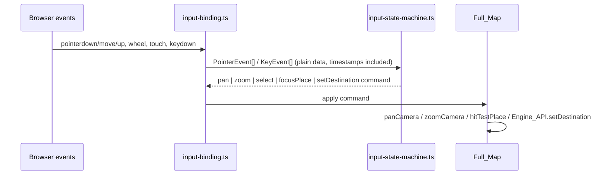
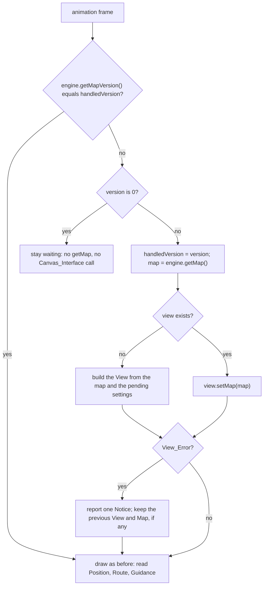

# Design Document

## Overview

This design covers Block B of `docs/brief.md`: the three map views (Minimap, Full_Map, Tilted_View) and the bare demo page that shows them. The Views live inside the engine package, `kit/engine/`, as pure logic plus one thin Canvas_Adapter, so they stay testable in Node like the rest of the engine. A separate, non-package page, `kit/demo/`, is a Vite app that imports the Engine and the Views and wires them to a canvas, a keyboard and a pointer.

The Views read the Map, the Route, the remaining Route, the Guidance and the Position only through the Engine_API (Requirement set, Introduction). Where a View needs something the API lacks — read access to the loaded Map's drawable data, and the already-implemented but unexported `snapToRoad` — that gap is closed on the Engine side first, documented in `kit/engine/docs/api.md`, and tested there, before the View that needs it is built. This design calls out each such gap explicitly (see "Engine API gaps to close" below) so the task list can schedule the Engine-side addition before the View that depends on it.

Applications use the Views through three one-call Mount_Functions (`mountMinimap`, `mountFullMap`, `mountTiltedView`, Requirement 21) that create the adapter, set the pixel ratio, observe the canvas size, bind input and run a Frame_Loop that reads the Position, Route and Guidance from the Engine. The lower-level Draw_Functions stay public. Drawing is cheap by construction: Roads are batched into one path per kind and per pixel width in each Draw_Pass (Requirement 22), and a change-detection gate makes a frame with no change cost zero Canvas_Interface calls (Requirements 14.9, 14.10, 22). The Tilted_View reads an optional per-Prop `blockHeight` that this spec adds to map file format version 1 (Requirement 23).

Pictures (Requirement 24) follow one rule: the caller loads, the Views draw. A caller passes an optional `images` lookup (picture reference to `{ image, width, height }`) to a Mount_Function or a Draw_Function. The Views hand the opaque `ImageHandle` to a new `CanvasInterface.drawImage` operation and never read it. A Picture_Prop is drawn as its image, or as a labelled placeholder rectangle when the image is missing. A Background_Picture is drawn in a new layer between the ground and the blocked areas, with its `scale` and `opacity`, and not at all when its image is missing. Every missing or bad picture is a Notice, never a thrown error. Two further small changes ride along: the Style colour rule widens to `#rgb`, `#rrggbb` and `#rrggbbaa` with a documented key table that a test keeps in step with `DEFAULT_STYLE` (Requirement 4 criteria 9 to 16), and the engine-core smoke test replaces its blanket browser-global scan with a scan that has a three-path allowlist (Requirement 19 criteria 19 to 24).

Logic and drawing are split the same way the engine core splits pure logic from nothing browser-specific: every draw call goes through a Canvas_Interface; a Recording_Canvas stores calls for Node tests; a Canvas_Adapter implements the interface on a real `CanvasRenderingContext2D`. Browser globals are allowed in exactly three Views files: `canvas-adapter.ts`, `input-binding.ts` and `mount.ts` (Requirement 19.18). Input handling is split the same way: a pure input state machine turns a sequence of pointer/key events into pan, zoom and selection commands; a thin binding layer attaches real DOM listeners and feeds them into the state machine.

Five later amendments (Requirements 25 to 29, and Requirement 12 criteria 20 and 21) change the design in five places, each described in its own section below. (1) The Engine gets `getMapVersion()`, and a mounted View reads `getMap()` only when that number changes, so a View is mounted once, may be mounted before any map exists, and is never mounted again when the map changes ("Map version and the Frame_Loop"). (2) The Tilted_View uses a real Perspective_Projection, a projective map of the ground plane with a Focal_Distance, instead of an affine squash; the default Tilt_Angle is 35 degrees (the current code default of 45 changes) and is checked with worked numbers against criteria 26.3 and 26.4 ("Perspective_Projection of the Tilted_View"). (3) The North_Mark becomes the letter `N` with a tick and gets a new default colour with measured contrast and hue difference ("North_Mark"). (4) The Demo_Page shows the Engine's own guidance sentence verbatim, has a tilt slider and no longer mounts its Views again ("Demo page changes"). (5) A fixed audit procedure keeps the dev tooling free of fixable vulnerabilities ("Dev tooling audit").

## Architecture

### Module layout inside `kit/engine/`

The Views add a `views/` subtree beside the existing engine-core files, so the existing `src/index.ts`, `engine.ts`, etc. (Block A) are untouched except for the four Engine-side additions this design calls out as production code (`Engine.getMap()`, the `snapToRoad` export, the optional Prop field `blockHeight`, and `Engine.getMapVersion()`, see "Engine API gaps to close"):

```
kit/engine/
  src/
    ... (Block A files, unchanged except index.ts's export list growing)
    views/
      canvas-interface.ts     # Canvas_Interface type: the operations Views call,
                               # including drawImage and the opaque ImageHandle type
      draw-safe.ts             # SafeCanvas: wraps a CanvasInterface, skips a call with a
                               # non-finite number (and a drawImage with a size not above
                               # 0) and collects a Notice naming the operation
      image-lookup.ts          # ImageLookup, ImageEntry, asImageHandle (identity cast),
                               # pictureRefOfKind, resolvePicture (pure; never throws)
      recording-canvas.ts     # Recording_Canvas: stores calls, no browser code
      canvas-adapter.ts        # Canvas_Adapter: implements Canvas_Interface on
                               # CanvasRenderingContext2D; one of the THREE files
                               # here (with input-binding.ts and mount.ts) that may
                               # reference `window`/`document`/`HTMLCanvasElement`
      camera.ts                # Camera type + createCamera, worldToScreen,
                               # screenToWorld, panCamera, zoomCamera (pure math)
      visible-set.ts            # buildSpatialIndex(map), computeVisibleSet(camera,
                               # index, margins) — pure, Node-testable
      style.ts                  # DEFAULT_STYLE, resolveStyle(map.style) ->
                               # Resolved_Style, contrast() helper (test-shared),
                               # the hex colour rule (#rgb, #rrggbb, #rrggbbaa), and the
                               # exported key lists the format document is checked against
      layers.ts                 # drawLayer functions in fixed order, called by
                               # each view's draw() in the same sequence. In the code
                               # this is the files layers-areas.ts (ground, background
                               # picture, blocked areas, flat props), layers-roads.ts,
                               # layers-route.ts, layers-places.ts, and draw-map-layers.ts
                               # (the fixed order, LAYER_ORDER)
      road-batching.ts          # groups visible Usable_Roads by (kind, pixel width)
                               # and Blocked_Roads by pixel width; builds one path
                               # per group per Draw_Pass (pure, uses CanvasInterface)
      frame-gate.ts             # change detection: FrameGate.shouldDraw(inputs) ->
                               # boolean, tracks Map/Route/Position/Camera/Viewport/
                               # Style versions and Settling (pure, no clock)
      block-height.ts           # blockHeightOf(prop, heightFactors) and
                               # DEFAULT_BLOCK_HEIGHTS, RAISED_KINDS (pure)
      label-placement.ts        # placeLabels(candidates, viewport) -> placed labels
                               # (pure; no canvas access)
      hit-test.ts                # hitTestPlace(places, screenPoint, camera) -> place | undefined
      tilted-projection.ts       # Perspective_Projection of the Tilted_View: focalDistanceFor,
                               # projectTilted, unprojectTilted (any height), depthOf,
                               # sortByDepth, tiltedFootprint, tiltedVisibleRegion,
                               # eyeGroundPoint, near clip (pure, no canvas)
      tilted-ground.ts           # ground layers of the Tilted_View, drawn point by point in
                               # screen space under the identity transform: ground fill,
                               # blocked areas, flat props, route line, markers; segment and
                               # polygon clipping at the near clip and far depth
      tilted-roads.ts            # splits Roads into depth pieces with a pixel width each and
                               # hands them to road-batching.ts
      tilted-pictures.ts         # Background_Picture and Picture_Props in depth bands
      smoothing.ts               # advanceSmoothed(current, target, dtMs, durationMs)
                               # (pure; caller supplies dtMs, no system clock read)
      input-state-machine.ts    # PointerEvent[]/KeyEvent[] -> pan/zoom/select commands
                               # (pure; no DOM types)
      input-binding.ts          # attaches real listeners, calls input-state-machine;
                               # one of the three files allowed browser-only globals
      mount.ts                  # mountMinimap / mountFullMap / mountTiltedView,
                               # Mount_Handle, Frame_Loop (map-version check, waiting
                               # state, pending settings), resize observer,
                               # Reduced_Motion listener; the third file allowed
                               # browser-only globals (all reached through injectable
                               # stand-ins so Node tests can run it)
      minimap.ts                 # Minimap: composes camera + visible-set + layers
      full-map.ts                 # Full_Map: composes camera + visible-set + layers +
                               # input-binding + hit-test
      tilted-view.ts              # Tilted_View: composes camera + tilted-projection +
                               # visible-set + layers
      index.ts                   # re-exports the Views' public surface (Mount_Functions
                               # and the public Draw_Functions)
    index.ts                    # existing Engine_API surface; grows to add the
                               # gap-closing exports (see below)
  docs/
    views-api.md                 # Requirements 19.14, 21.17: one entry per exported
                               # View function/type, mirroring the format of api.md;
                               # the three Mount_Functions, options, Mount_Handle
                               # controls, View_Errors and destroy(), one usage
                               # example for each Mount_Function
    map-file-format.md           # existing; gains `blockHeight` (Requirement 23.9) and, in
                               # its Style section, the colour rule, the Notice, the two
                               # key tables and the ignored-key / default statements
                               # (Requirement 4.12 to 4.14)
  tests/
    smoke.test.ts                # existing engine-core test; the ONE permitted edit
                               # (Requirement 19.23): allowlist scan + missing-path check
    smoke-allowlist.test.ts      # tests the allowlist check with a stand-in file list
    engine-map-version.test.ts   # Property 26 and the examples of 25.1 to 25.5 (engine-core
                                 # folder; a new file, no existing test edited)
    helpers/browser-global-scan.ts # pure check(files, allowlist) used by both tests above
    views/
      canvas-interface-draw-image.test.ts # drawImage on Recording_Canvas, SafeCanvas,
                                          # Canvas_Adapter stand-in context (1.10-1.13)
      image-lookup.test.ts                # picture refs, missing/bad entries, throwing
                                          # lookup (24.3, 24.14-24.16)
      picture-props.test.ts               # Picture_Prop as image or placeholder (24.4, 24.5,
                                          # 24.16, 24.19) and Property 23
      background-picture.test.ts          # background layer, order, alpha, bad scale/opacity
                                          # (24.6-24.8, 24.13, 24.19) and Property 24
      tilted-pictures.test.ts             # flat Picture_Prop, ground-plane background (24.10)
      style-colour-rule.test.ts           # accept/reject examples of 4.16, Notice text
      style-doc-drift.test.ts             # format document tables vs DEFAULT_STYLE (4.15)
      canvas-interface-recording.test.ts
      camera-round-trip.test.ts
      camera-no-shear.test.ts
      visible-set-model.test.ts
      style-resolution.test.ts
      style-contrast.test.ts
      layer-order.test.ts
      route-line.test.ts
      label-placement-overlap.test.ts
      label-placement-example.test.ts
      hit-test.test.ts
      minimap-player-centred.test.ts
      minimap-north-mark.test.ts
      full-map-zoom-anchor.test.ts
      full-map-click-snaps.test.ts
      tilted-depth-order.test.ts
      tilted-round-trip.test.ts           # Property 14 under the Perspective_Projection
      tilted-perspective-narrowing.test.ts # Property 28
      tilted-lens.test.ts                 # Property 29 and the worked numbers (26.3, 26.5)
      tilted-visible-region.test.ts       # Property 30
      tilted-criteria-26.test.ts          # criteria 26.3 and 26.4 on the Recording_Canvas for
                                          # 400 x 300 and 375 x 500 (26.12)
      tilted-ground-clip.test.ts          # near clip, depth pieces, face culling
      tilted-pictures-bands.test.ts       # band count and rows (24.10 under perspective)
      north-mark.test.ts                  # 27.2 and 27.3 with test-code contrast and hue
                                          # functions, 27.4 to 27.6, 27.10
      mount-map-version.test.ts           # Property 27 and the examples of 25.18
      mount-waiting.test.ts               # 25.11 to 25.14, 25.16, pending settings
      smoothing.test.ts
      input-pan-sum.test.ts
      road-batching-path-count.test.ts    # Property 18 + 5,000-road example (22.11)
      road-batching-order.test.ts         # outlines before fills, blocked dashed path,
                                          # one-way arrowheads per kind (5.2, 22.2-22.4)
      frame-gate-unchanged.test.ts        # Property 19
      frame-gate-changes.test.ts          # one example per change type (22.12), settling
                                          # final frame, hidden canvas (22.10)
      block-height.test.ts                # defaults, factor, flat fallback (12.14-12.18)
      tilted-block-height.test.ts         # Property 20
      mount-functions.test.ts             # Mount_Functions with stand-ins (21.18)
      mount-errors.test.ts                # View_Errors of 21.10-21.15, second destroy
      mount-destroy-leaves-nothing.test.ts # Property 17
      view-error-messages.test.ts        # one example per View_Error/Notice listed
      example-town-map.test.ts            # draws Town_Map on Recording_Canvas,
                                          # checked per Requirement 19.8
      helpers/
        view-arbitraries.ts               # fast-check generators: Camera, Viewport,
                                          # candidate labels, pointer-event sequences,
                                          # tilted-view inputs; reuses engine-core's
                                          # map/position generators
        naive-visibility-check.ts         # independent brute-force visibility check,
                                          # shares no code with visible-set.ts (same
                                          # separation discipline as the engine core's
                                          # exhaustive-search.ts)
        naive-nearest-place.ts            # independent brute-force nearest-place
                                          # search for the hit-test model property
        stand-ins.ts                      # fake canvas, animation frame scheduler,
                                          # resize observer, media-query listener and
                                          # Engine; each counts added/removed listeners,
                                          # observers and pending frame requests
kit/demo/
  index.html
  package.json                  # devDependency on Vite only; no runtime dependency
                               # beyond importing the local engine package
  vite.config.ts
  src/
    main.ts                     # mounts the three Views with the Mount_Functions and
                               # feeds only Position + timestamp to the Engine
                               # (Requirement 21.16)
    town-map.ts                  # Town_Map: hand-written MapFile (>=12 nodes, >=3
                               # road kinds, >=6 places, >=1 one-way road, >=1
                               # blocked area, >=6 props, >=3 of Raised_Kinds)
    map-choice.ts                 # switches between Town_Map and the engine-core
                               # bench generator's Large_Generated_Map (fixed seed)
    player-dot.ts                  # arrow-key-driven dot: position + heading + speed
    reduced-motion.ts               # reads prefers-reduced-motion, feeds Views
    page.ts                       # createDemo: mounts the Views once, loads maps into the
                               # Engine only, tilt control, status refresh
    status-text.ts                # guidanceStatusText (verbatim sentence) and the other
                               # status lines
    demo.css
  tests/                        # Default_Suite of the demo: status-text.test.ts (Property 31),
                               # main-wiring.test.ts (mount once, tilt slider, stand-in Engine)
  bench/
    frame-bench.spec.ts            # Playwright: Frame_Benchmark (Requirement 18)
    gate.spec.ts                   # Playwright: the Gate (Requirement 20)
  playwright.config.ts
```

One file per concern mirrors the engine core's discipline (`map-loader.ts` vs `map-loader-checks.ts`): `camera.ts` holds only transform math so it can be fuzzed without a canvas; `visible-set.ts` isolates the spatial index from the drawing code in `layers.ts` so the index can be swapped or tuned without touching draw order; `label-placement.ts` and `hit-test.ts` take plain data (no `Camera`, no canvas) so they are trivial to generate inputs for.

### Why the Views live inside `kit/engine/`, not a new package

The brief's layout names `kit/engine/` as "the map engine (route finding, guidance, map views)" — map views are explicitly part of the engine's job, not a separate package. Keeping `views/` as a subtree of the existing package (rather than a new `kit/views/`) avoids a second `package.json`/`tsconfig.json` to keep in sync, and lets the Views' pure logic import engine-core types (`EngineMap`, `Route`, `Position`, `Guidance`) directly without a package boundary. The split that matters for testability is file-level (pure logic vs. `canvas-adapter.ts`/`input-binding.ts`/`mount.ts`), not package-level; Requirement 1.6/1.7/19.18 are enforced by keeping the browser-touching code in exactly those three files and checking the rest for forbidden globals in a static test, the same way the engine core checks its own package.json/tsconfig statically rather than with a generated-input test.

### Data flow for one drawn frame

```mermaid
sequenceDiagram
    participant Page as Demo_Page
    participant View as Minimap / Full_Map / Tilted_View
    participant Cam as Camera
    participant VS as Visible_Set (spatial index)
    participant Lay as Layers
    participant Can as Canvas_Interface

    Page->>View: draw(map, route, guidance, position, timestampMs)
    View->>Cam: advanceSmoothed(target, dtMs) [unless Reduced_Motion]
    Cam-->>View: camera (this frame)
    View->>VS: computeVisibleSet(camera, index, margins)
    VS-->>View: visibleItems
    View->>Lay: drawGround / drawBlockedAreas / drawProps / drawRoads / ...
    Lay->>Can: save/translate/rotate/path/fill/stroke/text (in fixed layer order)
    Can-->>Page: (Recording_Canvas: stored calls; Canvas_Adapter: pixels)
```



### Design decisions and rationale

- **Views are pure data-in/data-out except three browser-facing files.** `canvas-adapter.ts`, `input-binding.ts` and `mount.ts` are the only files allowed to reference `window`, `document`, `HTMLCanvasElement`, pointer/touch/keyboard DOM event types, `ResizeObserver`, `requestAnimationFrame` or `matchMedia`. A static test (same style as the engine core's package.json/tsconfig check) greps the `views/` source (excluding those three files) for those identifiers so the boundary cannot erode silently.
- **Mounting is a thin layer over public Draw_Functions.** Each View's `draw()` stays a public function of a `CanvasInterface` and plain data, so an application can draw once on its own canvas (Requirement 21.7). `mount.ts` only adds the browser wiring (adapter, pixel ratio, resize observer, input binding, Reduced_Motion listener, animation frame loop). It takes its browser services (`requestAnimationFrame`, `cancelAnimationFrame`, `ResizeObserver`, `matchMedia`, `devicePixelRatio`) from an optional `services` option that defaults to the real globals, so Node tests inject stand-ins and count what was added and removed.
- **Batch by state, not by item.** Canvas state changes and path stroking dominate cost on a 5,000-road map, so Roads are grouped by (kind, pixel width) and each group is one path with one `stroke()` per pass (Requirement 22). Draw order is kept by running the passes in the fixed order of Requirement 6.1, never by interleaving per-road draws.
- **One gate decides whether to draw.** `FrameGate` compares monotonically increasing version counters (Map, Route, Position, Camera, Viewport, Style) and a Settling flag; the Frame_Loop calls `draw()` only when the gate says so, so an unchanged frame makes zero Canvas_Interface calls and is easy to assert on the Recording_Canvas.
- **`blockHeight`, not `height`.** Every Prop already has `width`/`height` as its ground footprint, so the new optional field is `blockHeight` (Requirement 23.2). Defaults per kind live in the Views (`block-height.ts`), not in the map file, so files without the field keep their meaning.
- **One spatial index built once per `setMap`, shared by all three Views.** Requirement 3.7's 5%-region/25%-roads bound rules out a linear scan per frame on the 5,000-road map; a uniform grid (cell size = a multiple of the median road length, rebuilt only when the Map changes) is simple, deterministic, and cheap to test against a brute-force "test every item" check (the model-based property pattern already used for the engine core's exhaustive search). An R-tree would also satisfy the bound but adds a dependency-free implementation cost without a speed requirement that demands it; a grid is chosen for simplicity, matching the engine core's "Dijkstra, not A*" call for the same reason (Decision 1 in `engine-core/design.md`).
- **Camera transforms are affine and shear-free by construction.** `worldToScreen` is composed as translate(viewport centre) ∘ rotate(camera.rotationDegrees) ∘ scale(camera.zoom) ∘ translate(-camera.center), so Requirement 2.10's "no shear, no unequal scaling" holds by construction and the property test is a check on the implementation, not a design risk.
- **Label_Placement and Hit_Test take plain screen-space data, not a `Camera`.** Both are pure functions of already-projected points and sizes; the View projects candidates with `worldToScreen` first and hands plain numbers to `label-placement.ts`/`hit-test.ts`. This keeps those two modules trivially fuzzable (Requirement 8.8/11.9 property tests) without needing a Camera generator inside them.
- **Tilted projection is a single reversible function, not "draw up then offset".** `projectTilted(ground, height, tiltAngleDegrees, camera, focalDistancePx?)` and its inverse `unprojectTilted` are implemented as one pair under the Perspective_Projection so the round-trip property of Requirements 12.12 and 26.6 is a direct test of the pair, and `Raised_Block` footprints reuse the same function the ground layers use (no duplicate math).
- **Perspective is a plane map with the player as pivot, not a squash.** The ground plane is mapped to the screen by a projective map (pinhole eye above and behind the player), so the scale of a ground point depends on its depth and a road across the heading is narrower at the top of the view. The Canvas_Interface can only translate, rotate and scale, so ground layers are not drawn under one transform: every vertex is projected on its own and drawn under the identity transform. Pictures, which cannot be given as vertices, are drawn in depth bands. The choice and the numbers are in "Perspective_Projection of the Tilted_View".
- **Heights are lifted at the scale of their ground point.** A height lifts the point up the screen by `height * zoom * cos(tilt)` times the perspective scale of the ground point under it, and does not move it sideways. At the player the scale is 1, so criteria 12.2 and 12.19 hold exactly there for every height from 0 to 1,000 (Requirement 12.20), which the exact pinhole formula does not give.
- **The View reads the map by version, not by value.** `Engine.getMap()` copies the whole Map with `structuredClone`, which costs milliseconds on the 5,000-road map and returns a new object on every call, so neither a per-frame copy nor an identity comparison is possible. `Engine.getMapVersion()` returns one whole number, the Frame_Loop compares one number per frame and copies the Map once per change (Requirement 25).
- **Smoothing is a pure step function driven by caller-supplied `dtMs`.** `advanceSmoothed(current, target, dtMs, durationMs)` never reads `Date.now()` or `performance.now()`; the three Views and the demo page supply timestamps, keeping Requirement 13.7's determinism and matching the engine core's `Rerouter` pattern of taking every timestamp as an argument (Decision in `engine-core/design.md`, "one `Engine` class... takes every timestamp as an argument").
- **The input state machine never imports a DOM event type.** It is typed over plain `{ kind, x, y, timestampMs, ... }` records that `input-binding.ts` constructs from real events, so Requirement 15.11's "runs in Node, tested without a browser" and the pan-sum property (Requirement 15.12) can generate event sequences directly without mocking the DOM.
- **The demo page is a separate Vite project, not part of the engine package.** It needs `index.html`, a dev server and DOM wiring that the engine package (no runtime dependency, Node-testable) must not carry; `kit/demo/` depends on the engine package via a local path/workspace reference, matching the brief's "no server... static files" and keeping `kit/engine/`'s own `package.json` free of a `vite` devDependency it does not otherwise need. Playwright specs live under `kit/demo/bench/` since they drive this page specifically, not the engine package's Default_Suite.

## Components and Interfaces

### Engine API gaps to close (production code, before the View that needs it)

Reading `kit/engine/src/index.ts`, `engine.ts`, `types.ts` and `docs/api.md` against the requirements above, four gaps need Engine-side work. Each is its own task with its own commit (code and tests together), and each must be done and green before any View file that uses it is built. Requirement 19.17 makes `blockHeight` the one allowed change to Engine behaviour besides gaps 1, 2 (Requirement 19.13) and 4 (Requirement 25).

1. **No read access to the loaded Map's drawable fields.** `Engine` exposes `getPlaces()` and `getBlockedRoads()` but nothing returns the nodes, roads, blocked areas, props, background picture or style of the currently loaded map, which every View needs to draw (Requirements 1, 4, 5, 6, 12). **Fix:** add `Engine.getMap(): EngineMap | undefined` to `engine.ts`, returning a defensive shallow-readonly copy consistent with `getPlaces()`'s copying behavior, and re-export the already-defined `EngineMap`/`MapFile`-field types that are not yet exported if any are missing (the current `index.ts` already exports `EngineMap`, `RoadData`, `PlaceData`, `PropData`, `BlockedAreaData`, `StyleData`, `BackgroundPictureData`, so only the `getMap()` method is new). Documented in `docs/api.md` under `Engine`, with a usage example; tested in `tests/engine-api.test.ts` (engine-core's existing file) alongside the other `Engine_API` methods, and in `tests/views/style-resolution.test.ts` as a consumer.
2. **`snapToRoad` is implemented but not part of the public surface.** `src/snapping.ts` exports `snapToRoad` and `isNoUsableRoad`, but `index.ts` re-exports neither, and `docs/api.md` documents neither — Requirement 11.4/11.8 (Full_Map converts a click to a world point, then needs the engine to snap it to the nearest Usable_Road) needs this as a called, documented function, not an internal implementation detail. **Fix:** add `snapToRoad` and `isNoUsableRoad` (and the `NoUsableRoadResult` type) to `index.ts`'s export list, document both in `docs/api.md` with a usage example, under the existing "Functions and classes" section next to `mirrorMap`. No logic changes to `snapping.ts` itself; this is a visibility/documentation fix, tested by extending `tests/engine-api.test.ts`'s export-list-matches-docs assertion to cover the new exports.

3. **No `blockHeight` on Props (Requirement 23).** `PropData` in `types.ts` has `width` and `height` (footprint) only. Fix, as separate tasks in this order, each with code and tests in one commit:
   1. **Type and format document.** Add `blockHeight?: number` to `PropData` and `MapFile`'s prop shape in `types.ts`; list it in the Props table of `docs/map-file-format.md` as optional (finite, 0 or more, world units), state the Default_Block_Height values (`building` 12, `house` 6, `tower` 24, `wall-block` 3, other kinds 0) and say why the field is not called `height`.
   2. **Loader check.** In `map-loader-checks.ts`, `checkProps` accepts an absent `blockHeight` (the Prop loads exactly as before, no `blockHeight` is added) and a finite number greater than or equal to 0 (kept in the Map). Anything else (text, NaN, infinity, below 0) is an `EngineError` naming the Prop identifier and `blockHeight` and stating "a finite number of 0 or more"; no Map is loaded. Boundary examples: 0, just below 0, a very large finite value, NaN, +Infinity, -Infinity, a string.
   3. **Saver.** In `map-saver.ts`, `toFile` writes `blockHeight` after `rotationDegrees` only for Props that have it, so saving a Prop without it writes no key and the text for existing maps is unchanged.
   4. **Round-trip generator.** Extend the Prop generator in `tests/helpers/arbitraries.ts` to produce Props with and without `blockHeight` (finite, 0 to 1,000). Existing assertions are not edited; the existing save-then-load property now runs over the extended generator (Requirement 23.7).
   5. **Mirror.** `mirrorMap` already spreads each Prop (`...p`), so `blockHeight` is copied unchanged; add a test with the extended generator that mirrored Props keep `blockHeight` and nothing else changes beyond the existing mirror rules (Requirement 23.8). No change to `mirror.ts` is expected; if a test shows one is needed, it is made in this task.

   The engine-core Default_Suite must stay green after each of these commits with no existing test edited (Requirements 19.12, 19.17, 23.12). Maps without `blockHeight` load and save byte-for-byte as before.

4. **No way to tell that the loaded Map changed (Requirement 25).** `Engine.getMap()` returns a deep copy on every call, so a View cannot compare Maps by identity, and copying the 5,000-road Map on every animation frame is not acceptable. **Fix:** add `Engine.getMapVersion(): number` in `engine.ts`: a private counter `mapVersion`, initially 0, raised by exactly 1 inside the success branch of `loadMap` (the branch that replaces `this.map`) and returned as it is, with no copy (Requirement 25.5). A load that fails, including a call with a value that is not text, takes the early return or the error branch, so the counter does not move (25.3). The counter is a JavaScript number that rises by 1 per load, so it is exact up to 2^53 loads. Documented in `docs/api.md` under `Engine` with the rules of 25.1 to 25.3 and a usage example in which the application mounts a View once and later calls `loadMap` again (25.19). Tested in a new `tests/engine-map-version.test.ts` (Property 26), including a spy that shows `getMapVersion` does not call `structuredClone`. One commit, code and tests together; no existing engine-core test is edited, and the documented-method check in `engine-api.test.ts` is satisfied by the `api.md` entry (25.20).

Gaps 1, 2 and 4 are engine-core production code (not Views code) and, per the commit rules, land in their own commit with their own test changes before any View file that imports them. They change no existing engine-core behavior (gap 4 adds a method and a counter) and the engine-core Default_Suite is asserted unchanged (Requirement 19.12). Gap 3 changes behaviour only for map files that carry `blockHeight`. The Views read `blockHeight` only through the Map (Requirement 23.13) and use no Prop in routing or guidance (Requirement 23.14).

No other gap was found: `findRoute`'s destination-snapping already covers Requirement 11.4's "snaps the world point to the nearest Usable_Road" by routing the click's world point through `Engine.setDestination({ point })`, which is the path Requirement 11.6 ("Full_Map sends the Destination to the Engine_API and computes no route itself") already requires; the Full_Map does not need to call `snapToRoad` itself for destination-setting, only for the click-lands-on-a-road property test's independent check and for any future maker use. `getGuidance()`/`getGuidanceSentence()`/`getRoute()`/`getRemainingRoute()`/`getLastNoWayResult()` already cover Requirement 7's needs.

### `canvas-interface.ts`

```ts
interface CanvasInterface {
  save(): void;
  restore(): void;
  translate(x: number, y: number): void;
  rotate(radians: number): void;
  scale(sx: number, sy: number): void;
  beginPath(): void;
  moveTo(x: number, y: number): void;
  lineTo(x: number, y: number): void;
  arc(x: number, y: number, radius: number, startRadians: number, endRadians: number): void;
  closePath(): void;
  fill(): void;
  stroke(): void;
  clip(): void;
  setFillColor(color: string): void;
  setStrokeColor(color: string): void;
  setLineWidth(width: number): void;
  setLineJoin(join: "round" | "bevel" | "miter"): void;
  setLineCap(cap: "round" | "butt" | "square"): void;
  setLineDash(segments: number[]): void;
  setGlobalAlpha(alpha: number): void;
  drawText(text: string, x: number, y: number, font: string, align: "left" | "center" | "right"): void;
  measureText(text: string, font: string): { width: number; height: number };
  // Requirement 1.10: dx, dy, width, height in the current transform's units; the
  // image is drawn at (dx, dy) with the given size, under the current alpha and clip.
  drawImage(image: ImageHandle, dx: number, dy: number, width: number, height: number): void;
}
```

`ImageHandle` is an opaque type (see Data Models): it has no readable member, so no Views code can inspect it, and the interface offers no operation that loads or decodes an image (Requirement 24.2). `drawImage` has no source-rectangle form because no requirement needs cropping.

Every number argument is checked for finiteness by the calling layer (`layers.ts`) before the call reaches an implementation (Requirement 1.8); neither implementation re-validates, keeping `CanvasInterface` a thin, mechanical seam. For `drawImage` the check is stricter: `SafeCanvas` also rejects a `width` or `height` that is not above 0 (Requirement 1.13).

### `draw-safe.ts` — `SafeCanvas`

`SafeCanvas` already wraps any `CanvasInterface` and skips a call whose numbers are not finite, collecting a Notice from `skippedDrawing(operation)`. It gains one method:

```ts
drawImage(image, dx, dy, width, height): void {
  if (!this.ok("drawImage", [dx, dy, width, height])) return; // adds the Notice
  if (width <= 0 || height <= 0) {
    this.collected.push(skippedDrawing("drawImage"));
    return;
  }
  this.inner.drawImage(image, dx, dy, width, height);
}
```

A non-finite number and a size of 0 or less both skip the call with exactly one Notice that names `drawImage`, and nothing reaches the wrapped canvas (Requirement 1.13). The handle is passed through untouched. Because `drawMapLayers` and every layer draw through a `SafeCanvas`, no layer needs its own check.

### `recording-canvas.ts` — `class RecordingCanvas implements CanvasInterface`

Stores an ordered `{ op: string; args: unknown[]; state: { fillColor, strokeColor, lineWidth, globalAlpha, transform } }[]`, where `transform` is the accumulated translate/rotate/scale stack at the time of the call (a 2x3 matrix), kept so a test can ask "what matrix was active when this path was drawn" without re-deriving it (Requirement 1.4). `globalAlpha` is added to the recorded state so a `drawImage` call carries the alpha current at the call (Requirement 1.11); `save` and `restore` push and pop it with the other state. A `drawImage` call is stored as `{ op: "drawImage", args: [image, dx, dy, width, height], state }` with the handle kept by reference, so a test compares it with the stand-in handle it supplied. Exposes `getCalls()` and `findCalls(op)` for tests.

### `canvas-adapter.ts` — `class CanvasAdapter implements CanvasInterface`

Wraps a `CanvasRenderingContext2D`, translating each method 1:1 (e.g. `drawText` calls `fillText`/`textAlign`/`font`, and `drawImage` calls `ctx.drawImage(handle, dx, dy, width, height)` with the handle cast to the context's image source type and not read, Requirement 1.12). Owns the Device_Pixel_Ratio scaling (Requirement 14.1/14.2/14.3/14.5): on construction and on a `resize(cssWidth, cssHeight, devicePixelRatio)` call, sets `canvas.width/height` to the rounded pixel size and calls `ctx.scale(dpr, dpr)` once so all other calls stay in CSS pixels. `CanvasAdapter.mount(canvas): CanvasAdapter | ViewError` returns a `View_Error` without constructing anything if `canvas.getContext("2d")` is `null` (Requirement 1.9).

### `camera.ts`

```ts
interface Camera {
  centerX: number; centerY: number;      // world units
  zoom: number;                           // CSS px per world unit, 0.001..1000
  rotationDegrees: number;                // finite
  viewportWidth: number; viewportHeight: number; // CSS px, 1..16384
}

function createCamera(init: Partial<Camera>): Camera | ViewError;
function worldToScreen(camera: Camera, point: { x: number; y: number }): { x: number; y: number } | ViewError;
function screenToWorld(camera: Camera, point: { x: number; y: number }): { x: number; y: number } | ViewError;
function panCamera(camera: Camera, screenDelta: { dx: number; dy: number }): Camera;
function zoomCamera(camera: Camera, anchor: { x: number; y: number }, factor: number): Camera | ViewError;
```

`worldToScreen`/`screenToWorld` validate every field of `camera` and the point's coordinates before computing (Requirement 2.4/2.5), returning a `ViewError` that never includes the rejected point's own coordinates per the glossary's `View_Error` rule. The composition translate(viewport centre) ∘ rotate ∘ scale ∘ translate(-centre) makes `screenToWorld` the exact matrix inverse, so round-trip error is pure floating-point error, well under the 0.001-unit tolerances in Requirements 2.7/2.8.

### `visible-set.ts`

```ts
interface SpatialIndex { /* uniform grid over the map's roads, blocked areas, props, places */ }
function buildSpatialIndex(map: EngineMap): SpatialIndex;
function visibleRegion(camera: Camera, marginWorldUnits: number): { minX: number; minY: number; maxX: number; maxY: number };
function computeVisibleSet(index: SpatialIndex, region: VisibleRegion): {
  roadIds: Set<string>; blockedAreaIds: Set<string>; propIds: Set<string>; placeIds: Set<string>;
};
```

`buildSpatialIndex` buckets every item's bounding box into grid cells sized to the map's median road length (a fixed minimum of 10 world units to avoid degenerate tiny maps); `computeVisibleSet` looks up only the cells overlapping `region` and unions their items, satisfying the ≤25%-roads-tested bound on the 5,000-road map (Requirement 3.7) because a region covering ≤5% of the map area overlaps a bounded, small number of grid cells regardless of map size. `visibleRegion` widens the camera's screen rectangle, converted to world units via `screenToWorld` on its corners, by `marginWorldUnits` (the caller passes the max of road width, route-line half-width in world units, and max Block_Height, per Requirement 3.3).

### `style.ts`

```ts
const DEFAULT_STYLE: ResolvedStyle; // one entry per key named in Requirement 4.3
function resolveStyle(style: StyleData | undefined): { resolved: ResolvedStyle; notices: Notice[] };
function contrastRatio(hex1: string, hex2: string): number; // WCAG relative-luminance formula
function isUsableColor(value: unknown): value is string;    // the hex rule below (exported for tests)
const STYLE_COLOR_KEYS: readonly string[];      // the 21 colour keys, in table order
const STYLE_LINE_KEYS: readonly string[];       // the 11 line style keys, in table order
```

**The colour rule (Requirement 4.9, 4.10).** `isUsableColor` is true if and only if the value is a text matching `/^#([0-9a-fA-F]{3}|[0-9a-fA-F]{6}|[0-9a-fA-F]{8})$/`. The current code trims the text and accepts only the 3 and 6 digit forms; the change adds the 8 digit form and removes the `trim()`, because the rule says the text has no other character, so `" #abc"` is rejected like any other text with a stray character. Everything else is rejected: the empty text, a number or other non-text, 4, 5, 7 or 9 or more digits, a non-hex digit, a missing `#`, a colour name and a function such as `rgb(0,0,0)`. A rejected value gives the Default_Style colour for that key and a Notice whose text names the key and the default colour used, for example `The style colour "routeLine" is not a colour like #rgb, #rrggbb or #rrggbbaa, so the default colour #0b4fb3 is used.` (the exact words are fixed by `view-error-messages.test.ts`). The accepted value is stored as written, so `#AABBCC` stays `#AABBCC`.

**Default_Style stays opaque and short (Requirement 4.11).** `DEFAULT_STYLE` keeps only `#rgb` and `#rrggbb` values, so `contrastRatio` and its `parseHex` need no alpha handling and still throw for anything else. A map's own `#rrggbbaa` colour is used only for drawing: the `rrggbbaa` text goes to `setFillColor` and `setStrokeColor` as it is, which a Canvas 2D context accepts. `contrastRatio` is never called on a map colour.

**Key lists and the format document (Requirements 4.12 to 4.15).** `STYLE_COLOR_KEYS` and `STYLE_LINE_KEYS` are the single source for what a map file may set. They hold the keys of Requirement 4.13, and a small table `colorKeyToField` maps each key to its `ResolvedStyle` field (for example `road.main` to `roadColors.main`, `routeLine` to `routeLineColor`), which `resolveStyle` already needs to fill the record. `kit/engine/docs/map-file-format.md` gets, in its Style section: the colour rule and the Notice; two tables, colour keys (key, default colour) and line style keys (key, default width in CSS pixels, default dash); the statement that a key the Views do not read is ignored and a key the map does not set takes its default; and the statement that the Engine loader accepts any colour text and the Views apply the rule (replacing the old statement that the engine does not check a colour text). The tables are plain Markdown tables with one row per key, the key in backticks in the first column, so a test can read them.

**Drift test (Requirement 4.15).** `tests/views/style-doc-drift.test.ts` reads `docs/map-file-format.md` as raw text through Vite's `?raw` glob (the same way `smoke.test.ts` reads files, so the engine needs no Node type package), cuts out the Style section, parses the two tables, and asserts: the colour key list equals `STYLE_COLOR_KEYS` as a set and in order; each documented default equals the value in `DEFAULT_STYLE` for that key; the line style key list equals `STYLE_LINE_KEYS`; each documented width and dash equals the `LineStyle` in `DEFAULT_STYLE` (a missing dash is written `none` in the table). It also asserts that every key of `DEFAULT_STYLE` is reachable from some listed key, so adding a field to `DEFAULT_STYLE` without a key fails the test. A failing assertion names the key and the two values, so the document or the code is fixed at once; the test is never loosened.

`resolveStyle` walks every key `DEFAULT_STYLE` defines; for each, if the map's `StyleData` has a usable value (a colour text that passes `isUsableColor`, or a line style whose width/dash values are finite and in range) it is kept, otherwise the default is used and a `Notice` naming the key is appended (Requirement 4.4/4.8). `contrastRatio` is exported so `tests/views/style-contrast.test.ts` can assert Requirement 4.5/4.6/4.7 directly against `DEFAULT_STYLE`'s own values, and so the demo page's palette file (one per application, per the brief) can self-check later.

### `layers.ts`

Exports one `drawX(canvas, resolvedStyle, visibleItems, camera, ...)` function per layer, called in the exact fixed order of Requirement 6.1 with the background picture of Requirement 24.6 inserted directly after the ground (ground, background picture, blocked areas, flat props, road outlines, road fills, blocked-road marks, route line, destination marker, place markers, place labels, player marker) from each View's `draw()`. Keeping the order as a single ordered list of function calls in each View (rather than a generic "layer registry") makes Requirement 6.5's layer-order property a direct, readable assertion against `RecordingCanvas.getCalls()` grouped by which `drawX` call produced them. The Road layers (outlines, fills, Blocked_Road marks, one-way arrowheads) delegate to `road-batching.ts`.

### `image-lookup.ts` and pictures in the layers (Requirement 24)

```ts
function pictureRefOfKind(kind: string): string | undefined;   // text after "picture:" or "upload:"; undefined if kind has neither prefix
function resolvePicture(images: ImageLookup | undefined, ref: string):
  { entry: ImageEntry } | { missing: Notice | undefined };
```

`pictureRefOfKind` strips exactly one prefix (`picture:` or `upload:`), so `picture:a:b` has the reference `a:b` (Requirement 24.3). An empty result is a valid return (`""`); the caller treats it as the empty-reference case of 24.16.

`resolvePicture` is the only place that touches the lookup, and it never throws. It returns `{ entry }` only when all of these hold: `images` is given; the lookup (object property read or function call) returns an object without throwing; the entry has an `image` that is not `undefined` or `null`; and `width` and `height` are finite and above 0. Otherwise it returns `{ missing }` with a Notice that names the reference:

| Case | Result | Requirement |
|---|---|---|
| `images` absent, or no entry for the reference | `missing`, no Notice here (the caller adds its own: placeholder Notice for a prop, background Notice for the background) | 24.5, 24.7 |
| entry with `width` or `height` not finite or not above 0 | `missing`, Notice naming the reference | 24.14 |
| entry without an `image` | `missing`, Notice naming the reference | 24.15 |
| the lookup throws | `missing`, Notice naming the reference; the drawing of the frame goes on | 24.15 |

For an object lookup the entry is read with an own-property check, so a reference such as `constructor` or `__proto__` finds nothing. A caller-supplied function is called at most once per reference per frame; `resolvePicture` results are held in a per-frame `Map` by `drawMapLayers` so several props with the same reference make one lookup and one Notice. The Notice texts are plain words, for example `The picture "clinic-floor" has no usable size, so it is treated as missing.`

**Picture_Props (`layers-areas.ts`, `drawFlatProps`).** `drawFlatProps` receives the lookup and the per-frame resolver. For a prop whose kind has a picture prefix:

1. Reference empty: draw the labelled placeholder rectangle and add a Notice naming the Prop identifier (24.16).
2. `resolvePicture` gives `{ entry }`: in the same `save`, `translate(prop.x, prop.y)`, `rotate(prop.rotationDegrees)` that the plain rectangle uses, call `drawImage(entry.image, ...)` with the destination rectangle that the plain rectangle of an unknown kind uses (so the picture lies where the placeholder would), width `prop.width`, height `prop.height` (24.4). The prop's own validity rules of Requirement 6.7 apply first, so a bad width, height or rotation draws nothing and reports the Requirement 6.7 Notice.
3. `{ missing }`: draw the placeholder, that is the rectangle of an unknown Prop kind, plus its label. The label is the full Prop kind (`picture:clinic-floor`), drawn with `drawText` at the rectangle centre, centred, in the existing 11 px label font, counter-scaled by `1 / zoom` inside the same `save` so it stays 11 CSS pixels. Add a Notice naming the Prop identifier and the missing reference (24.5). Any Notice that `resolvePicture` produced for the reference is added too.

The existing code already treats the two prefixes as placeholders; this change replaces that fixed behaviour by the three cases above. Only props in `visible.propIds` are drawn, so a picture outside the Visible_Region costs no call (24.9). The picture is in the flat-prop layer, so it lies above the ground, background and blocked areas and below the roads, and a Picture_Prop is never in `RAISED_KINDS`, so the Tilted_View draws it through the same function, flat (24.10, 12.17). A `blockHeight` on a picture kind is ignored for the same reason.

**Background_Picture layer (`layers-areas.ts`, new `drawBackgroundPicture`).**

```ts
function drawBackgroundPicture(canvas: CanvasInterface, background: BackgroundPictureData | undefined,
  resolve: (ref: string) => ResolvedPicture, region: WorldRegion): Notice[];
```

- No `background`: return at once, no call, no Notice (24.8).
- `scale` not finite or not above 0, or `opacity` not finite or outside 0 to 1: draw nothing and return one Notice naming the field and its range (`scale` must be a finite number above 0; `opacity` must be a finite number from 0 to 1), before any lookup (24.13). The loader already enforces this for a loaded map, so this guards a Map built in code.
- Picture missing: draw nothing and return a Notice that names the reference and states that the background picture is not drawn (24.7), plus the `resolvePicture` Notice when there is one.
- Otherwise the destination size in world units is `width = image.width * scale`, `height = image.height * scale`, and the rectangle runs from the world point (0, 0) to `(width, height)`. If this rectangle does not overlap `region` (the Visible_Region of the frame), return without a call (24.9). The Visible_Set stays a set of indexed items; the background is one rectangle, so it is tested against the same region directly and is not put in the spatial index.
- Draw: `save()`, `setGlobalAlpha(opacity)`, `drawImage(image, 0, 0, width, height)`, `restore()`. The `restore` returns the alpha to its earlier value (24.6). The call is made under the camera transform that `drawMapLayers` has set, so the destination is in world units and the recorded call converts through the transform of the call (24.18).

`opacity` 0 still makes the call (with alpha 0), because the rule draws for every `opacity` in 0 to 1 and a test checks the boundary; skipping it would be a silent difference between the boundary values.

**Place in `drawMapLayers`.** `LAYER_ORDER` gains `"backgroundPicture"` between `"ground"` and `"blockedAreas"`, `DrawMapLayersInput` gains `images?: ImageLookup`, and `drawMapLayers` marks and draws the new layer right after the ground:

```ts
mark("ground");            notices.push(...drawGround(canvas, style, region));
mark("backgroundPicture"); notices.push(...drawBackgroundPicture(canvas, map.backgroundPicture, resolve, region));
mark("blockedAreas");      ...
```

`resolve` is the per-frame memoising wrapper of `resolvePicture`, created once at the top of `drawMapLayers` (and in the Tilted_View's own draw function) so the Notices of one reference appear once per frame. The layer-order property (Property 5) now has twelve layers; the tests that read `LAYER_ORDER` (which are Views tests, not engine-core tests) are updated in the same commit as the code.

**Tilted_View.** The Tilted_View draws its ground-plane layers under a ground transform built only from `translate`, `rotate` and `scale`, with the forward axis compressed by `sin(Tilt_Angle)`: `translate(viewport centre)`, `rotate(camera rotation)`, `scale(zoom, zoom * sin(tilt))`, `translate(-centre)`. This is the same transform the ground and flat props use, so it calls `drawBackgroundPicture` right after its ground, with that transform set, and the picture lies on the ground plane (Requirement 24.10). It calls the same `drawFlatProps` for Picture_Props. No Raised_Block or depth sort is involved.

**Pictures never affect routing, hit testing or labels (Requirement 24.11).** `drawMapLayers` takes the lookup only for the two functions above. `label-placement.ts`, `hit-test.ts`, `visible-set.ts` and the Engine do not import `image-lookup.ts`; a static test asserts that, in the same way as the browser-global test.

**Where the lookup comes from (Requirements 21.20 to 21.22, 24.1).** Every Draw_Function and View `draw()` input has an optional `images`. `mount.ts` accepts `images` in `BaseMountOptions` and keeps it for the Frame_Loop, which passes it on every frame and uses it for `imagesSignature`. Mount-time validation: `images` that is neither an object nor a function (including `null`, a number or a text) is a View_Error that names the option `images` and says it must be an object or a function that gives, for a picture reference, an entry with an image and a width and height above 0. For an object, every own entry is checked at mount, and an entry with a width or height that is not finite or not above 0 gives the same View_Error naming the reference; the View_Error is returned before any listener, observer or frame request exists (Requirement 21.15). A function cannot be enumerated, so its entries are checked only when drawn (24.14 Notice). An absent `images` equals an empty lookup (21.20).

### `road-batching.ts`

```ts
interface RoadBatch { kind: RoadKind; widthPx: number; roadIds: string[] }
function batchUsableRoads(roadIds: Iterable<string>, map: EngineMap, camera: Camera, style: ResolvedStyle): { outlines: RoadBatch[]; fills: RoadBatch[] };
function batchBlockedRoads(roadIds: Iterable<string>, map: EngineMap, camera: Camera): { widthPx: number; roadIds: string[] }[];
function drawRoadPass(canvas: CanvasInterface, batches: RoadBatch[], segmentsOf: (id: string) => Segment, setup: (batch: RoadBatch) => void): void;
```

The pixel width of a Road is its world width times Zoom, raised to the 1 px floor of Requirement 5.5, and rounded to 0.25 px so Roads that differ only by floating-point noise share a batch. Batching rules, applied per Draw_Pass:

- **Outline pass:** one batch per (kind, outline pixel width); Roads under the 2 px footpath/corridor rule (Requirement 5.6) get no outline batch. Each batch is `beginPath`, one `moveTo` + `lineTo` per Road, one `stroke`, with round joins and caps set once per batch.
- **Fill pass:** one batch per (kind, fill pixel width), drawn after every outline batch (Requirement 5.2).
- **Blocked_Road pass:** one batch per pixel width, one dashed path with the blocked colour (Requirement 5.11, 22.2).
- **One-way arrowheads:** one path per Road kind per pass, with arrowheads at least 40 px apart (Requirements 5.7, 22.3).

Batches are ordered by kind then width so output is deterministic. Because a batch is one path, the number of paths begun depends on the number of distinct (kind, width) groups, not on the number of Roads (Requirement 22.5). Dash patterns of a Road kind (Requirement 5.4) make the dash setting part of the batch key through the kind. A Road with a non-finite or non-positive width is excluded before batching with a Notice (Requirement 5.9).

### `frame-gate.ts`

```ts
interface FrameInputs {
  mapVersion: number; routeVersion: number; positionVersion: number;
  cameraVersion: number; viewportVersion: number; styleVersion: number;
  imagesSignature: string;   // see "Image changes" below (Requirement 24.12)
  settling: boolean; canvasVisible: boolean;
}
class FrameGate {
  shouldDraw(inputs: FrameInputs): boolean;
}
```

`shouldDraw` returns true when any version differs from the one remembered at the last drawn frame, or when `settling` is true, or when the previous call reported settling and this one does not (one final frame at rest, Requirement 22.7). It returns false when `canvasVisible` is false (hidden or CSS size 0, Requirement 22.10), without remembering the versions, so the first frame with a valid size draws again. Versions are counters that the View increments in its setters (`setMap`, route change detected by the Engine's route identity, `setPosition`, Camera mutations, `resize`, `setStyle`). Under Reduced_Motion a Camera target is applied in one step, so `settling` is false in the same frame (Requirement 22.9). The gate never reads a clock. Each View's `draw()` calls the gate first and returns before touching the Canvas_Interface when it says no, which gives Requirements 14.4, 14.9, 14.10 and 22.6-22.8.

**Image changes (Requirement 24.12).** The Image_Lookup may be a plain object the application fills while pictures load, so a version counter set by a setter would miss the change. Before asking the gate, the Frame_Loop builds `imagesSignature` from the distinct picture references of the Map (every Picture_Prop reference and the Background_Picture `ref`, collected once per `setMap`, so no Visible_Set is computed on an idle frame): for each reference, the handle identity (an index from a small `Map` of handles seen so far), width and height of the resolved entry, or `missing`. A Map with no pictures has the empty signature and no lookup is made. A lookup that throws counts as `missing` here, and its Notice is reported only when the frame is drawn. A signature that differs from the last drawn one makes `shouldDraw` true, so a picture that arrives is drawn no later than the next animation frame, and an unchanged lookup keeps the zero-call frame of Property 19. A Draw_Function draws on every call and needs no signature.

### `block-height.ts`

```ts
const RAISED_KINDS: readonly string[];            // building, house, tower, wall-block
const DEFAULT_BLOCK_HEIGHTS: Record<string, number>; // building 12, house 6, tower 24, wall-block 3
function blockHeightValue(prop: PropData): number;   // blockHeight ?? default for kind ?? 0
function blockHeightOf(prop: PropData, heightFactors: Record<string, number>): number | Notice;
function validateHeightFactor(kind: string, factor: number): ViewError | undefined;
```

`blockHeightValue` is `prop.blockHeight` when present (also for kinds outside `RAISED_KINDS`, which stay flat, Requirement 12.17), otherwise the default for a raised kind, otherwise 0 (Requirements 12.15, 12.16). `blockHeightOf` multiplies by the kind's height factor (default 1, range 0 to 100) and never reads the footprint `height` field. A non-finite or negative height returns a Notice and the Tilted_View draws that Prop flat (Requirement 12.14). The largest `blockHeightOf` among visible Raised_Blocks feeds the Visible_Region margin (Requirement 12.18).

### `label-placement.ts`

```ts
interface LabelCandidate { placeId: string; priority: number; screenX: number; screenY: number; width: number; height: number }
function placeLabels(candidates: LabelCandidate[], viewport: { width: number; height: number }): { placeId: string; rect: Rect }[];
```

Pure, deterministic: sorts candidates by `priority` ascending (the View assigns priority 0 to the Destination place, 1 to the nearest-to-player place, then identifier order, per Requirement 8.3), then greedily places each candidate's rectangle, nudging it inside the viewport if it fits (Requirement 8.7), skipping it if it overlaps (within 4px) a rectangle already placed by a higher-priority candidate (Requirement 8.4/8.8) or if it is non-finite/non-positive sized (Requirement 8.10).

### `hit-test.ts`

```ts
function hitTestPlace(places: { placeId: string; screenX: number; screenY: number }[], point: { x: number; y: number }, radiusPx: number): string | undefined;
```

Returns the nearest place within `radiusPx` (20, per Requirement 11.2), breaking ties by lowest `placeId` (Requirement 11.3), or `undefined` when none is within range (Requirement 11.9). The View projects places to screen space with `worldToScreen` before calling this, so the function itself needs no `Camera`.

### `tilted-projection.ts`

```ts
const DEFAULT_TILT_DEGREES = 35;          // was 45 (Requirement 26.2)
const PLAYER_SCREEN_FRACTION = 0.75;      // moved here from tilted-view.ts, which re-exports it
const HORIZON_ABOVE_TOP_FRACTION = 0.75;  // the horizon row lies this many viewport heights above the top edge
const NEAR_CLIP_FRACTION = 0.25;          // ground with depth under this share of the Focal_Distance is clipped

function focalDistanceFor(tiltAngleDegrees: number, viewportHeight: number): number;        // 1.5 * H / tan(tilt)
function validateFocalDistance(focalDistancePx: number, tiltAngleDegrees: number, viewportHeight: number): ViewError | undefined;

function projectTilted(ground: { x: number; y: number }, heightWorldUnits: number, tiltAngleDegrees: number, camera: Camera, focalDistancePx?: number): { x: number; y: number } | ViewError;
function unprojectTilted(screen: { x: number; y: number }, tiltAngleDegrees: number, camera: Camera, focalDistancePx?: number, heightWorldUnits?: number): { x: number; y: number } | ViewError; // height defaults to 0

function tiltedFootprint(camera: Camera, tiltAngleDegrees: number, focalDistancePx?: number, heightWorldUnits?: number): { x: number; y: number }[] | ViewError; // the four world corners of the viewport
function tiltedVisibleRegion(camera: Camera, tiltAngleDegrees: number, maxLiftWorldUnits: number, marginWorldUnits: number, focalDistancePx?: number): Bounds | ViewError;
function eyeGroundPoint(camera: Camera, tiltAngleDegrees: number, focalDistancePx?: number): { x: number; y: number } | ViewError; // world point under the eye, for face culling
function depthOf(ground: { x: number; y: number }, camera: Camera): number | ViewError; // Depth_Order sort key, unchanged
```

`projectTilted` and `unprojectTilted` implement the Perspective_Projection of the next section, as an exact pair for every height. `depthOf` is unchanged: it returns the rotated forward-axis offset (larger = nearer the viewer, lower on the screen), used to sort Raised_Blocks and upright labels for Requirements 12.6, 12.7 and 12.11, with a stable sort keyed secondarily by `propId` for the 0.001-world-unit tie rule. It still orders correctly under perspective, because the depth `z` of a ground point is a strictly increasing function of the forward offset (see below), so "farther" by `depthOf` is "farther" by perspective depth (Requirement 26.7).

### Perspective_Projection of the Tilted_View (Requirements 12.20, 12.21 and 26)

**Why the old projection goes.** The earlier projection shortened the vertical offset from the viewport centre by `sin(tilt)` and lifted heights by `cos(tilt)`, the same everywhere. That is an affine squash: a road across the heading has the same screen width at the top of the view as at the bottom, so nothing looks farther away (Requirement 26.1). The Canvas_Interface can only translate, rotate and scale, so a perspective image cannot be drawn under one canvas transform. The sections below give the math and then the drawing method that works within that limit.

**The model.** The Tilted_View camera is centred on the player (the old "ahead" offset of the camera centre is removed) with the rotation `headingUpRotation(heading)`. For a world point `p`, `flat = worldToScreen(camera, p)` gives, in CSS pixels, the lateral offset `X = flat.x - W/2` (right) and the forward offset `g = -(flat.y - H/2)` (up the screen, so `g > 0` is farther from the viewer). `W` and `H` are the Viewport width and height. A height of `hw` world units is `h = hw * zoom` pixels. The lens has four numbers: the tilt `t`, the Focal_Distance `f` in CSS pixels, the principal row `A = 0.75 * H` (the player's screen row, `PLAYER_SCREEN_FRACTION`), and the principal column `W/2`.

The eye is above and behind the player. It lies on the viewing line through the player that is `t` below the horizontal, at distance `f` from the player: forward offset `-f * cos(t)`, height `f * sin(t)`, both in pixels. The principal point sits at the player's row, so the optical axis meets the ground at the player, and the player stays at `(W/2, 0.75 H)` while the Viewport is a window onto the image plane (a lens shift). With `z = f + g * cos(t)` as the depth of a ground point along the optical axis:

```
x = W/2 + f * X / z
y = A   - f * (g * sin(t) + h * cos(t)) / z          (z does not depend on h, see below)
```

**Heights.** The exact pinhole formula also lowers the depth by `h * sin(t)`. That is not used, for two reasons: at the player it gives a lift of `f*h*cos(t)/(f - h*sin(t))`, which is 2.2% above `h*cos(t)` for the 12-unit building at zoom 2 and is undefined for a block taller than the eye, while Requirement 12.20 asks for exactly `Block_Height * cos(t)` at the player for every height from 0 to 1,000. So a height lifts the point straight up the screen by `h * cos(t)` times the scale `f / z` of the ground point under it, and does not move it sideways. Vertical block edges stay vertical on the screen, and heights get smaller with depth as Requirement 26 asks.

**At the player** (`X = 0`, `g = 0`, `z = f`): the lateral scale is 1, a forward step of one pixel moves the point by `sin(t)` (`dy/dg = -f^2 sin(t) / z^2 = -sin(t)`, Requirement 12.2), and a height lifts by exactly `h * cos(t)` (Requirement 12.19). Everywhere else the scale is `f / z`, which falls with distance (Requirement 12.20).

**Inverse.** For a screen point `(x, y)` and a height `h` (default 0), put `q = (A - y) / f`. Then

```
g = (q * f - h * cos(t)) / (sin(t) - q * cos(t))        z = f + g * cos(t)        X = (x - W/2) * z / f
```

and the world point is `screenToWorld(camera, { x: W/2 + X, y: H/2 - g })`. The denominator is positive exactly when the row is below the horizon row, so a point on or above the horizon returns a plain-worded ViewError, as does a result with `z` under the near clip. For `h = 0` this is the algebraic inverse of the forward map, so the round trip (Requirements 12.12 and 26.6) carries only floating-point error.

**The Focal_Distance rule.** `f = 1.5 * H / tan(t)`. The horizon row is `A - f * tan(t) = 0.75 H - 1.5 H = -0.75 H`, so the horizon lies 0.75 H above the top edge at every tilt, and the scale of a ground row is linear in the screen row: `scale(y) = (y + 0.75 H) / (1.5 H)`. That gives 0.5 at the top row (the Far_Edge), 1 at the player's row, and 7/6 = 1.167 at the bottom row. The ratio of Requirement 26.3 is therefore exactly 0.5 for every `W`, every `H` and every tilt, against the limit 0.6, and the top edge is on the ground (Requirement 26.5) with a margin of 0.75 H. The rule depends on `H` only, so it "scales with the viewport", and `W` has no effect on the scale of a row. A constant `f = k * A` was tried and rejected: its Far_Edge ratio is `1 - 1/(k * tan(t))`, so 26.3 holds only up to a tilt limit (with `k = 3`, 0.524 at 35 degrees but 0.667 at 45 degrees, which fails), at 20 degrees the horizon is only 0.07 H above the top edge, and the ground footprint grows without bound as the tilt falls. `validateFocalDistance` allows a caller value only if it is finite, `f * tan(t) > A` (the top edge on the ground) and `f <= 1000 * H`; the View_Error names the Focal_Distance and the range for that tilt and Viewport (Requirement 26.9). The Tilted_View always uses the rule; the optional parameter exists for the pure functions and their tests, and the Mount_Function has no focal option.

**Worked numbers** (computed with the formulas above):

| Viewport W x H | Focal_Distance at 35 degrees | Horizon row | Scale at the top row |
|---|---|---|---|
| 200 x 200 | 428.4 px | -150 | 0.5000 |
| 400 x 300 | 642.7 px | -225 | 0.5000 |
| 375 x 500 | 1071.1 px | -375 | 0.5000 |
| 1600 x 1600 | 3427.6 px | -1200 | 0.5000 |

| Tilt (400 x 300) | 20 | 35 | 45 | 70 |
|---|---|---|---|---|
| Focal_Distance (px) | 1236.4 | 642.7 | 450.0 | 163.8 |
| Visible ground area divided by Viewport area at pivot scale (`120 / (49 sin t)`) | 7.16 | 4.27 | 3.46 | 2.61 |

**Check of the 35-degree default against Requirement 26.3.** Ratio 0.5 against the limit 0.6, so a Road segment of fixed world length across the heading is half as wide at the Far_Edge as at the player, for any Viewport from 200 to 1600 px on each side. No change of the default is needed.

**Check against Requirement 26.4.** The scene: a `building` of Block_Height 12, footprint 12 by 12 world units, centre 20 units ahead of the player on the heading line, zoom 2 (the Tilted_View default), tilt 35 degrees. The viewer's eye lies on the heading line, so only the face that looks towards the viewer is drawn (see "Faces"); the other three sides are edge-on or hidden. For 400 x 300: the front face covers 439.9 px squared, the top face 272.3 px squared, a ratio of 1.62 against the limit 0.25 (6.5 times the limit). For 375 x 500: 452.3 and 294.0, ratio 1.54. Over zoom 1 to 8 the ratio runs from 1.52 to 2.30 (400 x 300) and from 1.48 to 1.91 (375 x 500). The no-perspective limit of the ratio is `cot(t)` for equal height and footprint, 1.43 at 35 degrees, so criterion 26.4 holds for every allowed tilt up to 75.96 degrees, that is, for the whole range 20 to 70. The default of 35 degrees therefore passes with a wide margin and is kept (45 degrees would give a ratio near 1.0 and pass too, but shows the sides less). The lift of this block at 20 units ahead is 18.71 px against 19.66 px (`24 cos 35`) at the player, 4.8% less, which is the depth effect of Requirement 12.20.

**Near clip and far limit.** A ground point is projectable when its depth is at least `0.25 f` (`NEAR_CLIP_FRACTION`); `projectTilted` returns a ViewError for a nearer one, so no point is ever divided by a depth near 0 or by a negative depth. The Viewport reaches only `z = 6f/7 = 0.857 f` at its bottom row (at every tilt), so the clip lies below the Viewport and removes only ground behind the viewer's feet. For depth in the other direction, the top row has `z = 2 f`; ground, areas and Roads are cut at `z = 2.2 f`, which keeps strokes that cross the top edge and drops what cannot be seen. Both cuts are straight lines of constant forward offset `g` (depth is linear in `g`), so a segment is clipped by interpolation and a polygon by one Sutherland-Hodgman pass per cut.

**Footprint and Visible_Region.** The four corners of the Viewport unproject in closed form (heading-up frame, pixels): top corners `X = +/-W`, `g = f / cos(t)`, `z = 2f`; bottom corners `X = +/-3W/7`, `g = -f / (7 cos(t))`, `z = 6f/7`. The ground footprint is a trapezoid 2W wide at the Far_Edge, 6W/7 wide at the bottom edge and `12 H / (7 sin(t))` long, with area `120 W H / (49 sin(t))` pixels squared, 4.27 times the Viewport area at 35 degrees. Perspective preserves straight lines, so every screen point of the Viewport lies in that trapezoid. `tiltedVisibleRegion` returns the axis-aligned box of: the four corners at height 0, and the two bottom corners unprojected at the height `maxLift` (the largest Block_Height of the visible Raised_Blocks times its factor, Requirement 12.18; this is the ground position whose roof reaches the bottom row, so a block whose base is below the Viewport but whose top is inside is kept, Requirement 12.10), widened by the margin `max(largest Road width, route line width / (0.5 * zoom))` in world units (Requirement 3.3; 0.5 is the smallest scale in the Viewport). `maxLift` is capped at the height whose bottom-row unprojection reaches the near clip. `computeVisibleSet(index, region)` is unchanged and takes this box, so Property 4 still compares the index with a plain check against the same box. The box of a trapezoid that is turned by the heading is larger than the trapezoid: computed over every heading, the worst case is a heading of 45 degrees, where the box is 2.10 times the trapezoid area at 400 x 300 and 35 degrees, 2.51 times at 20 degrees and 2.57 times at 375 x 500 and 35 degrees.

**Faces.** A side face of a Raised_Block is drawn only if its outward normal on the ground points towards the eye's ground point `eyeGroundPoint` (forward offset `-f cos(t)` behind the player). This is exact for the vertical-edge model and draws no hidden face. A block whose centre lies on the heading line shows its front face only; one that is off the line shows the front and one side. The faces are drawn farther edge first, then the top face, in screen space under the identity transform. A block with a footprint corner nearer than the near clip is not drawn and one Notice names the Prop.

**How the ground layers are drawn under perspective.**

| Option | Exact? | Cost | Verdict |
|---|---|---|---|
| One affine ground transform (the old squash) | No: one transform has one scale, the real scale runs from 0.5 to 1.17 over the Viewport | one pass | rejected, it is the problem |
| Depth bands, each under its own affine transform and clip | Position inside a band is approximate | bands times the items in each band | used for pictures only |
| Project every vertex, draw under the identity transform | Exact for vertices, because a straight edge projects to a straight edge | one pass | used for everything that has vertices |

Under the identity transform: the ground is one filled rectangle of the Viewport (the horizon is outside it, so the ground covers it); Blocked_Areas and flat Props are ground polygons (a plain shape of Requirement 6.3 becomes a ground polygon, a circle one of 16 points) clipped at the two cuts and projected vertex by vertex, filled and outlined with the same pixel widths as before; the Route_Line is a polyline of projected points drawn with its outline and fill strokes at a constant pixel width (the 6 px of the Resolved_Style, inside the 4 to 12 px of Requirement 7.2), because it is an overlay and not a road surface; place markers, the Destination_Marker and the Player_Marker are upright, screen-sized shapes at the projected point, using the optional `project` argument that `drawPlaceLabels` already has (`drawPlaceMarkers`, `drawDestinationMarker` and `drawPlayerMarker` gain it), so they keep the 10 to 24 px size of Requirement 7.7. The Player_Marker pointer points up the screen, which is the heading. The layer order of Requirement 6.1 is kept; Raised_Blocks come after all ground layers and place markers, farther first, and the Player_Marker and the labels come last (Requirement 12.5).

**Roads.** A Road is a stroke of world width `w`, so under perspective its screen width is `w * zoom * f / z` and falls with depth. Chosen: project the centre line and stroke it per piece. Each Road (a straight segment between two nodes) is cut at ground points so that `z_far / z_near <= 1.1` for every piece, at most 24 pieces per Road, after the two cuts above. The piece width is `w * zoom * f / z_mid` with `z_mid` the depth at the middle of the piece, floored at 1 px (Requirement 5.5), so the width at either end of a piece differs from the drawn width by at most 5%. The pieces are batched by Road kind and by pixel width rounded to 0.5 px, as `road-batching.ts` already batches by kind and width, with the piece as the item (`roadId#k` as its identifier, and the `segmentsOf` callback of `drawRoadPass` returns its screen segment), so the outline pass, the fill pass, the 2 px footpath and corridor rule of Requirement 5.6, round joins and caps, the dash of Requirement 5.4, the dashed Blocked_Road path of Requirement 5.8 and the 40 px arrowhead spacing of Requirement 5.7 are the code that already exists. Round caps hide the small step between neighbouring pieces. For the 100-unit roads of the Large_Generated_Map at 35 degrees, a Road along the heading needs 2 or 3 pieces and a Road across it needs 1.

The alternative, filling each Road as a ribbon of projected quads with a disc at each node, tapers exactly and has no width state, but it needs a second implementation of the outline, the dash (dashes cannot be filled quads without cutting the Road into one quad per dash), round joins and the arrowheads, and it would change the rules of Requirement 5, which say "stroke". It was rejected. Depth bands for Roads were rejected because every Road would be drawn once per band it overlaps.

The number of paths is bounded by `kinds x distinct pixel widths x passes`: the pixel widths of one world width span a factor of 2.33 over the Viewport (scale 0.5 to 1.167), at most 11 bins of 0.5 px for an 8 px Road, so at most about 90 paths for 4 kinds and 2 passes, independent of the number of Roads. Requirement 22.5 counts paths for "one kind and one width"; on the Tilted_View one world width is one pixel width only at one depth, so Property 18 on the Tilted_View places its Roads on one line across the heading (see the property).

**Pictures.** A Background_Picture or Picture_Prop is an image on a ground rectangle; it cannot be given as vertices, and the Canvas_Interface has no projective `drawImage`. Chosen: depth bands. The scale of a row is linear in the screen row, so a depth band is a horizontal strip of the screen. The strips cover the rows from the Viewport bottom up to the top edge (`z` from `0.857 f` to `2 f`, a ratio of 2.33), cut so that the depth ratio per strip is 1.02, which gives at most 43 strips, and rows are rounded to whole CSS pixels so adjacent strips share an exact row and leave no seam at a whole Device_Pixel_Ratio. For each strip that the picture's projected quadrilateral overlaps: `save`, the path of the quadrilateral cut to the strip, `clip`, the transform `translate(W/2, y_k) * scale(f/z_k, f^2 sin(t) / z_k^2) * translate(-W/2, -(H/2 - g_k))` applied after the camera transform (the old ground transform with the scale `(1, sin(t))` replaced by the local scale of the strip, where `z_k` is the depth at the middle of the strip and `g_k` the forward offset of that depth), the usual `setGlobalAlpha` and one `drawImage` with the destination rectangle in world units, then `restore`. Inside a strip the placement error is at most 1% of the distance from the centre line of the screen horizontally (2 px at the edge of a 400 px Viewport, 8 px at 1600 px) and at most `10^-4` times the distance from the horizon row vertically (0.05 px at H = 300, 0.28 px at H = 1600), and the outline of the picture is exact. A picture makes between 1 and 43 `drawImage` calls per frame, which is one call per strip the picture covers and none for a picture outside the Visible_Region (Requirement 24.9). Missing pictures and the placeholder rectangle of Requirement 24.5 are polygons, drawn by the vertex path.

**Performance on the 5,000-road map.** The index is built once per map version. A frame costs in proportion to the Roads in the Visible_Set, not to 5,000. The Large_Generated_Map has 5,000 Roads on 4,900 by 4,900 world units, about 2.1 per 10,000 world units squared. At the Tilted_View defaults (400 x 300, zoom 2, tilt 35 degrees) the footprint is 4.27 times the 30,000 world units squared that the Viewport shows at the player's scale, 128,000 world units squared, which holds about 27 Roads; the box of the footprint (worst heading) holds 2.1 times that, about 56. With 2 or 3 pieces per Road that is under 170 pieces, each one `moveTo` and one `lineTo` in a batch. The frame time on this map is measured by the Frame_Benchmark and reported, not assumed; the design expects the Tilted_View to cost less than the Full_Map at the whole-map fit, which draws every Road. At 20 degrees the footprint is 7.16 times the Viewport (about 45 Roads, about 112 in the worst box), and at 375 x 500 and 35 degrees about 42 (107 in the worst box); the count stays bounded at every tilt because the Far_Edge scale is fixed at 0.5. All counts use the Roads-per-area density of the Large_Generated_Map, which is uniform; they are estimates to be checked by the Frame_Benchmark, which already reports paths begun per frame (Requirement 22.13).

### `smoothing.ts`

```ts
function advanceSmoothed(current: number, target: number, dtMs: number, durationMs: number): number;
function advanceSmoothedHeading(current: number, target: number, dtMs: number, durationMs: number): number; // shortest-turn
function advanceCamera(current: Camera, target: Camera, dtMs: number, durationMs: number, reducedMotion: boolean): Camera;
```

`advanceSmoothed` uses an exponential-approach step, `current + (target - current) * (1 - exp(-k * dtMs))` with `k` chosen so that after `durationMs` the step reaches ≥95% of the remaining distance (Requirement 13.2), clamped so the result never passes `target` (no overshoot, Requirement 13.3) and snapped exactly to `target` once within a tiny epsilon so repeated calls converge rather than approach forever. `advanceSmoothedHeading` wraps the same step around the shortest signed angular difference (reusing `geometry.ts`'s `signedAngleDifference` from the engine core, imported, not duplicated). `advanceCamera` returns `target` unchanged in one step when `reducedMotion` is true (Requirement 13.4/13.5), and otherwise calls the two functions above per field. `dtMs` is clamped to at most 1000 before use (Requirement 13.12) and a negative `dtMs` (timestamp went backwards) is treated as 0 (Requirement 13.11) by the caller (`engine.ts`-side Views code), not inside `advanceSmoothed` itself, keeping the function a pure clamp-free step and the backwards-time policy in one place.

### `input-state-machine.ts`

```ts
type InputEvent =
  | { kind: "pointerdown" | "pointermove" | "pointerup"; x: number; y: number; timestampMs: number; pointerId: number }
  | { kind: "wheel"; x: number; y: number; deltaY: number; timestampMs: number }
  | { kind: "touchmove"; touches: { id: number; x: number; y: number }[]; timestampMs: number }
  | { kind: "keydown"; key: string; timestampMs: number };

type InputCommand =
  | { type: "pan"; dx: number; dy: number }
  | { type: "zoom"; anchor: { x: number; y: number }; factor: number }
  | { type: "select"; x: number; y: number }
  | { type: "focusNextPlace" | "focusPreviousPlace" | "activateFocusedPlace" | "fit" | "follow" };

function processEvents(state: InputState, events: InputEvent[]): { state: InputState; commands: InputCommand[] };
```

A single-threaded reducer: tracks the active pointer/touch set and the pointerdown position/time to decide "selection vs. pan" (within 6px and 500ms, Requirement 11.1), converts drag deltas to `pan` commands, converts wheel deltas and two-finger pinch distance ratios to `zoom` commands anchored at the pointer/midpoint (Requirement 15.1/15.4), and maps the key set of Requirement 15.5/15.6 to the remaining command types. Every event carries its own `timestampMs`; the reducer does not read a clock. Malformed events (non-finite `x`/`y`/`timestampMs`) are dropped with a `Notice` appended to the returned state rather than thrown (Requirement 15.13).

### `input-binding.ts`

Attaches `pointerdown`/`pointermove`/`pointerup`/`wheel`/`touchstart`/`touchmove`/`touchend`/`keydown` DOM listeners to a canvas element, constructs plain `InputEvent` records from each (reading `event.clientX/clientY`, `event.timeStamp`, etc.), calls `processEvents`, and applies the returned commands to a `Full_Map` instance. Also calls `event.preventDefault()` for wheel/touch events on the canvas (Requirement 15.10) and sets `touch-action: none` on mount.

### `minimap.ts` / `full-map.ts` / `tilted-view.ts`

Each is a small class composing the pieces above:

- `Minimap`: owns a `Camera` whose `centerX/centerY` tracks the player and whose `rotationDegrees` tracks the negated heading (so heading-up means the Map rotates opposite the player's turn), both advanced through `advanceCamera` each frame; clips drawing to a circle via `CanvasInterface.clip()`; draws the rim and the North_Mark (a tick and the upright letter `N`, see "North_Mark"); exposes `setZoomLimits(min, max)` and `setZoom(z)` guarded per Requirement 9.9/9.10; refuses to draw (Notice only) below 40x40 px (Requirement 9.11).
- `Full_Map`: owns a `Camera` with `rotationDegrees` pinned to 0 (Requirement 10.7); exposes `pan`, `zoomAt`, `fit`, `follow`, `setDestination`-via-selection (calling `Engine.setDestination` unless the caller supplied its own selection handler, Requirement 11.7), and wires `input-binding.ts`; enforces the ≥20%-extent-visible pan clamp (Requirement 10.4) and the zoom-limit clamp with a Notice (Requirement 10.10).
- `Tilted_View`: owns a `Camera` like the Minimap (player-centred, heading-up) plus a `tiltAngleDegrees` (20..70, default 35, Requirements 12.8, 12.9 and 26.2) and a per-kind height-factor table (0..100, default 1, Requirement 12.13); draws ground-plane layers first, then Raised_Blocks and upright labels in `depthOf` order (Requirement 12.5/12.6). Each Raised_Block's top face is its footprint projected with `projectTilted(point, blockHeightOf(prop, factors), tilt, camera)`, so the top lies above the footprint by `blockHeight * zoom * cos(tilt)` CSS pixels times the perspective scale of the footprint point, which is exactly `blockHeight * zoom * cos(tilt)` at the player (Requirements 12.19 and 12.20); side faces are the quads between footprint and top edges in a darker shade (Requirement 12.4).

Each View's `draw(canvas, state, timestampMs)` first asks its `FrameGate` whether to draw. All Draw_Functions and View classes are exported from `views/index.ts` and stay usable without `mount.ts` (Requirement 21.7).

### `mount.ts`

```ts
interface MountServices {                       // defaults to the real browser globals
  requestFrame(cb: (timestampMs: number) => void): number;
  cancelFrame(handle: number): void;
  createResizeObserver(cb: () => void): { observe(el: unknown): void; disconnect(): void };
  matchReducedMotion(): { matches: boolean; addListener(cb: () => void): void; removeListener(cb: () => void): void };
  devicePixelRatio(): number;
}
interface BaseMountOptions { smoothingDurationMs?: number; services?: MountServices; onNotice?(n: Notice): void; images?: ImageLookup }
interface MinimapOptions extends BaseMountOptions { minZoom?: number; maxZoom?: number; zoom?: number }
interface FullMapOptions extends BaseMountOptions { minZoom?: number; maxZoom?: number; onSelect?(s: Selection): void }
interface TiltedViewOptions extends BaseMountOptions { tiltAngleDegrees?: number; heightFactors?: Record<string, number> }

function mountMinimap(canvas: HTMLCanvasElement, engine: Engine, options?: MinimapOptions): MinimapHandle | ViewError;
function mountFullMap(canvas: HTMLCanvasElement, engine: Engine, options?: FullMapOptions): FullMapHandle | ViewError;
function mountTiltedView(canvas: HTMLCanvasElement, engine: Engine, options?: TiltedViewOptions): TiltedViewHandle | ViewError;

interface MountHandle { destroy(): void }
// MinimapHandle: setZoomLimits, setZoom
// FullMapHandle: pan, zoomAt, fit, follow, select
// TiltedViewHandle: setTiltAngle, setHeightFactor
```

Mounting order (so a failure leaves nothing behind, Requirement 21.15): (1) validate canvas, Engine functions the View reads (`getMapVersion` first, so an Engine without it is refused with a View_Error that names the engine argument and `getMapVersion`, Requirement 25.16; then `getMap`, `getPosition`-side reads, `getRoute`, `getRemainingRoute`, `getGuidance`, `getGuidanceSentence`, `getLastNoWayResult`; `setDestination` for the Full_Map), options ranges, the `images` option (Requirement 21.21, see "`image-lookup.ts`" above), and that the canvas is not already mounted (a module-level `WeakSet` of mounted canvases); (2) create the `CanvasAdapter` (a `View_Error` here also stops the mount); (3) only then register side effects: size and Device_Pixel_Ratio set per Requirement 14, `ResizeObserver`, Reduced_Motion listener, `input-binding` for the Full_Map, `aria-live` guidance element and canvas name/description, and finally the first `requestFrame`.

Frame_Loop, per animation frame: compare the Map_Version with `handledVersion` and, only when they differ, read and set the Map (see "Map version and the Frame_Loop"); read the Position, Route, remaining Route and Guidance from the Engine; bump the View's version counters for anything whose identity changed; call `draw(canvas, state, timestampMs)` (which consults the `FrameGate`); then schedule the next frame, keeping exactly one pending request. The timestamp is the frame's own, passed through to Smoothing; no clock is read in the pure logic (Requirements 13.7, 21.6). The application only feeds Positions to the Engine (Requirement 21.5).

`destroy()` cancels the pending frame, removes every listener this mount added (input, Reduced_Motion, canvas), disconnects the resize observer, removes the canvas from the mounted set and sets a `destroyed` flag. A second call does nothing and returns no error (Requirement 21.9). After `destroy()` every control returns a View_Error stating the view has been destroyed (Requirement 21.10). Mount_Handle controls call the same validating setters as the View classes, so their View_Errors are the ones already specified in Requirements 9, 10, 11 and 12.

All three validate their `Position`/`Route`/`Map` inputs per Requirement 7.9/7.10/3.11 before touching drawing state, consistent with the engine core's "guard before mutating" pattern (`engine.ts`'s own methods).

### Map version and the Frame_Loop (Requirement 25)

The mount core no longer builds its View unconditionally at mount. It keeps three things:

```ts
interface MountCoreState<V, P> {
  view: V | undefined;       // undefined while the View waits for its first map
  handledVersion: number;    // the Map_Version for which getMap() was last called
  settings: P;               // zoom limits and zoom, or tilt angle and height factors; used when the View is built
}
```

**At mount.** Validation is as before, with `getMapVersion` first in the list of Engine functions the View reads. Then `version = engine.getMapVersion()`.

- If `version > 0`, `getMap()` is called once and the View is built at once, as today. A View_Error from the build is returned from the Mount_Function with nothing left behind (Requirement 21.15). `handledVersion = version`.
- If `version = 0`, no View is built and `getMap()` is not called. The Mount_Function still succeeds: it creates the Canvas_Adapter and sets the canvas size (these are not Canvas_Interface drawing calls), then registers the resize observer, the Reduced_Motion listener, the input binding and the first frame request, and returns the handle (Requirement 25.11). The factory `noMapToShow` and its case in `view-errors.test.ts` are deleted, so no View reports that the engine has no map.

**Per frame.**



- `handledVersion` is set before `setMap` or `build` runs, so a Map that the View refuses is not read again on the next frame; `getMap()` runs again only when the Map_Version changes again (Requirement 25.15). Requirement 25.6 compares with "the Map_Version of the Map that the View shows". These two readings agree whenever `setMap` succeeds. The design uses `handledVersion` because only it gives the "not again until the version changes" rule of criterion 15; a refused Map is reported once as a Notice.
- A frame at an unchanged version makes no `getMap()` call and no copy (Requirements 25.5, 25.6). The Frame_Loop reads one whole number per frame.
- `view.setMap(map)` bumps the View's `mapVersion` counter, so the FrameGate lets the next frame draw (Requirement 25.7, the same path as a Style change in Requirement 22.8). It builds the spatial index and the Resolved_Style once for the new Map and drops those of the old Map (Requirement 25.10). It keeps everything the caller set: Zoom limits, Zoom, Tilt_Angle, height factors, `images` and the Smoothing duration (Requirement 25.8), because these live in fields of the View that `setMap` does not touch. The Full_Map keeps its Camera on a later Map and fits only on the first Map, because `FullMap.create` fits and `setMap` does not (Requirement 25.9). After a later `loadMap` an application that wants the new Map in view calls `fit()`.
- The first build in the Frame_Loop reads the CSS size of the canvas at that time, resizes the adapter, applies the Reduced_Motion setting, and reports the View's Notices, as at mount. After every `setMap` the Notices of the new Map are reported (for example "the map has no roads").
- While `view` is undefined the frame still reads the Guidance sentence for `onGuidance`, but reads no Position for drawing and makes no Canvas_Interface call (Requirement 25.12). The first frame after the first `loadMap` builds and draws the View, which is no later than the next animation frame.

**Controls.** Every control of a handle that needs a Map (`select`, `selectPlace`, `fit`, `follow`, `pan`, `zoomAt`) first runs the same version check as the frame (`syncMap`). A control called right after `engine.loadMap` therefore acts on the new Map and not on the previous one, which is what the Demo_Page needs when it calls `fit()` after a map switch. If after that check there is still no View, the control returns the plain-worded View_Error `noMapYet(control)`, for example `The control "fit" needs a map, and no map has been loaded yet.`, and changes nothing (Requirement 25.13). `resize()` needs no Map and works in the waiting state. The controls that only hold a setting (`setZoom`, `setZoomLimits` of the Minimap, `setTiltAngle`, `setHeightFactor`) check their value with the same functions as before. With no View they store the value in `settings`, using the stored zoom for the rule that limits must contain the zoom, and with a View they apply it and also store it, so the View that is built later starts with the latest settings.

**Input binding.** `bindInput` takes a getter `() => FullMap | undefined` instead of a View. While the getter returns `undefined`, every handler returns at once: no command, no Notice and no `preventDefault` (Requirement 25.14). `touch-action: none` is still set at mount, because it belongs to the canvas and not to the View.

**Stand-ins and tests.** The stand-in Engine in `helpers/stand-ins.ts` gains `getMapVersion()`, and it counts calls of `getMap()` and `getMapVersion()`. The existing mount tests that expect a View_Error for an engine with no map are Views tests of this spec, so they are changed in the commit that changes the behaviour; no engine-core test is edited.

### North_Mark (Requirement 27)

**Colour.** The key `northMark` keeps its place in the Style and its own colour, shared with no other key. Its Default_Style value changes from `#b3261e` to `#08203a` (deep navy). The numbers, computed with the WCAG relative luminance and the HSL hue of the same hex values the tests use:

| Colour | Relative luminance | HSL hue | Contrast with `playerMarker` | Hue difference to `playerMarker` |
|---|---|---|---|---|
| `playerMarker` `#d1360f` | 0.1623 | 12.06 degrees | 1.000 | 0 |
| old `northMark` `#b3261e` | 0.1106 | 3.22 degrees | 1.321 (fails 3 to 1) | 8.84 degrees (fails 60) |
| new `northMark` `#08203a` | 0.0139 | 211.20 degrees | 3.322 (passes 3 to 1) | 160.86 degrees (passes 60) |

The new colour also has a contrast of 16.43 to 1 against `#ffffff` and 13.90 to 1 against the ground colour `#f0ecdf`. It differs from `rim` (`#3a3a3a`, a grey) and from every other key. The margin over 3 to 1 is 0.32, so a rounding difference between two contrast functions cannot flip the test. The hue difference is the shorter way round the circle, `min(|a - b|, 360 - |a - b|)`. The test of Requirements 27.2 and 27.3 uses a contrast function and a hue function written in test code (not the ones in `style.ts`), and the drift test of Requirement 4.15 fails while the `northMark` row of the format document differs from `DEFAULT_STYLE` (Requirement 27.8), so the code and the document change in one commit.

**Shape.** `northMarkFor(camera, radius)` returns

```ts
interface NorthMark {
  directionDegrees: number;  // screen direction of world north (0, -1), unchanged
  tickInner: Point;          // rim radius - 6.5 along that direction
  tickOuter: Point;          // rim radius + 1.5, the outer edge of the default 3 px rim
  letterCentre: Point;       // rim radius - 19
  showLetter: boolean;       // rim radius is at least 42 px
}
```

with `u = (sin r, -cos r)` the unit vector of north as in the current code and every point equal to the viewport centre plus `u` times its radius. The old fields `tip`, `baseLeft` and `baseRight` go, because no triangle is drawn (Requirement 27.5). The Minimap draws, after the rim and outside the clip: one stroked line from `tickInner` to `tickOuter` (8 px long, within the 6 to 10 px of Requirement 27.4) in `northMarkColor`, 3 px wide, butt caps; then, if `showLetter`, a filled disc of radius 10 px at `letterCentre` in `placeLabelBackgroundColor`, and the text `N` in `northMarkColor`, font `bold 18px sans-serif` (the cap height of this size is about 13 px, at least the 12 px of Requirement 27.4), centred on `letterCentre`, upright because it is drawn in screen space at a rotated position and not under the Camera rotation (Requirement 27.6). The disc keeps the letter readable on any map colour; the letter against it has the 16.43 to 1 contrast above.

The letter sits at `rim radius - 19` so that its box (half diagonal about 9 px) stays about 3 px clear of the tick, and it needs a rim radius of at least 42 px (a Minimap side of about 87 px) so that its disc, whose inner edge is `radius - 29` from the centre, stays clear of the Player_Marker, which is at most 12 px from the centre. Below that radius `showLetter` is false, only the tick is drawn, and one Notice says that the minimap is too small to show the letter N. This is a stated exception to Requirement 27.4 for Minimaps between 40 and 86 px; the requirement text has no size condition, so it needs a "WHILE the rim radius is at least 42 px" clause or a larger minimum size for the Minimap (Requirement 9 criterion 11 sets 40 px). An unusable `northMark` colour falls back to the default with the Notice of Requirement 4.10 through the existing `resolveStyle` path (Requirement 27.10). `directionDegrees`, the direction of `tickOuter` from the centre and the direction of `letterCentre` from the centre are the same angle, which Property 9 checks.

### Demo page changes (Requirements 25.17 and 28)

**Mount once.** `createDemo` mounts the three Views in `start()`, once, before any map is loaded, and `main.ts` calls `demo.start()` and then `demo.loadChoice(...)`. `loadChoice` loads the chosen map into the Engine with `engine.loadMap`, feeds the start position and the dot, calls `fit()` on the Full_Map handle (which first syncs the new Map, see "Controls"), and refreshes the status. It calls no `destroy()` and no Mount_Function. `stop()` is the only place that destroys the Views. The test counts calls on stand-in Mount_Functions: exactly one per View after any number of `loadChoice` calls, zero `destroy` calls until `stop()`. A View_Error from `fit()` is shown in the errors line. The Playwright specs select the map through the map choice and wait for the first frame drawn on the new map; they no longer depend on a remount.

**Status text.** `status-text.ts` replaces `guidanceText(sentence)` by

```ts
interface GuidanceStatusInput { hasRoute: boolean; hasNoWayResult: boolean; sentence: unknown }
function guidanceStatusText(input: GuidanceStatusInput): string;
```

with exactly three outcomes: neither a Route nor a No_Way_Result gives the fixed line `No destination is set. Click a place on the full map.`; otherwise a `sentence` that is a text with at least one character is returned as the same string (no trim, no prefix, no suffix, no rewording); otherwise the line `The guidance is not available.`. A text of only spaces is a text with characters and is returned unchanged, so the verbatim property holds for every generated text. The page passes `engine.getRoute() !== undefined`, `engine.getLastNoWayResult() !== undefined` and `engine.getGuidanceSentence()`. The Engine already puts its plain words in the sentence (for a No_Way_Result: `There is no route. <reason>`), so the page builds no sentence. The line with the No_Way_Result message (`status-message`) stays, because Requirement 17.8 names it, so the reason text can show twice; this is kept on purpose and is easy to drop if the reviewer prefers one line. The initial text of `#status-guidance` in `index.html` is the fixed line, so the first paint equals what `guidanceStatusText` gives.

**Tilt slider.** In the Controls section of `index.html`:

```html
<div class="control">
  <label for="tilt-input">Tilt angle</label>
  <input id="tilt-input" type="range" min="20" max="70" step="1" value="35" autocomplete="off" aria-describedby="tilt-value" />
  <output id="tilt-value" for="tilt-input">35 degrees</output>
</div>
```

The native range input gives the arrow keys, Home, End, Page Up and Page Down (Requirement 28.6). `demo.css` gives the input `width: 100%`, `min-height: 44px` and `box-sizing: border-box`, and the control `min-width: 0`, so the slider has a 44 px touch target and fits 375 px without a horizontal scroll bar (Requirements 28.6 and 28.10; the Gate checks the width at 375 px). `autocomplete="off"` stops a browser from restoring an old value on reload; the value is read at mount anyway. `createDemo` gets `initialTiltText: string` in its dependencies, parses it with `Number`, falls back to the default of 35 with a message if `validateTilt` refuses it, and passes the number as `tiltAngleDegrees` to `mountTiltedView` (Requirement 28.9). The Demo gets

```ts
setTiltText(text: string): { message: string | null; value: number }
```

which parses the text, calls `setTiltAngle(value)` on the Tilted_View handle (never a new mount, Requirement 28.7), and on a View_Error returns its plain-worded message and the previous value; on success it returns no message and the new value. `main.ts` writes `value` back to the slider and `${value} degrees` to the output on every `input` event, which restores the slider after a refused value (Requirement 28.8). `tilt-input` is read by `createDemo` only through that text and function, so the wiring is tested with a stand-in handle in Node (Requirement 28.11).

### Dev tooling audit (Requirement 29)

Done as its own tasks, one commit per package, before the other amendment work so that later commits run on the final tooling. The commands are run one per call, in `kit/engine` and then in `kit/demo`:

1. `npm audit`: record the output as the baseline.
2. `npm audit fix --dry-run`: the lines that add, change or remove a package are the non-breaking fixes (Requirement 29.1). If none, nothing more is needed for that package.
3. `npm audit fix` (never `--force`): this changes `package-lock.json` and, where the allowed range must move, the version range of a `devDependency`. Then `npm test` (`vitest --run`) and `npm run build` (`tsc --noEmit`). Commit if both pass, with the advisories fixed and the test result in the body.
4. `npm audit` again. For each advisory that remains, `npm audit fix --dry-run --force` shows the package and the major version that would fix it. The update is made deliberately, not with `--force`: edit the version range of that `devDependency` in `package.json` (for the engine, `vitest`; for the demo, `vite`, `vitest` and `@playwright/test`), run `npm install`, then `npm test` and `npm run build`. Green: keep it and commit it (Requirement 29.2). Not green: restore the two files with `git restore kit/<package>/package.json kit/<package>/package-lock.json`, and name the package, the advisory and the failing test in the checkpoint report (Requirement 29.3).
5. After a `vite` major update in `kit/demo`, run the Playwright Gate and the Frame_Benchmark once, because they are not in the Default_Suite and `vite` serves the page they drive.
6. Check that only `devDependencies` and lock files changed: `git diff --stat` shows `package.json` and `package-lock.json` only, and the existing static test still shows that `kit/engine/package.json` declares no `dependencies` (Requirements 29.4, 1.6).
7. The Default_Suite of both packages passes with no test skipped, no time limit raised and no threshold loosened (Requirement 29.5).

The checkpoint report gives the `npm audit` output before and after for each package.

### Document changes of the amendment

- `kit/engine/docs/api.md`: `Engine.getMapVersion()` with the rules of Requirements 25.1 to 25.3, the waiting mount of 25.11 and the rule that an application mounts a View once and loads maps into the Engine (25.19).
- `kit/engine/docs/views-api.md`: the default Tilt_Angle of 35 degrees (the options table says 45 today), the Focal_Distance rule (`1.5 * H / tan(tilt)`, horizon 0.75 H above the top edge), the two measurable criteria 26.3 and 26.4 with the numbers above (Requirement 26.11); `projectTilted` and `unprojectTilted` with the optional focal and height arguments, `tiltedFootprint`, `tiltedVisibleRegion`, `eyeGroundPoint`, `focalDistanceFor`; `northMarkFor` and `NorthMark` with the new fields; the waiting mount, `noMapYet` and the controls of 25.13; every Mount_Function example that checked the engine for a map.
- `kit/engine/docs/map-file-format.md`: the `northMark` row of the colour table, `#08203a` (Requirement 27.8), in the same commit as the code.

### Smoke test allowlist (Requirement 19 criteria 19 to 24)

`kit/engine/tests/smoke.test.ts` today scans every file under `src/**` for `/\b(window|document|HTMLCanvasElement)\b/` with no exception, so any file that names a browser global fails it. Three files must name them (the adapter, the input binding and `mount.ts`), so the scan gets an allowlist of exactly those three paths. The logic moves into a pure helper so it can be tested with a stand-in file list:

```ts
// tests/helpers/browser-global-scan.ts
export const BROWSER_GLOBAL_ALLOWLIST: readonly string[] = [
  "src/views/canvas-adapter.ts",
  "src/views/input-binding.ts",
  "src/views/mount.ts",
];
export const BROWSER_GLOBAL_PATTERN = /\b(window|document|HTMLCanvasElement)\b/;
/** files: path (as the glob gives it, e.g. "../src/views/mount.ts") -> text. Returns plain-worded problems. */
export function checkBrowserGlobals(files: Record<string, string>, allowlist: readonly string[]): string[];
```

`checkBrowserGlobals` strips the leading `../` from each path and then does two things, in this order:

1. For each allowlisted path with no matching file, it adds `The allowlisted path "src/views/mount.ts" does not exist under kit/engine/src, so the allowlist is out of date.` (Requirement 19.21).
2. For each file whose path is not in the allowlist and whose text matches the pattern, it adds `src/x.ts mentions a browser global` (Requirement 19.22, the message the test gives today). An allowlisted file is not scanned. The match is on the exact path: no directory, no pattern, no prefix (Requirement 19.20), so `src/views/mount.test.ts` or `src/views/mount-extra.ts` are scanned.

`smoke.test.ts` keeps its other tests as they are. Its one test "uses no browser global in any source file" becomes `expect(checkBrowserGlobals(sources, BROWSER_GLOBAL_ALLOWLIST)).toEqual([])`, which keeps the same pattern, scans the same glob and makes the same kind of failure message. This is the one permitted edit of an engine-core test (Requirement 19.23); it changes only the scan rule and adds the existence check.

`tests/smoke-allowlist.test.ts` (Requirement 19.24) tests `checkBrowserGlobals` with stand-in file lists: (a) an allowlist path missing from the list fails and the message names it; (b) an extra file that mentions `window` and is not on the allowlist fails and the message names the file; (c) an allowlisted file that mentions `document` passes; (d) a file with a name that only extends an allowlisted name (`src/views/mount-extra.ts`) is still scanned; (e) with all three allowlisted files present and clean, the result is empty.

**Commit order.** The three allowlisted files do not all exist at the same time, and the existence check fails while one is missing. So the commit that edits `smoke.test.ts` and adds the helper and `smoke-allowlist.test.ts` is the commit that adds the last of the three files, which is `mount.ts` (Requirement 19.23: "together with the change that needs it"). The Canvas_Adapter and the input binding are written first against structural types and the injected `services`, so that neither names a browser global in its source text before the edit (the old scan still passes). If either of them needs to name one, the order is changed so the edit lands with the last of the three files to exist. The commit leaves the whole engine-core Default_Suite green.

## Data Models

```ts
// views/camera.ts
interface Camera {
  centerX: number; centerY: number;
  zoom: number;                     // 0.001..1000 CSS px per world unit
  rotationDegrees: number;
  viewportWidth: number; viewportHeight: number; // 1..16384 CSS px each
}

interface ViewError {
  message: string;   // plain words, names the input and its allowed range
  field?: string;
}

interface Notice {
  message: string;    // plain words, names the input/key
}

// views/style.ts
interface ResolvedStyle {
  roadColors: Record<RoadKind, string>;
  roadOutlineColor: string;
  groundColor: string;
  blockedAreaColors: Record<BlockedAreaKind, string>;
  blockedRoadColor: string;
  propColor: string;
  raisedBlockTopColor: string;
  raisedBlockSideColor: string;
  routeLineColor: string;
  routeLineOutlineColor: string;
  playerMarkerColor: string;
  destinationMarkerColor: string;
  placeLabelTextColor: string;
  placeLabelBackgroundColor: string;
  roadLineStyles: Record<RoadKind, { dash?: number[]; widthPx: number }>;
  // ... one width/dash entry per drawn line kind named in Requirement 4.3
}
// Every colour field is a text of the form #rgb, #rrggbb or #rrggbbaa (Requirement 4.9).
// DEFAULT_STYLE holds only #rgb and #rrggbb values (Requirement 4.11).

// views/draw-map-layers.ts (additions, Requirement 24)
type LayerName = "ground" | "backgroundPicture" | "blockedAreas" | "flatProps" | "roadOutlines"
  | "roadFills" | "blockedRoadMarks" | "routeLine" | "destinationMarker" | "placeMarkers"
  | "placeLabels" | "playerMarker";
interface DrawMapLayersInput { /* existing fields */ images?: ImageLookup }
// The map's own backgroundPicture ({ ref, scale, opacity }) is read from `map`.

// views/visible-set.ts
interface VisibleRegion { minX: number; minY: number; maxX: number; maxY: number }
interface VisibleSet {
  roadIds: Set<string>;
  blockedAreaIds: Set<string>;
  propIds: Set<string>;
  placeIds: Set<string>;
}

// views/label-placement.ts
interface Rect { x: number; y: number; width: number; height: number }
interface LabelCandidate { placeId: string; priority: number; screenX: number; screenY: number; width: number; height: number }
interface PlacedLabel { placeId: string; rect: Rect }

// views/tilted-projection.ts
interface TiltedProjectionInput { ground: { x: number; y: number }; heightWorldUnits: number }

// views/input-state-machine.ts (see Components above for the full union types)
interface InputState {
  activePointerId?: number;
  pointerDownAt?: { x: number; y: number; timestampMs: number };
  activeTouches: { id: number; x: number; y: number }[];
  focusedPlaceId?: string;
  notices: Notice[];
}

// views/smoothing.ts
interface SmoothingOptions { durationMs: number } // 1..5000, default 300

// engine types.ts (Requirement 23.10)
interface PropData {
  id: string; kind: string; x: number; y: number;
  width: number; height: number;       // ground footprint, unchanged
  rotationDegrees: number;
  blockHeight?: number;                 // NEW, optional: finite, >= 0, world units
}

// views/road-batching.ts
interface RoadBatch { kind: RoadKind; widthPx: number; roadIds: string[] }

// views/frame-gate.ts
interface FrameInputs {
  mapVersion: number; routeVersion: number; positionVersion: number;
  cameraVersion: number; viewportVersion: number; styleVersion: number;
  imagesSignature: string;
  settling: boolean; canvasVisible: boolean;
}

// views/canvas-interface.ts, views/image-lookup.ts (Requirements 1.10, 24.1)
declare const imageHandleBrand: unique symbol;
interface ImageHandle { readonly [imageHandleBrand]: never }   // opaque: no member to read
interface ImageEntry { image: ImageHandle; width: number; height: number } // image pixels, each > 0
type ImageLookup =
  | Readonly<Record<string, ImageEntry | undefined>>
  | ((ref: string) => ImageEntry | undefined);
function asImageHandle(source: unknown): ImageHandle;  // identity; the caller's loaded image

// views/mount.ts (options and handles as in "mount.ts" above)
interface MountHandle { destroy(): void }

// kit/demo/src: Town_Map is a plain MapFile literal (engine-core's MapFile type),
// no new type — satisfies Requirement 17.2's counts via hand-written content.
```

Data of the amendment (Requirements 25 to 28):

```ts
// engine.ts (Requirement 25)
class Engine { /* existing */ getMapVersion(): number; }   // 0 before the first successful loadMap, then +1 per success

// views/mount.ts
interface MountCoreState<V, P> { view: V | undefined; handledVersion: number; settings: P }
// P is { min, max, zoom? } for the Minimap, { min?, max? } for the Full_Map,
// { tilt?, factors } for the Tilted_View
function noMapYet(control: string): ViewError;              // view-errors.ts; noMapToShow is deleted

// views/tilted-projection.ts (Requirement 26)
// The lens is derived from the Camera, the tilt and the focal rule on every call; it holds no state:
//   f = 1.5 * viewportHeight / tan(tilt);  principal point (W / 2, 0.75 * H);  near clip depth 0.25 * f
interface TiltedPiece { id: string; kind: RoadKind; x1: number; y1: number; x2: number; y2: number; widthPx: number }
// a screen-space piece of a Road (id "roadId#k"); the item that road-batching.ts batches under the Tilted_View

// views/minimap.ts (Requirement 27): NorthMark { directionDegrees, tickInner, tickOuter, letterCentre, showLetter }
// views/style.ts: DEFAULT_STYLE.northMarkColor is "#08203a"

// kit/demo/src/status-text.ts (Requirement 28)
interface GuidanceStatusInput { hasRoute: boolean; hasNoWayResult: boolean; sentence: unknown }
```

## Correctness Properties

*A property is a characteristic or behavior that should hold true across all valid executions of a system — essentially, a formal statement about what the system should do. Properties serve as the bridge between human-readable specifications and machine-verifiable correctness guarantees.*

PBT is appropriate for nearly all of the Views' logic: cameras, visibility, label placement, hit testing, tilted projection, smoothing and input reduction are all pure functions over structured data (points, rectangles, event sequences) with large input spaces and clear universal invariants, in the same style as the engine core. Drawing itself is checked through the `RecordingCanvas`'s call log rather than pixels, which keeps even the layer-order and route-line properties expressible as PBT over the call log. The properties below map to the required list in Requirement 19.3 (Properties 1 to 16) and to the properties added by Requirements 4, 12, 21, 22, 23 and 24 (Properties 17 to 25) and by Requirements 12, 25, 26 and 28 (Properties 26 to 31; Properties 9, 13, 14, 18, 20, 23 and 24 are restated for the amendment, and keep their numbers), each traced back to the acceptance criterion it was adapted from; property reflection notes at the end record where closely related criteria were folded into one property, matching the engine-core design's own reflection practice.

### Property 1: Transform round trip (world to screen to world)

For all generated Cameras with world centre coordinates of absolute value at most 1,000,000 world units, and world points within 100,000 CSS pixels divided by Zoom of the world centre, `worldToScreen` followed by `screenToWorld` returns the original world point within 0.001 world units.

**Validates: Requirements 2.7**

### Property 2: Transform round trip (screen to world to screen)

For all generated Cameras with world centre coordinates of absolute value at most 1,000,000 world units, and screen points within 100,000 CSS pixels of the viewport centre, `screenToWorld` followed by `worldToScreen` returns the original screen point within 0.001 CSS pixels.

**Validates: Requirements 2.8**

### Property 3: No shear, uniform scaling

For all generated Cameras and pairs of world points, the distance between the two screen points produced by `worldToScreen` equals the distance between the two world points multiplied by Zoom, within a relative tolerance of 0.000001. The world centre maps to the centre of the Viewport within 0.001 CSS pixels for every generated Camera (folded in as the same construction's base case).

**Validates: Requirements 2.9, 2.10**

### Property 4: Nothing visible is left out

For all generated Maps (including the whole-map-extent camera case) and Cameras, the Visible_Set returned by `computeVisibleSet` over the spatial index equals the set produced by an independent, brute-force check of every Road, Blocked_Area, Prop and Place against the same widened Visible_Region (model-based property: optimized spatial index vs. plain exhaustive check).

**Validates: Requirements 3.4, 3.5, 3.6**

### Property 5: Layer order

For all generated Maps and Cameras, including Maps with a Background_Picture and an Image_Lookup that holds its image, the ordered calls recorded by the Recording_Canvas, grouped by which layer-drawing function produced them, show every call of a later layer in Requirement 6.1's fixed order (with the background picture directly after the ground, Requirement 24.6) strictly after every call of an earlier layer, within the same drawn frame.

**Validates: Requirements 6.5, 24.6**

### Property 6: Route line lies on the remaining route

For all generated Maps and Routes, every point of the Route_Line drawn on the Recording_Canvas, converted back to world space with `screenToWorld`, lies on the remaining Route within 0.01 world units.

**Validates: Requirements 7.8**

### Property 7: Place labels never overlap

For all generated sets of label candidates (screen positions and measured sizes), no two rectangles returned by `placeLabels` lie within 4 CSS pixels of each other.

**Validates: Requirements 8.8**

### Property 8: Minimap keeps the player centred with heading up

For all generated Positions with coordinates of absolute value at most 1,000,000 world units and headings from -360 to 360 degrees, `worldToScreen` of the Minimap's Camera maps the player's world point to the centre of the Viewport within 0.001 CSS pixels, and a point one world unit ahead of the player along the heading maps to a screen point directly above the centre, within 0.001 CSS pixels horizontally.

**Validates: Requirements 9.7**

### Property 9: North mark points to world north

For all generated Cameras of the Minimap, the direction from the Viewport centre to the tick of the North_Mark, and the direction from the Viewport centre to the centre of its letter, each equal the screen direction of the world vector (0, -1), within 0.001 degrees.

**Validates: Requirements 9.8, 27.7**

### Property 10: Zoom keeps the anchor point fixed in world space

For all generated Cameras, anchor points inside the Viewport and zoom factors from 0.1 to 10, the world point under the anchor point is the same before and after `zoomCamera`, within 0.001 world units, whenever the resulting Zoom lies inside the configured limits.

**Validates: Requirements 10.8**

### Property 11: A click lands on a usable road

For all generated Maps with at least one Usable_Road and screen points inside the Viewport, the point obtained by converting the screen point with `screenToWorld` and then snapping it with the Engine's `snapToRoad` lies on a Usable_Road within 0.001 world units.

**Validates: Requirements 11.8**

### Property 12: Hit test returns the nearest place within range

For all generated sets of places (with screen positions) and screen points, `hitTestPlace` returns the place nearest to the screen point among the places within 20 CSS pixels, with ties broken by the lowest place identifier, and returns no place when none is within 20 CSS pixels; this matches an independent brute-force nearest-place search over the same inputs (model-based property).

**Validates: Requirements 11.9**

### Property 13: Raised blocks are drawn nearer after farther

For all generated Maps, Cameras, Positions and Tilt_Angles from 20 to 70 degrees, the Raised_Blocks drawn on the Recording_Canvas by the Tilted_View under the Perspective_Projection appear in an order in which no Raised_Block is drawn before a Raised_Block that is farther from the viewer by more than 0.001 world units, with ties (depth difference at or below that tolerance) broken by ascending Prop identifier.

**Validates: Requirements 12.11, 12.21, 26.7**

### Property 14: Tilted projection round trip at ground level

For all generated Cameras with a Viewport of 200 to 1600 CSS pixels on each side, Tilt_Angles from 20 to 70 degrees and ground points whose projection lies inside the Viewport, `projectTilted` of the ground point at height 0, followed by `unprojectTilted`, returns the original ground point within 0.001 world units. For all screen points inside the Viewport, `unprojectTilted` followed by `projectTilted` returns the screen point within 0.001 CSS pixels.

**Validates: Requirements 12.12, 12.21, 26.6**

### Property 15: Smoothing moves monotonically toward the target without overshoot

For all generated target values and frame-time sequences with frame intervals from 1 to 1000 ms, `advanceSmoothed` produces a sequence of values that moves monotonically toward the target without ever passing it, within a tolerance of 0 units; for all generated finite heading pairs, `advanceSmoothedHeading` takes the turn of at most 180 degrees between the current and target heading on every step (the same step function applied to the angular case, covered by the same generator and the same property).

**Validates: Requirements 13.8, 13.9**

### Property 16: Pointer drag commands sum to the total screen displacement

For all generated sequences of drag events with coordinates within 100,000 CSS pixels, the sum of the `pan` commands' `dx`/`dy` produced by `processEvents` equals the screen distance between the first and the last event in the sequence, within 0.001 CSS pixels.

**Validates: Requirements 15.12**

### Property 17: Destroy leaves nothing behind

For all generated sequences of calls to the Mount_Handle controls and to `destroy()` (any number of times, in any order), after the first `destroy()` the numbers of listeners, observers and pending animation frame requests counted by the stand-ins are all 0, and a failed mount leaves the same zero counts.

**Validates: Requirements 21.8, 21.15, 21.19**

### Property 18: Path count does not depend on the number of roads

For all generated Maps with N Usable_Roads of one kind and one width, all in the Visible_Set, with N from 1 to 5,000, the number of paths begun on the Recording_Canvas for the Roads of that kind (outline pass plus fill pass) is the same for every N, and the number of paths begun for N Blocked_Roads of one width is the same for every N. On the Tilted_View the generated Roads lie on one line across the heading, so that one world width is one pixel width (Requirement 22.1 counts paths per line width in CSS pixels); Roads at different depths have different pixel widths, and then the count is bounded by the number of distinct pixel widths in 0.5 px steps and not by N.

**Validates: Requirements 5.10, 5.11, 22.1, 22.2, 22.5**

### Property 19: An unchanged frame makes zero drawing calls

For all generated Maps (with and without pictures), Cameras, Positions, Routes and Image_Lookups, and for all View kinds, drawing a View twice with no change of Map, Route, Position, Camera, Viewport, Style or Image_Lookup entries between the draws, and no Camera Settling, leaves the second draw with zero calls recorded on the Recording_Canvas. A change of an Image_Lookup entry (a picture that arrives, or a changed size) between two draws makes the next draw non-empty.

**Validates: Requirements 14.4, 14.9, 14.10, 22.6, 24.12**

### Property 20: Raised block top lies above its footprint by the block height

For all generated Maps with Props that have a `blockHeight` between 0 and 1,000 world units, Tilt_Angles from 20 to 70 degrees and Cameras: (a) when the footprint centre of a Raised_Block is the player's ground point, the top face of the Raised_Block drawn on the Recording_Canvas lies above its footprint on the screen by `blockHeight * cos(Tilt_Angle)` times the height factor times Zoom CSS pixels, within 0.01 CSS pixels (Requirement 12.19 at the screen point of the player, as Requirement 12.20 states); (b) for every other footprint centre inside the Viewport, the lift equals that value multiplied by the perspective scale `f / z` of the footprint centre, computed by an independent closed form in test code, within 0.01 CSS pixels. Requirement 12.19 holds as written only at the player, because the scale of heights changes with depth everywhere else (Requirement 12.20).

**Validates: Requirements 12.15, 12.17, 12.19, 12.20**

### Property 21: Save and load round trip keeps blockHeight

For all generated Maps whose Props each have no `blockHeight` or a finite `blockHeight` of 0 or more, saving the Map and loading the result gives the same Map, with absent `blockHeight` still absent. This extends the engine-core round-trip property by widening its generator.

**Validates: Requirements 23.3, 23.4, 23.6, 23.7**

### Property 22: Mirroring keeps blockHeight and changes nothing else

For all generated Maps whose Props may carry `blockHeight`, mirroring the Map leaves every Prop's `blockHeight` unchanged and changes nothing beyond what the engine-core mirror property already allows. This extends the engine-core mirror property by widening its generator.

**Validates: Requirements 23.8**

### Property 23: A Picture_Prop is an image or a placeholder, never nothing

For all generated Maps with Picture_Props (kinds with the prefix `picture:` or `upload:`, including an empty reference) and for all Image_Lookups that hold any subset of the references (with valid entries), the number of `drawImage` calls made for Picture_Props on the Recording_Canvas (on the Tilted_View a run of 1 to 43 consecutive calls with the same handle, one per depth band, counts as one) equals the number of visible Picture_Props that have a non-empty reference with an entry in the lookup, and every other visible Picture_Prop is drawn as a placeholder rectangle with its Prop kind as label. A Picture_Prop entirely outside the Visible_Region makes no call. The property runs on the Full_Map, the Minimap and the Tilted_View.

**Validates: Requirements 24.4, 24.5, 24.9, 24.16, 24.17**

### Property 24: The background picture is drawn at its scale and opacity, before every later layer

For all generated Background_Pictures with `scale` above 0 and `opacity` from 0 to 1, image sizes above 0 and Cameras that show part of the picture, the `drawImage` call of the Background_Picture on the Recording_Canvas is recorded with the global alpha equal to `opacity`, a destination of width image width times `scale` and height image height times `scale` from the world point (0, 0) (read through the transform of the call), and before every call of a later layer; the global alpha after the call equals the alpha before it. On the Tilted_View the picture is drawn as 1 to 43 calls, one per depth band, each with this alpha and this destination in world units, each inside its own clip, all before every call of a later layer.

**Validates: Requirements 24.6, 24.18**

### Property 25: The hex colour rule accepts exactly `#rgb`, `#rrggbb` and `#rrggbbaa`

For all generated texts (built from `#`, hex digits of both cases, non-hex letters and other characters, with lengths from 0 to 12) and for all generated non-text values, `isUsableColor` is true if and only if the value is a text that starts with `#`, has 3, 6 or 8 further characters, and has only hexadecimal digits among them, as decided by an independent model in test code that shares no code with `style.ts`. For every value that is not usable, `resolveStyle` returns the Default_Style colour for the key and one Notice that names the key and the default colour.

**Validates: Requirements 4.9, 4.10**

### Property 26: The map version counts the successful loads

For all generated sequences of `loadMap` calls, each with a valid map file text, an invalid map file text or a value that is not text, `getMapVersion()` after each call equals the number of calls so far that succeeded, never goes down, rises by exactly 1 at a call that succeeds and stays the same at a call that fails.

**Validates: Requirements 25.1, 25.2, 25.3, 25.4**

### Property 27: A mounted View reads the Map once per version change

For all generated sequences of steps on a View that is mounted before the first step, with a stand-in Engine that counts calls, where each step is a successful `loadMap` of a generated Map, a failed `loadMap`, a Map that the View refuses (a generated Map with a coordinate that is not finite) or one animation frame: (a) the number of `getMap()` calls equals the number of frames at which `getMapVersion()` was above 0 and different from the version handled before; (b) after the frame that follows a successful load the View draws the Map of the Engine, and after two successive loads and one frame it draws the second Map; (c) while the version is 0 no call is made on the Canvas_Interface; (d) at a refused Map one Notice is reported, the previous Map stays on the screen and `getMap()` is not called again until the version changes.

**Validates: Requirements 25.6, 25.7, 25.12, 25.15, 25.18**

### Property 28: Perspective narrowing

For all generated Cameras, Tilt_Angles from 20 to 70 degrees, lateral separations above 0 and pairs of lines across the heading whose points project inside the Viewport, where the second line lies farther from the viewer than the first, the screen distance between two ground points on the second line that are the lateral separation apart is smaller than the screen distance between two ground points on the first line that are the same separation apart.

**Validates: Requirements 26.8, 12.20**

### Property 29: The lens puts the top edge on the ground and keeps the Far_Edge scale

For all Viewports with width and height each from 200 to 1600 CSS pixels and all Tilt_Angles from 20 to 70 degrees, with the Focal_Distance of the rule `1.5 * H / tan(tilt)`: (a) every point of the top row of the Viewport unprojects to a ground point with a depth above the near clip, and the horizon row lies above the top edge of the Viewport; (b) the screen width of a ground segment of fixed world length across the heading at the Far_Edge, measured by `projectTilted`, is at most 60% of the screen width of the same segment at the player's ground point (the closed form gives 50%).

**Validates: Requirements 26.3, 26.5**

### Property 30: The Tilted_View's visible region covers the Viewport

For all generated Maps, Cameras, Tilt_Angles from 20 to 70 degrees and Block_Heights up to the largest of the Map: every ground point under a screen point inside the Viewport lies in the box returned by `tiltedVisibleRegion`, and every Prop whose footprint or top face projects at least partly inside the Viewport is in the Visible_Set that the Tilted_View computes, as decided by an independent screen-space test of the projected corners of every Prop in test code (the same discipline as Property 4).

**Validates: Requirements 12.10, 12.18, 3.4**

### Property 31: The status text returns the engine sentence unchanged

For all generated non-empty texts (any characters, including leading and trailing spaces, line breaks and non-ASCII characters) given as the guidance sentence while a Route or a No_Way_Result is present, `guidanceStatusText` returns the same text, character for character.

**Validates: Requirements 28.1, 28.4**

**Property reflection notes:**
- Requirements 25.1 to 25.3 and 25.5 are examples in `engine-map-version.test.ts` (0 before any load, the values after a valid text, an invalid text, a number, `null`, `undefined` and the empty text, no `structuredClone` call); Property 26 is the "equals the number of successes" of 25.4. Requirements 25.6, 25.7, 25.12, 25.15 and 25.18 are folded into Property 27, which is model-based (the stand-in Engine's counters against the generated steps). Requirements 25.8 to 25.11, 25.13, 25.14, 25.16, 25.17 and 25.19 are example tests, because each has a short fixed list of cases (a control per name, one stand-in Engine without the function, the Demo_Page mount counts).
- Requirement 26.1, 26.2 and 26.9 to 26.12 are examples; 26.3 and 26.5 are Property 29 plus the Recording_Canvas example of 26.12; 26.4 is an example for the fixed scene named in the requirement on the two Viewports of 26.12 (the numbers are in "Perspective_Projection of the Tilted_View"); 26.6 is Property 14; 26.7 is Property 13; 26.8 is Property 28. Requirement 12.21 is Properties 13 and 14 over the tilt range, and 12.20 is Property 20 (a) and (b) with Property 28.
- Requirement 27.2 and 27.3 are one example each, because the default colours are two fixed values; 27.7 is Property 9; 27.1, 27.4 to 27.6, 27.8 and 27.10 are examples on the Recording_Canvas, the drift test and `resolveStyle`.
- Requirements 28.1 to 28.3 are examples and 28.4 is Property 31; 28.5 to 28.11 are examples with a stand-in Engine and a stand-in Tilted_View handle. Requirement 29 is a process check (the audit commands and the suite), not a test.
- Property 18, 20, 23 and 24 keep their numbers and are restated for the Perspective_Projection (one-depth Roads, the lift at the player, bands). Their tests change in the commit that changes the drawing.
- Requirements 4.16 (the named accept and reject examples) stay example tests in `style-colour-rule.test.ts`; Property 25 is the "if and only if" of 4.9, and the examples pin the named values and the Notice text. Requirement 4.15 (document against `DEFAULT_STYLE`) is an example-style test, not a property: it has one fixed input, the document.
- Requirement 24.18 (background) and 24.17 (picture or placeholder) are Properties 24 and 23. Requirements 24.13 to 24.15 (bad `scale`/`opacity`, bad entry size, entry without image, throwing lookup) and 24.19 (named boundary values) are example tests, because each has a short fixed list of bad values that the generators of Properties 23 and 24 are not made to produce.
- Requirement 19.24 (the allowlist check) is an example test with a stand-in file list; the scan itself runs over the real source files in `smoke.test.ts`.
- Requirements 22.3, 22.4, 22.7, 22.8, 22.10 and 22.12 are example tests, not properties: arrowhead batching, draw order of batches, the one-final-frame rule, the per-change-type frame count and the hidden-canvas rule each have a small fixed set of cases that the generators of Properties 18 and 19 would not add coverage to. Requirement 21.9 to 21.14 are error examples.
- Requirement 5.10 and 5.11 are folded into Property 18 with 22.1, 22.2 and 22.5, since they state the same batching invariant.
- Requirements 12.15 to 12.18 (default heights, fallback, factor, margin) are example tests in `block-height.test.ts`; 12.19 is Property 20 and subsumes the lift part of 12.15/12.17.
- Property 21 and 22 are the existing engine-core round-trip and mirror properties run over the extended Prop generator, not new test files; each keeps one property-based test.
- Requirement 19.17 and 23.12 (engine-core suite unchanged) are checked by running the engine-core Default_Suite unedited after each Engine-side commit; it is a process check, not a property.
- Property 3 folds Requirement 2.9 (world centre maps to viewport centre) into the no-shear property's generator as the zero-distance base case, since both are facets of the same affine-construction invariant and one generator covers both without losing either assertion.
- Property 4 folds Requirement 3.5 (visible set holds every road when the camera shows the whole extent) and 3.6 (model property against a plain test-code check) into the single "nothing-visible-is-left-out" property Requirement 19.3 names, since 3.5 is simply the generator's whole-extent-camera case of the same index-vs-brute-force comparison that 3.6 already states generally.
- Requirement 8.9 (the Destination place is included among labels when it fits) is not written as a fourteenth PBT entry because Requirement 19.3 does not name a separate "destination priority" property; it is covered instead by an example-based test in `label-placement-example.test.ts` that asserts priority ordering directly, consistent with the engine core design's practice of moving caller-supplied-value and other non-listed guarantees to example tests (see `engine-core/design.md`'s closing reflection note on Requirements 12.5/13.6).
- Property 15 merges Requirements 13.8 and 13.9 (the no-overshoot property and the shortest-turn rule) into one property test, since both exercise the same `advanceSmoothed`/`advanceSmoothedHeading` step function and Requirement 19.3 lists only "smoothing without overshoot" as the one PBT entry for this area.
- Every property above is implemented as a single property-based test, each tagged `// Feature: map-views, Property {n}: {title}` and run with at least 100 generated cases, per Requirement 19.3/19.4.

## Error Handling

- **Drawing never throws for bad data.** Every View validates its `Camera`, `Position`, `Route`, `Map` item and Style input before it reaches a `CanvasInterface` call; a `View_Error` is returned (and the previous state kept) for a rejected setter call (`createCamera`, `setZoom`, `setDestination`'s selection path, `resize`), while a per-item problem inside an otherwise-drawable Map (a bad Road width, a degenerate Blocked_Area polygon, a non-finite Prop field, an empty Place name) produces a `Notice` and that one item is skipped, matching the glossary's View_Error-vs-Notice split and the engine core's own `LoadResult`-style "never throw for caller-supplied data" rule.
- **Non-finite numbers never reach the Canvas_Interface.** `layers.ts` checks every coordinate it is about to pass to a draw call; on a non-finite value it skips the call and appends a Notice naming the operation (Requirement 1.8), the same discipline `camera.ts` applies to its own inputs before computing.
- **Mount_Functions validate before they touch anything.** A non-canvas first argument, an Engine missing a function the View reads, an options value outside its range, or a canvas that already has a View returns a `View_Error` (Requirements 21.11 to 21.14) before any listener, observer, frame request or canvas size change; a `View_Error` from the adapter step also unwinds anything already done (Requirement 21.15). Controls on a destroyed Mount_Handle return "the view has been destroyed" and change nothing; a second `destroy()` is silent (Requirements 21.9, 21.10).
- **A missing or bad picture is a Notice and a fallback, never an error.** A Picture_Prop without a usable image is drawn as the placeholder rectangle; a Background_Picture without a usable image, or with a bad `scale` or `opacity`, is not drawn. An entry without a handle, an entry with a bad size and a lookup that throws are all treated as missing, each with a Notice that names the picture reference, and the rest of the frame is drawn (Requirements 24.5, 24.7, 24.13 to 24.16). A `drawImage` call with a number that is not finite or a size not above 0 is skipped by `SafeCanvas` with a Notice naming `drawImage` (Requirement 1.13). Only an `images` option of the wrong type, or an object lookup with a bad entry size, is a View_Error, and only at mount, before anything is registered (Requirement 21.21).
- **A bad colour falls back, with its default named.** A Style colour that fails the hex rule gets the Default_Style colour and a Notice naming the key and the default colour; the Engine loader still accepts any colour text (Requirements 4.10, 4.12).
- **Drawing is skipped, not faked, when the canvas cannot be drawn on.** A hidden or 0-size canvas makes zero Canvas_Interface calls and the version counters are kept unchanged, so the first frame with a valid size draws (Requirement 22.10).
- **`blockHeight` errors stop the load.** The loader returns an `EngineError` naming the Prop identifier and `blockHeight` ("a finite number of 0 or more") and loads no Map (Requirement 23.5). Inside the Views, a Raised_Block whose computed height is non-finite or negative (for example from a bad height factor that slipped through) is drawn flat with a Notice naming the Prop (Requirement 12.14); a bad height factor passed to a setter is a `View_Error` (Requirement 12.13).
- **The Canvas_Adapter fails fast on an unusable canvas.** `CanvasAdapter.mount` returns a `View_Error` and mounts nothing when `getContext("2d")` is `null` (Requirement 1.9), rather than deferring the failure to the first draw call.
- **The input state machine drops, never throws, on a malformed event.** A non-finite `x`/`y`/`timestampMs` in any `InputEvent` is ignored, with a Notice appended to the returned state and no command issued for that event (Requirement 15.13); a pinch distance under 1 CSS pixel yields no zoom command for that step rather than a division error (Requirement 15.14).
- **Engine-side additions reuse the existing error vocabulary.** `Engine.getMap()` and the newly exported `snapToRoad`/`isNoUsableRoad` introduce no new error path; `getMap()` can only return `undefined` (no map loaded) or a value, and `snapToRoad` already returns its typed `NoUsableRoadResult` rather than throwing, so no change to `errors.ts` is needed. `getMapVersion()` returns a number and has no error path.
- **No map yet is a state, not an error (Requirement 25).** A View mounted on an Engine with Map_Version 0 waits: it draws nothing and reports nothing. A control that needs a Map returns the View_Error `noMapYet(control)` and changes nothing. A Map that a View refuses on a later version is one Notice, the previous Map stays, and `getMap()` is not called again until the version changes. An Engine without `getMapVersion` is refused at mount with a View_Error that names the engine argument and the function, and nothing is registered.
- **Perspective errors never produce a wrong picture (Requirement 26).** A Tilt_Angle outside 20 to 70 degrees, or a Focal_Distance that is not finite, makes the top edge miss the ground, or exceeds 1000 H, is a View_Error that names the value and its range for that Viewport, and the previous state is kept. A point on or above the horizon row, or with a depth under the near clip, returns a View_Error from `unprojectTilted` or `projectTilted`. Ground that is clipped by the near clip or the far cut lies outside the Viewport, so it is dropped without a Notice. A Raised_Block with a footprint corner under the near clip is not drawn and gets one Notice naming the Prop; a picture whose strips are all outside the Viewport makes no call.
- **A Minimap too small for the letter says so (Requirement 27).** Under a rim radius of 42 px the tick is drawn without the letter and one Notice states that the minimap is too small to show the letter N.
- **The status line never invents guidance (Requirement 28).** With a Route or a No_Way_Result and an empty or non-text guidance sentence, the page shows `The guidance is not available.` and writes nothing else for the guidance. A tilt value that `setTiltAngle` refuses is shown as the View_Error message and the slider goes back to the previous value.

## Testing Strategy

**Dual approach**, matching the engine core: property-based tests (Vitest + fast-check, the same library already a devDependency, no new dependency added) cover the 31 properties above; example-based unit tests cover the fixed scenarios and error/notice cases the requirements name; a separate Playwright suite (outside the Default_Suite, per Requirement 18.1/20.5) covers the Frame_Benchmark and the Gate.

**Property test configuration.**
- Each property test runs at least 100 generated cases (`fc.assert(fc.property(...), { numRuns: 100 })` or higher where the input space is larger, e.g. Property 4's map/camera combinations).
- Each test file is tagged `// Feature: map-views, Property {number}: {property title}`.
- The engine-core Prop generator in `kit/engine/tests/helpers/arbitraries.ts` is extended to produce Props with and without `blockHeight` (Requirement 23.7); existing assertions are not edited, and the full engine-core Default_Suite is run unedited after every Engine-side commit (Requirements 19.12, 19.17, 23.12). Properties 21 and 22 are the existing round-trip and mirror property tests run over that generator.
- Generators live in `tests/views/helpers/view-arbitraries.ts`, reusing the engine core's map/position generators (`kit/engine/tests/helpers/arbitraries.ts`) rather than duplicating them, plus new generators for `Camera`, `Viewport`, label candidates, pointer-event sequences and tilted-view inputs (ground point, height, tilt angle).
- `tests/views/helpers/naive-visibility-check.ts` and `naive-nearest-place.ts` share no code with `visible-set.ts`/`hit-test.ts`, mirroring the engine core's `exhaustive-search.ts` separation (Requirement 9.3 of the engine-core spec; the same discipline applies here even though no single Views requirement names it, because Property 4 and Property 12 are explicitly model-based).
- fast-check's default shrinking and seed reporting is left enabled; no test raises an iteration count or a time limit to force a pass (Requirement 19.5/19.6/19.7).

**Example-based tests.**
- `canvas-interface-recording.test.ts`: draws a small fixed scene and asserts the exact ordered call list, including stored transform state, demonstrating Requirement 1.3/1.4/1.5.
- `style-resolution.test.ts`: a Style that sets only some keys, asserting the unset keys fall back to `DEFAULT_STYLE` exactly (Requirement 19.9) and that an invalid colour/line-width/dash value is replaced with a Notice naming the key (Requirement 4.4/4.8).
- `style-contrast.test.ts`: asserts `DEFAULT_STYLE`'s label text/background contrast is ≥4.5:1 and its Route_Line contrast against every Road kind colour and the ground colour is ≥3:1, using `contrastRatio` (Requirement 4.5/4.6/4.7).
- `example-town-map.test.ts`: draws the Town_Map on the Recording_Canvas with each View and asserts the presence of road, Blocked_Area, Prop, Route_Line, Player_Marker, Destination_Marker and Place_Label calls (Requirement 19.8).
- `view-error-messages.test.ts`: one case per named View_Error and Notice in Requirements 1-18, asserting the message is plain-worded, names the input, and contains no coordinates where the requirement forbids them (Requirement 19.15), plus boundary-value cases (lower bound, upper bound, just below, just above, `NaN`, `+Infinity`, `-Infinity`) for every numeric input with a stated range (Requirement 19.16).
- `canvas-interface-draw-image.test.ts`: a `drawImage` on the Recording_Canvas is recorded in order with the stand-in handle, destination, size, transform and global alpha (Requirement 1.11); `SafeCanvas` skips `drawImage` with NaN, +Infinity, -Infinity, a width or height of 0 and a negative one, adds one Notice that names `drawImage` and passes nothing on (1.13); the Canvas_Adapter, given a stand-in 2D context, calls the context's `drawImage` with the same handle object and the four numbers, and never reads a member of the handle (a handle whose every property getter throws is used as the test double) (1.12).
- `image-lookup.test.ts`: `pictureRefOfKind` for `picture:a`, `upload:b`, `picture:` (empty), `picture:a:b`, a kind with no prefix; `resolvePicture` for an absent lookup, a missing reference, an object lookup and a function lookup, an entry with a bad size (0, negative, NaN, +Infinity), an entry without an image (`undefined`, `null`), a function that throws, and the reference `constructor` on an object lookup (24.3, 24.14, 24.15).
- `picture-props.test.ts`: with a stand-in handle, a visible Picture_Prop with an image gives one `drawImage` at the Prop's translate and rotate; without one it gives the placeholder rectangle, the kind as label and a Notice naming the Prop and the reference; an empty reference gives the placeholder and a Notice naming the Prop (24.4, 24.5, 24.16); a prop outside the Visible_Region gives no call (24.9). Property 23 lives in this file.
- `background-picture.test.ts`: no background gives no `drawImage` and no Notice (24.8); a missing image gives no call and a Notice that names the reference (24.7); `opacity` 0 and 1 (alpha recorded, alpha restored afterwards), `scale` 0, a negative value, NaN and +Infinity (nothing drawn, Notice names `scale` and its range), `opacity` just below 0, just above 1 and NaN (24.13); the call comes after the ground and before the blocked areas on each of the three Views (24.6, 24.19); a background wholly outside the Visible_Region gives no call (24.9). Property 24 lives in this file.
- `tilted-pictures.test.ts`: on the Tilted_View a Picture_Prop is drawn flat even with a `blockHeight`, and the background `drawImage` is recorded under the ground transform (the same recorded transform as the ground fill) (24.10).
- `style-colour-rule.test.ts`: the accept list `#abc`, `#aabbcc`, `#aabbccdd`, `#AABBCC` and the reject list `#abcd`, `#abcde`, `#aabbccd`, `abc`, `#ggg`, `red`, `rgb(0,0,0)`, the empty text and a number, each run through `resolveStyle` and through a draw of each View, with the key and the default colour in the Notice checked for each rejected value (Requirement 4.16). Property 25 lives in this file.
- `style-doc-drift.test.ts`: described under "`style.ts`" above (Requirement 4.15).
- `smoke-allowlist.test.ts`: described under "Smoke test allowlist" above (Requirement 19.24).
- `mount-errors.test.ts` also gets: `images` as a number, a text and `null` (View_Error naming `images`); an object lookup with an entry of width 0, of height NaN and of a negative width (View_Error, nothing left behind); a function lookup that returns a bad entry only when drawn (Notice, not a View_Error) (21.21).
- `label-placement-example.test.ts`: asserts the Destination place's label is included among the placed labels when its marker and label both fit in the Viewport (the non-PBT guarantee noted in the property reflection above).
- `mount-functions.test.ts` and `mount-errors.test.ts` run `mount.ts` in Node with the stand-ins of `helpers/stand-ins.ts` (canvas, animation frame scheduler, resize observer, Reduced_Motion listener, Engine). Examples cover a valid mount of each View, the Frame_Loop reading Position/Route/Guidance each frame, listener/observer counts added and removed (Requirement 21.8), the second `destroy()` (21.9), controls after `destroy()` (21.10), and one example for each `View_Error` of 21.11 to 21.14 plus nothing left behind (21.15).
- `road-batching-path-count.test.ts` includes the example with 5,000 Roads of one kind and width against 1 Road (Requirement 22.11); `road-batching-order.test.ts` checks outlines before fills, one dashed path for Blocked_Roads and one arrowhead path per kind per pass. `frame-gate-changes.test.ts` has one example per change type (Map, Route, Position, Camera, Viewport, Style) asserting exactly one more frame and then zero calls (Requirement 22.12), the final frame after Settling, Reduced_Motion at rest in the same frame, and a hidden or 0-size canvas.
- `block-height.test.ts`: default heights per kind, `blockHeight` over default, `blockHeight` on a non-raised kind staying flat, height factor, footprint `height` never used, flat fallback with a Notice for a negative or non-finite height, Visible_Region margin from the largest Block_Height.
- Engine-side examples (in the engine-core test folder, new files or additions only): loader tests for `blockHeight` at 0, just below 0, a very large finite value, NaN, +Infinity, -Infinity and a string (Requirement 23.11); saver test that no key is written when absent; `getMap()` and `snapToRoad` export tests in `engine-api.test.ts`.
- A static test (string/AST check over `views/` source, excluding `canvas-adapter.ts`, `input-binding.ts` and `mount.ts`) asserts no reference to `window`, `document`, `HTMLCanvasElement` or other browser-only globals, and that the engine package's `package.json` still declares no `dependencies` (Requirement 1.6/1.7).

**Examples of the amendment (Requirements 25 to 29).**
- `engine-map-version.test.ts` (new file in the engine-core test folder): `getMapVersion()` is 0 before a load; 1 after the first valid text; unchanged after an invalid text, the empty text, a number, `null` and `undefined`; 2 after a second valid text; `structuredClone` is not called by `getMapVersion` (a spy). Property 26 lives here.
- `mount-map-version.test.ts` and `mount-waiting.test.ts`: a View mounted on an Engine at version 0 returns a handle, makes zero Canvas_Interface calls over several frames and draws at the first frame after `loadMap` (25.11, 25.12, 25.18); `getMap()` is called once per version change and never on a frame without a change; a failed load does not make the View read again; two successive loads show the second Map; a refused Map is one Notice and no second read (25.15); each of `select`, `selectPlace`, `fit`, `follow`, `pan` and `zoomAt` returns `noMapYet` with no Map and acts on the new Map when called right after `loadMap` (25.13); `setTiltAngle(60)` and `setZoom` before the first Map are kept and used by the View that is built, and a bad value is a View_Error and is not kept; the Full_Map ignores pointer, wheel, touch and key input with no Map, with no `preventDefault` call and no Notice (25.14); an Engine without `getMapVersion` is refused with a View_Error that names `engine` and `getMapVersion` and leaves zero listeners, observers and frame requests (25.16); the first Map fits the Full_Map and a later Map keeps its Camera until `fit()` (25.9); Zoom limits, Zoom, Tilt_Angle, height factors, `images` and the Smoothing duration survive a new Map (25.8). Property 27 lives in `mount-map-version.test.ts`.
- `tilted-criteria-26.test.ts`: on the Recording_Canvas, for 400 x 300 and 375 x 500, a Road segment of fixed world width and length across the heading at the Far_Edge has a screen width of at most 60% of the same segment at the player (the numbers are 50%), and the scene of Requirement 26.4 gives side faces of at least 25% of the top face (the numbers are 1.62 and 1.54 times). The tests assert the limits, not the numbers.
- `tilted-lens.test.ts`: `focalDistanceFor` for the Viewports and tilts of the worked tables; Property 29; `validateFocalDistance` for a non-finite value, a value at and just below the top-edge bound, and a value above `1000 * H`; `validateTilt` for 19.99, 20, 70 and 70.01.
- `tilted-ground-clip.test.ts`: a segment that crosses the near clip is cut at it; a polygon that crosses the far cut is cut; a Road along the heading gives 2 or 3 pieces and a Road across it gives 1, each piece within a depth ratio of 1.1 and with a width equal to `w * zoom * f / z_mid` within the floor of 1 px; a box centred on the heading line draws its front face only, and an off-line box draws two side faces; a Raised_Block with a corner under the near clip gives one Notice and no draw.
- `tilted-pictures-bands.test.ts`: at most 43 strips for the default Viewport, strips share whole-pixel rows, a picture outside the Visible_Region makes no call, and a picture inside makes at least one.
- `north-mark.test.ts`: the contrast of `northMark` and `playerMarker` is at least 3 and the hue difference at least 60 degrees, with both functions written in the test (27.2, 27.3); the letter `N` is drawn with a font of at least 17 px in `northMarkColor`; the tick is 6 to 10 px long and crosses the rim; no closed path of the mark has three points (27.5); the letter and the tick move with the Camera rotation while the letter stays upright (27.6); a radius under 42 px draws the tick, no letter and one Notice; `#zzz` as `northMark` gives the default and the Notice of 4.10 (27.10).
- `kit/demo/tests/status-text.test.ts`: the three examples of Requirements 28.1 to 28.3 (a Route with a sentence, a No_Way_Result with a sentence, neither, an empty sentence and a sentence that is not a text), and Property 31. `main-wiring.test.ts`, with a stand-in Engine and stand-in Mount_Functions: one mount call per View after any number of `loadChoice` calls and no `destroy` call (25.17); `fit()` of the Full_Map handle is called after each load; the slider text goes to `setTiltAngle` and never to a mount call (28.7); a View_Error from `setTiltAngle` shows its message and gives back the previous value (28.8); the first mount gets the slider value as `tiltAngleDegrees` (28.9). The slider range, step, label, the 44 px target and the 375 px fit (28.5, 28.6, 28.10) are checked on the real page by the Gate at 375 px, and the markup attributes by a static check of `index.html` in the Default_Suite.
- Tests of this spec that name the old behaviour are changed in the commit that changes it, and no engine-core test is edited: the default tilt of 45, the triangle North_Mark, the affine ground transform of the Tilted_View, the `noMapToShow` View_Error, and the mount tests that load the map before mounting.

**Benchmark and Gate (outside the Default_Suite).**
- `kit/demo/bench/frame-bench.spec.ts` (Playwright): loads the Large_Generated_Map on the Demo_Page, moves the player along a fixed seeded path for at least 300 frames, measures each View's Frame_Time and inter-frame interval separately, including the Full_Map at both the whole-map-fit zoom and 4 px/world-unit, and reports the number of paths begun per frame for each View, counted by a counting wrapper around the Canvas_Interface (Requirement 22.13), and prints the median/95th-percentile/maximum in ms plus the browser, Node version, viewport, Device_Pixel_Ratio and machine description, with no pass/fail threshold on the numbers themselves (Requirement 18.2-18.7); it fails only on a run-time failure (too few frames measured, or a non-finite/negative measurement), per Requirement 18.8/18.9/18.10. Because the Views are no longer mounted again, it also reports once, for each View, the duration of the one frame in which the View picks up the Large_Generated_Map (the `getMap()` copy, `setMap` and the index build), separately from the percentiles, so the cost that moved from a remount to a map switch is measured and not assumed.
- `kit/demo/bench/gate.spec.ts` (Playwright): drives the Demo_Page with mouse/keyboard (and, in a second pass, touch at a 375px viewport) to click a Place on the Full_Map on the Large_Generated_Map, confirms the Route_Line appears on all three Views, confirms the travelled part disappears as the player moves and no reroute happens while on the route, then forces the player off the route past the Reroute_Margin for longer than the Reroute_Delay and confirms a new route is drawn to the same destination — reporting, not gating on, the count of frames with an inter-frame interval over 50ms (Requirement 20.1-20.6). It fails with a plain-worded reason if the map does not load within 30 seconds or if the click yields a No_Way_Result (Requirement 20.9/20.10). Per Requirement 20.7, the Gate task itself is the last task of the spec and is additionally tried by hand on the Demo_Page by a person before the checkpoint is reported.

**Commit discipline note (per the project's commit rules).** Each module above (`camera.ts`, `visible-set.ts`, `style.ts`, `layers.ts`, `road-batching.ts`, `frame-gate.ts`, `block-height.ts`, `label-placement.ts`, `hit-test.ts`, `tilted-projection.ts`, `smoothing.ts`, `input-state-machine.ts`, the Canvas_Interface/Recording_Canvas/Canvas_Adapter trio, `mount.ts`, each of the three View classes, the Engine-side additions (`getMap()`, the `snapToRoad` export, and the five `blockHeight` steps of gap 3), and the demo page's pieces) is sized to land in its own commit together with its own tests, so "a piece of code and its tests go in one commit" holds task by task; no module's production code and its property/example tests are split across commits, and the task list that follows this design will keep each task to one such module.

**Task ordering constraints for the task list.** (1) All Engine-side tasks (`getMap()`, `snapToRoad` export, the five `blockHeight` steps) come first and each ends green on the unedited engine-core suite; no View file that reads `getMap()`, `snapToRoad` or `blockHeight` is built before its Engine-side task. (2) `road-batching.ts` and `frame-gate.ts` land before the View classes that call them. (3) `mount.ts` lands after the three View classes and before the demo page, which uses only the Mount_Functions. (4) `views-api.md` entries, including one usage example per Mount_Function, are written in the task of the code they document; the Image_Lookup, `ImageHandle`, the reference rule, the background placement and each picture Notice are documented in the pictures task (Requirement 24.20), and the `images` option with an example in which the application loads the image is documented with the Mount_Functions (21.23). (5) The Gate stays the last task. (6) `drawImage` lands first, as one commit across `canvas-interface.ts`, `recording-canvas.ts`, `draw-safe.ts` and `canvas-adapter.ts` if the adapter exists by then (otherwise the adapter's `drawImage` lands with the adapter), then `image-lookup.ts`, then the Picture_Prop change, then the background layer with its place in `drawMapLayers`, then `images` in the Mount_Functions and the frame gate signature. Each is its own commit with its tests. (7) The colour rule change in `style.ts` (widening to `#rrggbbaa`, removing `trim()`, the new Notice text) with its tests is one commit. The key lists and the format document tables, with the drift test, are a second commit, so the document and the test that guards it land together. (8) The smoke test edit is made in the commit that adds `mount.ts` (see "Smoke test allowlist") and is the only edit of an engine-core test in this spec.

**Task ordering for the amendment (Requirements 25 to 29).** (9) The npm audit tasks of Requirement 29 come first, one commit per package, so the later commits run on the final tooling. (10) `Engine.getMapVersion()` (gap 4) is the next Engine-side task, with its tests, before any View file that calls it. (11) The `mount.ts` change (version check, waiting state, pending settings, `noMapYet`, `getMapVersion` in the Engine function lists, the input-binding getter, the stand-in Engine, and the removal of `noMapToShow` with its test case) is one commit with its tests and the `api.md` and `views-api.md` entries. (12) The North_Mark change (default colour, `northMarkFor`, the drawing, the format document row and the drift test, `north-mark.test.ts`) is one commit, because the drift test fails while the document and `DEFAULT_STYLE` differ. (13) The perspective work is split, each step with its tests and green: `tilted-projection.ts` (lens, projection, footprint, region, properties 14, 28, 29, 30 in the pure part) first; then `tilted-ground.ts` and `tilted-roads.ts` with the batching front end; then `tilted-pictures.ts`; then the Tilted_View integration (camera centred on the player, default tilt 35, faces, labels and markers with `project`, `tilted-criteria-26.test.ts`) together with the `views-api.md` entries. No step leaves the Tilted_View half converted: the integration commit is the one that switches the View over, and until then the old projection and its tests stay. (14) The Demo_Page changes come after (11) and (13): the status text with Property 31 first, then the tilt slider, the single mount and the `fit()` call with the wiring tests and the Playwright spec updates. (15) The Frame_Benchmark and the Gate stay last, and the Gate task stays the last task of the spec (Requirement 20.7).

**Coverage summary against Requirement 19.3's required property list:**

| Required property (Req 19.3) | Design property |
|---|---|
| transform round trip | Properties 1, 2 |
| nothing-visible-is-left-out | Property 4 |
| layer order | Property 5 |
| route line on the remaining route | Property 6 |
| labels do not overlap | Property 7 |
| player centred and heading up on the Minimap | Property 8 |
| North_Mark direction | Property 9 |
| zoom anchor | Property 10 |
| click lands on a Usable_Road | Property 11 |
| hit test | Property 12 |
| nearer after farther in the Tilted_View | Property 13 |
| tilt round trip | Property 14 |
| smoothing without overshoot | Property 15 |
| pan sum | Property 16 |
| destroy-leaves-nothing (Req 21.19) | Property 17 |
| path-count (Req 22.5) | Property 18 |
| unchanged-frame (Req 22.6) | Property 19 |
| block-height (Req 12.19) | Property 20 |
| save/load round trip with blockHeight (Req 23.7) | Property 21 |
| mirror keeps blockHeight (Req 23.8) | Property 22 |
| picture or placeholder (Req 24.17) | Property 23 |
| background picture (Req 24.18) | Property 24 |
| hex colour rule (Req 4.9, 4.10) | Property 25 |
| map version (Req 25.4) | Property 26 |
| map read once per version change (Req 25.18) | Property 27 |
| perspective narrowing (Req 26.8) | Property 28 |
| top edge on the ground, Far_Edge scale (Req 26.3, 26.5) | Property 29 |
| visible region under perspective (Req 12.10, 12.18) | Property 30 |
| status text verbatim (Req 28.4) | Property 31 |
